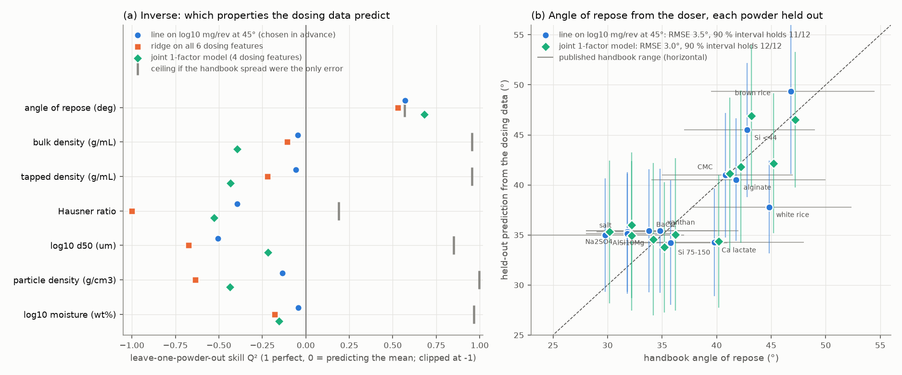
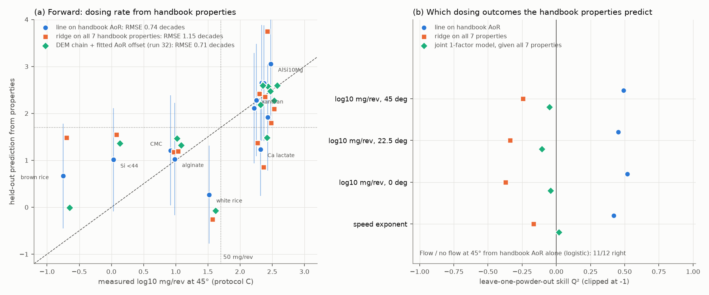
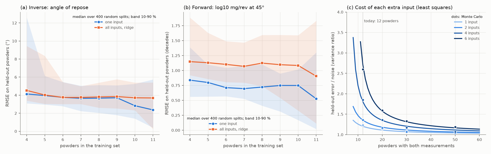

# ml-property-dose: machine-learning models from dosing behaviour to powder properties, and back

## What it asks and why
William asked on #196 (5 Nov 2026) how machine-learning models could predict a powder's properties from how it
doses, how best to train such a model, and how, given the properties, to predict the dose outcome. This run trains
both directions on the data that exist today, holding out each powder in turn, to show what works at this size and
what limits it. Nothing new is simulated; run 32's DEM-chain predictions are reused as one of the forward models.

* **Inverse** (the paper's direction, "the doser as a cheap powder test"): dosing fingerprint → property.
* **Forward** ("what will this powder do in the doser?"): properties → dosing outcome.
* **Joint**: one Gaussian latent-factor model of both blocks, conditioned on whichever block is known, so the two
  directions come from the same fitted model.

## Data
* **12 powders, one row each.** The powders of Sam's #116 battery that have #163 handbook properties (fumed silica
  has none). Each powder's representative run, as in Sam's `rate_summary.csv`
  ([`../heldout-powders/data/`](../heldout-powders/data/SOURCES.md)).
* **Dosing fingerprint, 6 features:**
  * log<sub>10</sub> mg/rev at 0, 22.5 and 45° (protocol C: 30 rpm, six single revolutions per tilt; floored at
    0.1 mg/rev);
  * the speed exponent *a* (protocol D, mg/s ∝ rpm<sup>a</sup>; missing for brown rice flour);
  * log<sub>10</sub> mg per tap at 22.5°, and log<sub>10</sub> mg in the 15 s static hold at 45°. These two sit
    below the balance's noise floor in several runs of the metal batch.
* **Properties, 7:** handbook angle of repose (AoR), bulk and tapped density, Hausner ratio, log<sub>10</sub> d50,
  particle density and log<sub>10</sub> moisture, each with its published range. The range is read as a uniform
  spread, which gives each value a "label SD".
* **Dosing outcomes (forward targets):** log<sub>10</sub> mg/rev at each tilt, the speed exponent, and whether the
  powder conveys (at least 50 mg/rev at 45°; 7 of 12 do).
* **Replicate noise** of the fingerprint comes from the six revolutions per tilt in Sam's per-revolution
  [`data/trials.csv`](data/SOURCES.md).

## Models
Every score is **leave one powder out**: fit on 11 powders, predict the 12th, repeat for all 12. Imputation,
scaling, input selection and hyperparameters are chosen inside each fold, so no score has seen the held-out powder.

| model | inputs | notes |
|---|---|---|
| training mean | none | the no-information baseline |
| one input fixed in advance | log<sub>10</sub> mg/rev at 45° (inverse), AoR (forward) | the choices of run 32 and #163, made before this run |
| best single input, nested | each input in turn | picked by an inner leave-one-out on the 11 training powders, so the selection step is scored as well |
| ridge | all | penalty from an inner leave-one-out |
| PLS, 1 component | all | |
| Gaussian process | all | Matérn 5/2 with one length scale per input (ARD), plus white noise |
| random forest | all | 300 trees, at least 2 powders per leaf |
| 2 nearest powders | all | the "most similar powder" baseline |
| joint factor model, 1 or 2 factors | 4 fingerprint features (rates and speed exponent) + 7 properties | Gaussian, Σ = WW<sup>T</sup> + Ψ in standardized units. The inverse conditions on the fingerprint, the forward on the properties, or on any subset |
| DEM chain (run 32) | AoR, particle density | forward only: with no fit, and with its one fitted AoR offset |

Also: logistic regression for flow / no flow and for hygroscopic or not; a two-part model (flow class, then each
class's mean rate); a few-shot check (one quick dosing measurement → the rest of the fingerprint); learning curves;
and the error inflation from each extra input.

**Scores.** Q² = 1 − Σ(error²)/Σ(y − ȳ)², where 1 is perfect, 0 is no better than predicting the mean, and
negative is worse. Also RMSE, and for models with a predictive distribution, how many of the 90 % intervals contain
the held-out value. **Ceiling:** if the handbook spread were the only error in a property, a perfect model would
score Q²<sub>max</sub> = 1 − (label SD)²/var(property). For AoR that is 0.57.

## Result


*(a) Leave-one-out skill for each handbook property, for three models, with the ceiling the handbook spread allows
(grey tick). (b) AoR predicted from each held-out powder's dosing data against its handbook value. Vertical bars:
90 % prediction intervals. Grey horizontal bars: the published handbook ranges.*



*(a) log<sub>10</sub> mg/rev at 45° predicted from handbook properties, each powder held out. Vertical bars: 90 %
intervals of the AoR line. (b) Skill for each dosing outcome.*



*(a, b) Learning curves: models trained on random subsets of the 12 powders and scored on the rest (median over 400
subsets per size; band 10–90 %). (c) How much fitting p inputs on n powders inflates the held-out error of least
squares, (1 + 1/n)(n − 2)/(n − p − 2), with a Monte Carlo check (dots).*

All numbers are in [`tables.md`](tables.md) and [`result.json`](result.json).

### Inverse: what the dosing data say about the powder
* **Angle of repose is the one property the fingerprint predicts.**
  * Joint 1-factor model: RMSE 3.0°, Q² 0.68. PLS: 3.3°. The single line on log<sub>10</sub> mg/rev at 45°: 3.5°,
    Q² 0.57. The mean: 5.9°.
  * That is already as small as the handbook spread allows: the ceiling is Q² 0.57, at a label SD of 3.7°. So
    handbook values cannot show whether the doser reads AoR better than this; same-jar AoR can
    ([`../heldout-powders/SAME_JAR.md`](../heldout-powders/SAME_JAR.md), criterion C3).
  * Pooling the rates at three tilts and the speed exponent into one latent score helps where one tilt misleads.
    White rice flour delivers 37 mg/rev at 45°, which the line reads as 37.8°. Its low rates at 0° and 22.5° and
    its speed exponent of 1.36 pull the joint model to 42.2° (handbook 45°).
* **Nothing else is predictable.** For bulk, tapped and particle density, Hausner ratio, d50 and moisture, no model
  reaches Q² 0.25. The best are GP on bulk density (0.21) and the 2-factor model on moisture (0.13). The handbook
  values are precise enough to learn from (ceilings 0.85–1.00 for all but Hausner, 0.19), so the dosing data
  simply carry no usable information about them at this size. Flow at this exit is set by cohesion, which swamps
  the density and size signals.
* **Classes.** Hygroscopic or not (moisture above 1 %, 5 of 12) from the full fingerprint: 9/12 right, a Brier score
  of 0.255 against 0.289 for the base rate. Barely better than guessing.

### Forward: what the properties say about dosing
* **AoR predicts flow or no flow, and the order of magnitude.**
  * Flow / no flow at 45° from AoR (logistic): 11/12 right. Only Ca lactate is wrong: handbook 40°, but it delivers
    232 mg/rev.
  * log<sub>10</sub> mg/rev at 45°: RMSE 0.74 decades from the AoR line (Q² 0.49), 0.71 from run 32's DEM chain
    with one fitted offset (Q² 0.52), 0.77 from the two-part model (flow class, then class mean). The mean scores
    1.13.
  * Speed exponent from AoR: RMSE 0.19 (Q² 0.42).
* **Adding the other six handbook properties makes every model worse.** Ridge on all 7: RMSE 1.15 (Q² −0.24),
  worse than the mean. GP: 1.00 (Q² 0.00). Random forest: 0.93. The joint model given all 7: 1.06. The same joint
  model given AoR alone: 0.84. Particle density plus d50 gets flow / no flow right for 6 of 12, below the base rate.
* **Within the 7 powders that convey, no property explains the rate.** Their spread is only 0.09 decades (SD,
  ±23 %). Every single handbook property but moisture, and a constant-volume × particle-density rule, predicts it
  worse than their mean; moisture is marginally better (RMSE 0.095 against 0.10), which with 7 powders is noise.
* **One quick dosing measurement beats every property.** From the held-out powder's own six revolutions at 22.5°,
  a line predicts its 45° rate with an RMSE of 0.47 decades (Q² 0.79) and its 0° rate with 0.30 (Q² 0.90). It
  cannot predict the speed exponent (Q² −2.3, driven by Si <44 µm, whose 22.5° rate sits at the floor).

### Honest uncertainty
* The simple models' t-intervals are about right: the AoR line's 90 % intervals hold 11 of 12 held-out powders, the
  joint model's 12 of 12, and the forward AoR line's 9 of 12 at 45° and 11 of 12 at 22.5°.
* The GP with one length scale per input is overconfident: its 90 % intervals hold only 6–7 of 12 in five of the
  six checks (9 of 12 in the sixth).

### What limits it
1. **The labels.** Handbook values for each material class, with published AoR ranges 6–16° wide. The inverse error
   is already at the label spread.
2. **The number of powders.** With 12 powders, each extra input costs a lot. For least squares the held-out error
   variance grows by a factor of 1.20 with one input, 1.81 with four and 2.71 with six; at 30 powders, six inputs
   cost 1.32. Letting the data pick the one input inside each fold dropped the AoR skill from Q² 0.57 to 0.17,
   because two folds picked the wrong input.
3. **Confounded powder classes.** In the 2-factor model fitted on all 12, factor 1 loads on bulk, tapped and
   particle density (+0.84 to +0.95) against moisture, AoR and Hausner ratio (−0.71 to −0.79). That is the
   biopolymers against the salts and metals. Factor 2 is flow beyond class (the three rates −0.72 to −0.79, AoR
   +0.39). In these 12 powders, being light, hygroscopic and cohesive go together, so no model can tell which of
   them stops the flow.
4. **Not the fingerprint's precision.** The standard error of log<sub>10</sub> mg/rev at 45° from six revolutions
   is 0.03 decades (median; 0.31 at worst, a powder near the floor), against model errors of 0.7.

### How much data
* **Learning curves.** The forward AoR line levels off at about 0.7 decades from 6 training powders on
  (median 0.84, 0.71, 0.72, 0.75 at 4, 6, 8, 10 powders). The inverse line goes 4.1°, 3.8°, 3.7°, 2.8° and has not
  levelled off. With handbook labels, more powders will not make the forward model much better.
* **Inputs vs powders** (least squares, held-out error variance over noise variance):

  | powders | 1 input | 2 inputs | 4 inputs | 6 inputs |
  |---|---|---|---|---|
  | 12 | 1.20 | 1.35 | 1.81 | 2.71 |
  | 20 | 1.11 | 1.18 | 1.35 | 1.58 |
  | 30 | 1.07 | 1.11 | 1.21 | 1.32 |
  | 50 | 1.04 | 1.06 | 1.11 | 1.17 |

  Keeping that factor near 1.2–1.35 means 1–2 inputs at today's 12 powders, up to 4 at 20 and up to 6 at 30.

## How to train these models as the data grow
1. **Train on one table: one row per jar.** Fingerprint and properties both measured on the same jar, with date,
   RH and temperature. Revolutions, taps and repeat runs are replicates of that row, not extra rows: average them
   and keep their standard error as the noise term. Split by jar, never by revolution, or the score leaks.
2. **Measure the labels** ([`SAME_JAR.md`](../heldout-powders/SAME_JAR.md)): AoR by one method, PSD, bulk and
   tapped density with a fixed pour, moisture (loss on drying) and RH. Hall/Carney and the shear cell stay held-out
   checks, never inputs.
3. **Choose the powders to break the confounds**, not only to add more:
   * sieved fractions of one material (size alone);
   * one powder dry and humid (moisture alone, above 75 % RH for salt);
   * spherical and irregular grades of one alloy (shape alone);
   * metal AM powders whose AoR falls at 38–43°, where the flow / no-flow step sits and the predictions are most
     uncertain.
   About 25–30 jars in total would allow 4–6 inputs.
4. **Keep the models as simple as the data.**
   * Today: 1–2 inputs, linear in log rate, or one latent score over the fingerprint (PLS, 1-factor joint model).
     Logistic regression for flow / no flow.
   * At 20–30 jars: a joint latent model with 2–3 factors (or a multi-output GP with 2–4 inputs). One model then
     serves both directions and any partial set of measurements.
   * GPs with many length scales, forests and neural networks only beyond that, or when pretrained on simulations.
5. **Treat no-flow as censored**, not as a small number. Use a two-part model (does it convey, and if so how
   fast) or a censored likelihood; the floor here is 0.1 mg/rev.
6. **Validate prospectively.** Score leave one jar out with all choices nested inside, report RMSE, Q² and interval
   coverage, and commit predictions for a new powder before it is dosed (`same_jar.py new`).
7. **Use the simulator where data are thin.** As a physics feature or prior mean (run 32's DEM chain matches the
   best regression with one fitted parameter), as a source of synthetic powders to pretrain on, or as the latent
   model itself: DEM friction and cohesion as the factors, and a DEM emulator in place of the learned loadings
   (q10's workflow, runs 28–29), with a discrepancy term for what the DEM misses.
8. **For a new powder's settings, dose it briefly.** A 2–3 minute fingerprint predicts its other tilts better than
   any property, and it is the descriptor the multi-task GP of the paper plan (§2.5) already uses. Properties are
   most useful for the flow / no-flow call and for picking the search range before the first dose.

## Runtime
About 85 s on one core (the 400-subset learning curves take most of it).

## Status
**Ran.** All models in both directions, the checks and the figures.

## Limitations
* **Handbook values, not measurements on the lab's lots.** The property side is #163's class-level values, so every
  score above mixes model error with label error.
* **n = 12.** A difference of 0.1 in Q² or one powder in a class count is within the noise of the comparison. The
  learning-curve subsets overlap heavily, so their bands understate the uncertainty.
* **One representative run per powder**, from August 2026. The jars are older now, and BaCl₂ has caked since.
* **The label SD** treats each published range as uniform. Ranges that mix methods (AoR) may overstate the
  jar-to-handbook error, and some single-source values have no range at all.
* **The tap and hold features** are below the balance's noise floor for several runs of the metal batch.
* **The joint model** is fitted after median imputation of the one missing speed exponent; a model that handles
  missing values directly (EM, or a Bayesian factor model) would be cleaner once there are more gaps.

## How to rerun
```
python3 -m venv /tmp/venv && /tmp/venv/bin/pip install numpy scipy scikit-learn matplotlib
/tmp/venv/bin/python ml_property_dose.py     # writes tables.md, result.json and the three figures
```
