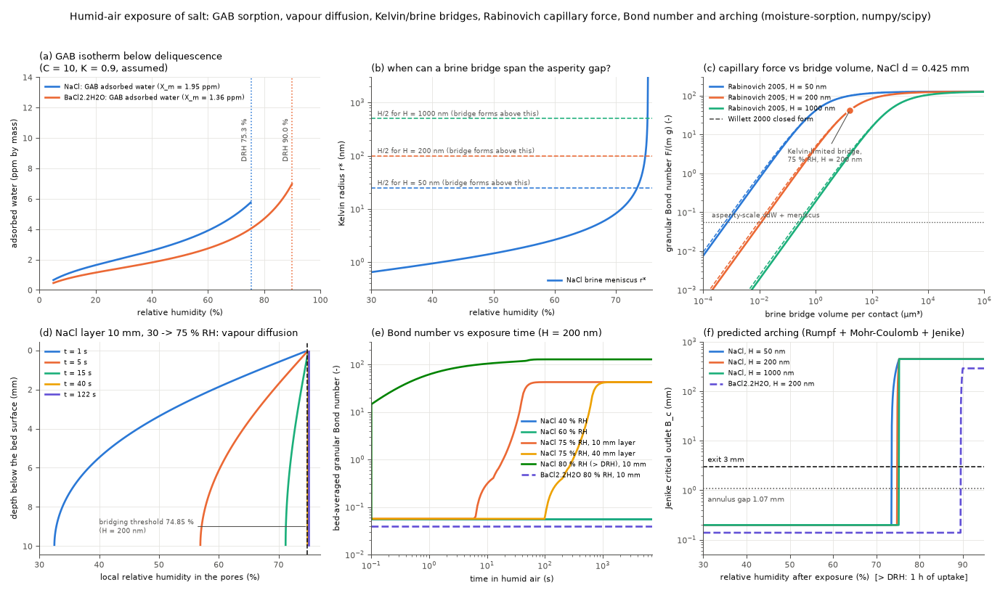

# moisture-sorption: humid-air exposure, brine bridges and predicted flow of salt

## What it models and why it matters here

Sterling proposed dosing a powder before and after it sits in humid air. This reduced-order model predicts what that test should show for the rig's NaCl (and BaCl2·2H2O as a control), as a chain of standard models:

1. **GAB isotherm** for water adsorbed on the crystal surface below the deliquescence humidity (DRH).
2. **Fickian vapour diffusion** into a powder layer with GAB sorption storage (1D PDE): local RH(z, t).
3. **Kelvin equation for a saturated-brine meniscus**, r* = γ V_m / (R T ln(DRH/RH)). Any water condensed at a salt contact dissolves salt, so its equilibrium is set by DRH/RH, not 1/RH. A particle-scale bridge forms only when 2r* exceeds the asperity gap H. Above DRH the salt deliquesces and the bridge grows from the vapour flux.
4. **Capillary bridge force**, Rabinovich et al. (2005) sphere-sphere formula (Willett et al. 2000 closed form for comparison), giving the **granular Bond number** Bo = F/(m g).
5. **Bond number to flow**: Rumpf (1970) tensile strength σ_t = ((1−ε)/ε) F/d², Mohr-Coulomb unconfined yield strength σ_c = 2σ_t sin φ/(1 − sin φ), then ffc = σ_1/σ_c and the Jenike critical outlet B_c = H(θ) σ_c/(ρ_b g), compared with the rig's 1.07 mm core-tip annulus gap and 3 mm exit. This is a mechanistic Bo-to-ffc mapping, not a fitted empirical correlation.

## Code and version

Custom Python script [`run.py`](run.py): Python 3.12.3, numpy 2.5.4, scipy 1.18.1 (`solve_ivp`, BDF, sparse tridiagonal Jacobian), matplotlib 3.11.2.

## Setup

| quantity | value | source |
|---|---|---|
| NaCl DRH | 75.3 % at 25 °C | Greenspan (1977) J. Res. NBS 81A:89 |
| BaCl2·2H2O DRH | 90 % | commonly tabulated constant-humidity value for saturated BaCl2·2H2O at 25 °C; not checked against a primary source in this run |
| NaCl grains | ρ_p 2165 kg/m3, d 0.425 mm, ρ_b 1250 kg/m3 (assumed), so ε = 0.423 | brief |
| BaCl2·2H2O grains | ρ_p 3097 kg/m3, same d and porosity (ρ_b 1788 kg/m3) | assumed |
| water monolayer | 0.299 mg/m2 (1.0e19 molecules/m2) | assumed typical value |
| specific surface | 6/(ρ_p d) = 6.52 m2/kg (NaCl), giving X_m = 1.95 ppm per monolayer | geometry |
| GAB constants | C = 10, K = 0.9, giving 1.3 monolayers at 40 % RH and 2.9 just below DRH | **assumed**. Only the order of magnitude (a few monolayers near the DRH) matches IR studies of water on NaCl(001), e.g. Foster & Ewing (2000) J. Chem. Phys. 112:6817 |
| vapour diffusivity in air | 2.55e-5 m2/s at 25 °C | Massman (1998) Atmos. Environ. 32:1111, D = 2.178e-5 (T/273.15)^1.81 |
| effective diffusivity in the bed | D ε^1.5 (Bruggeman tortuosity) | assumed |
| saturated vapour density | 0.0230 kg/m3 (p_sat 3169.9 Pa) | steam tables |
| brine surface tension | 0.082 N/m (NaCl), 0.076 N/m (BaCl2) | **assumed**: water 72 mN/m plus about 1.6 mN/m per mol/kg of NaCl |
| saturated NaCl brine | 26.4 wt % NaCl, 1197 kg/m3 | standard solubility data |
| contact angle | 0 (brine wets salt) | assumed |
| asperity gap H | 50 / **200** / 1000 nm | **assumed** (sets the threshold) |
| asperity radius, Hamaker constant | 100 nm, 6e-20 J (z0 0.4 nm) | assumed; gives the dry baseline force 4.8e-8 N |
| coordination number | 6 | assumed |
| layer depth | 10 mm (dish) and 40 mm (reservoir-like); initial RH 30 %; top held at the ambient RH | assumed |
| above DRH | vapour flux through a 2 mm still-air layer, absorbed as brine and spread uniformly over the depth (wicking) | assumed |
| doser stresses | σ_1 = 400 Pa (Janssen saturation, see analytic-orifice-screw) and 3 kPa (shear-cell standard); φ = 34°; H(θ) = 2.617 | brief and analytic-orifice-screw |

Numerics: 80 finite-volume cells, BDF with rtol 1e-7, simulated time 2 h, 9 runs (NaCl at 40/60/75/80 % RH plus 75 % with a 40 mm layer; BaCl2·2H2O at 40/60/75/80 %).

## How to rerun

```bash
python3 -m venv /tmp/venv-continuum && /tmp/venv-continuum/bin/pip install numpy scipy matplotlib
OMP_NUM_THREADS=1 /tmp/venv-continuum/bin/python run.py   # writes result.json and moisture_sorption.png
```

## Runtime

14 s wall clock on 1 core (8.5-9.6 s inside the script across reruns).

## Result



- **Adsorbed water is tiny for pure NaCl**: 2.6 / 3.9 / 5.7 ppm by mass at 40 / 60 / 75 % RH. Weighing cannot detect it, so a measurable mass gain below 75 % RH would point to deliquescent impurities (e.g. MgCl2 in table salt) rather than NaCl itself.
- **Vapour reaches the powder quickly**: the mean RH of a 10 mm layer is within 1 % of the ambient value after 13 / 18 / 24 s (40 / 60 / 75 % RH). A 40 mm layer takes 375 s at 75 %. The time scales as depth squared, so for these coarse grains exposure time matters only for deep beds.
- **Sharp threshold just below the DRH**: the brine Kelvin radius is 0.94 / 2.6 / 150 nm at 40 / 60 / 75 % RH. A particle-scale bridge needs 2r* > H, so bridging starts at 73.5 / 74.85 / 75.2 % RH for H = 50 / 200 / 1000 nm.
- **Bond number**: 0.057 at 30, 40 and 60 % RH (asperity-scale van der Waals plus meniscus), so no change from the dry state. At 75 % RH it is 107 / 43 / 0.057 for H = 50 / 200 / 1000 nm. Above the DRH (80 %, 1 h) it is 128, the full-bridge limit 2πRγ/(m g), for any H. Rabinovich and Willett agree to within 1 % at the 75 % Kelvin bridge (ratio 0.993).
- **Kinetics** (H = 200 nm): at 75 % RH half of a 10 mm layer is bridged after 37 s and all of it after 40 s (40 mm layer: 614 s and 659 s). At 80 % RH the vapour flux is 49.7 g/(m2 h). Under the uniform-wicking assumption the bed-average Bo is already 15 at the first output (0.1 s), 62 at 1 s, 104 at 10 s and 128 at 100 s, which is too fast (see Limitations). Pore saturation is 1.3 % after 1 h, and the 10 % saturation that roughly ends the pendular regime is reached after 7.5 h.
- **Predicted dosing change**: dry, 40 % and 60 % RH give σ_c = 0.93 Pa, ffc(400 Pa) = 431 and B_c = 0.20 mm, smaller than a grain, so the salt **flows as before**. At 75 % RH with H = 200 nm: σ_c = 698 Pa, ffc = 0.57 at 400 Pa and 4.3 at 3 kPa, B_c = 149 mm. At 80 % RH: σ_c = 2100 Pa, ffc(400 Pa) = 0.19, B_c = 448 mm. In both cases the salt should **arch over the 3 mm exit and stall without agitation** (I_stop towards 1). BaCl2·2H2O does not bridge up to 80 % RH (threshold 88.0-89.9 %): Bo stays at 0.040, B_c 0.14 mm, no change.
- What this means for the test: for pure NaCl, exposure at 40-60 % RH should leave the dosing fingerprint unchanged. Any change there would point to impurities or another mechanism. Near or above 75 % RH the model predicts a collapse within minutes. On re-drying, brine bridges recrystallise into solid salt bridges (caking), which this model does not quantify. BaCl2·2H2O is a natural control up to about 88 % RH.

## Status

**ran.** All numbers above are from `run.py` (see [`result.json`](result.json)).

## Limitations

- Several key inputs are assumed, not measured: GAB C and K, asperity gap and radius, Hamaker constant, coordination number, brine surface tension, the BaCl2·2H2O DRH, the boundary layer and uniform wicking above the DRH. The 75 % RH outcome depends on H: bridges form only for H below 300 nm, so it flips from "stall" to "no change" between the H = 200 nm and 1000 nm cases.
- Below about 2 nm (40-60 % RH) the continuum Kelvin equation is not reliable. The asperity-scale force is taken as independent of RH.
- Bridge volumes are small-filling-angle geometric estimates. The Rabinovich formula ignores the filling-angle term and large-bridge effects, and the PDE storage term includes adsorbed water but not bridge water (at most about 10 % of it at 75 % RH).
- Every contact is assumed bridged (Rumpf), and σ_c is treated as independent of consolidation stress, so ffc here is an upper-bound cohesion estimate. Hysteresis, temperature swings, impurities and solid-bridge caking on drying are not modelled.
- Above the DRH the top of the bed would in reality form a crust before brine wicks down. The uniform-wicking assumption makes the bed-average Bo rise faster than it would.

References: Greenspan (1977); Massman (1998); Foster & Ewing (2000); Rabinovich, Esayanur & Moudgil (2005) Langmuir 21:10992; Willett, Adams, Johnson & Seville (2000) Langmuir 16:9396; Rumpf (1970) Chem. Ing. Tech. 42:538; Jenike (1964) Bull. 123; GAB: Guggenheim (1966), Anderson (1946), de Boer (1953).
