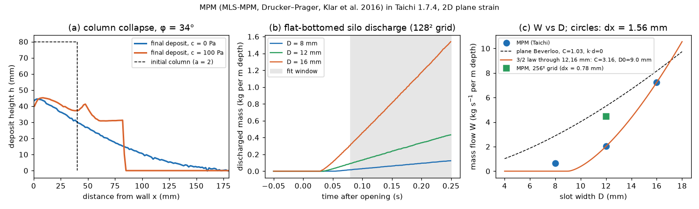

# mpm-taichi: Material Point Method with Drucker–Prager plasticity (Taichi, CPU)

## What it models and why it matters here
A continuum elastoplastic model of the powder: the granular material is a Drucker–Prager solid that
flows once its frictional yield limit is reached. We ran two classic tests. (a) A 2D granular column
collapse, which links the friction angle and cohesion to runout and final slope (the angle-of-repose
family of tests). (b) Discharge from a flat-bottomed silo through a slot, i.e. Beverloo-type orifice
flow. Both are continuum stand-ins for the doser's reservoir, funnel and outlet.

## Code and version
Self-written MLS-MPM kernel (`run.py`) in Taichi 1.7.4 (LLVM 15), on CPU with
`ti.init(arch=ti.cpu, cpu_max_num_threads=1)`, using Python 3.12 and numpy 2.5. It follows Hu et al. 2018
(MLS-MPM/APIC) and Klar et al. 2016 (Drucker–Prager return mapping in Hencky strain, no dilatancy).
`plots.py` makes the figure, the animation and `result.json`.

## Setup
- **Grid and particles:** 2D plane strain, per metre depth. The domain is 0.2 m × 0.2 m on a 128² grid
  (dx = 1.5625 mm), with 4 particles per cell and quadratic B-splines. dt = 3.04e-5 s (0.35 dx/c).
- **Material:** bulk density 1250 kg/m³ (assumed, from the measured 1200–1300 for the salt bed).
  E = 0.3 MPa and ν = 0.3, deliberately soft for speed; the elastic strain ρgh/E stays below 0.4 %.
- **Yield cone:** the input φ = 34° (salt, 32–36°) gives the Klar cone α = √(2/3)·2 sin φ/(3 − sin φ).
  With 2D tensors this cone equals a Mohr–Coulomb friction angle of **31.9°**.
- **Cohesion:** added as a shift of the cone apex to a tensile mean stress c·cot φ. c = 100 Pa stands in
  for a cohesive powder: ffc is about 3 at 1 kPa consolidation.
- **Column:** a0 = 40 mm wide and h0 = 80 mm tall (aspect a = 2). The left wall slips, the floor is rough
  (no-slip), and the column is released at t = 0. Runs last 0.45 s.
- **Silo:** 80 mm wide and filled 80 mm deep, with rough walls and floor. A central slot of D = 8, 12 or
  16 mm (5.1, 7.7 and 10.2 dx) opens after 0.05 s of settling. W is the slope of discharged mass against
  time over 0.08–0.25 s after opening.

## How to rerun
```
python3 -m venv /tmp/venv-continuum && /tmp/venv-continuum/bin/pip install taichi numpy scipy matplotlib imageio imageio-ffmpeg
OMP_NUM_THREADS=1 /tmp/venv-continuum/bin/python run.py     # raw output in /tmp/sims-scratch/mpm-taichi
MPM_NGRID=256 MPM_MAXP=45000 /tmp/venv-continuum/bin/python run.py silo 0.012   # resolution check
/tmp/venv-continuum/bin/python plots.py                      # figure, GIF, MP4, result.json
```

## Runtime
104 s wall clock on 1 core of a shared 4-core runner for the main run. Each column took 17–19 s, each
silo 22–23 s, plus about 3 s of JIT compile. The resolution check (one silo on a 256² grid, 41 205
particles) took another 130 s.

## Result


Animation: [mpm_taichi.gif](mpm_taichi.gif) / [mpm_taichi.mp4](mpm_taichi.mp4) (columns c = 0 and c = 100 Pa, silo D = 12 mm).

| case | runout (L∞ − L0)/L0 | H∞/H0 | mean slope atan(H∞/L∞) | fitted slope, 20–80 % of H∞ |
|---|---|---|---|---|
| column, c = 0 | 3.06 (L∞ = 162 mm) | 0.55 | 15.2° | 18.5° |
| column, c = 100 Pa | 1.11 (L∞ = 84 mm) | 0.53 | 26.6° | 13.9° (flat top and steep front, so this fit means little) |

- **Final slopes:** the cohesionless deposit comes to rest at 15–18°, about half the 31.9° yield-cone
  angle. Collapse deposits are known to settle below the angle of repose because the flow is inertial.
- **Runout:** quasi-2D experiments give roughly 1.2a, i.e. 2.4 for a = 2 (Lube et al. 2005; Lajeunesse
  et al. 2005, quoted from memory). The model's 3.06 is 27 % longer, and the thin tail counts toward it
  (we threshold at 1 dx).
- **Cohesion:** 100 Pa of cohesion halves the runout and leaves a blocky deposit with a vertical scarp.
  That is the qualitative signature of a cohesive powder in an angle-of-repose test.

| slot D | W (kg s⁻¹ per m depth) | plane Beverloo, C = 1.03, k·d = 0 |
|---|---|---|
| 8 mm (5.1 dx) | 0.64 | 2.89 |
| 12 mm (7.7 dx) | 2.02 | 5.30 |
| 16 mm (10.2 dx) | 7.23 | 8.16 |
| 12 mm on the 256² grid (15.4 dx) | 4.46 | 5.30 |

- **Scaling:** over 5–10 grid cells, W grows as D^3.46, not as D^1.5.
- **Beverloo fit:** a 3/2-power law through the 12 and 16 mm points needs an offset D0 = 9.0 mm (5.8 dx)
  and C = 3.2. That is unphysical, and it predicts zero flow at 8 mm. So **the run is not yet in the
  Beverloo regime**. Only the widest slot (10 dx) comes within 11 % of the plane Beverloo law.
- **Resolution check:** we reran the 12 mm slot on a 256² grid (dx = 0.78 mm, D = 15.4 dx). W rose from
  2.02 to **4.46 kg s⁻¹ m⁻¹**, from 38 % to 84 % of the plane Beverloo value of 5.30. So the suppressed
  flow at small D/dx is mainly a resolution artefact, and the discharge approaches Beverloo magnitudes as
  the slot is resolved by more cells. It is not converged at 15 cells.
- **Why:** in a continuum there is no grain size. The k·d "empty annulus" is replaced by a grid-scale
  offset, set by the sticky floor nodes and the B-spline support of about 1.5 dx on each side.
- **For the doser:** the outlet annulus is only about 2.5 grains wide. A continuum MPM cannot predict the
  throughput there unless dx is much smaller than the gap, and even then it lacks the grain-scale k·d
  physics. MPM is better suited to the stress and velocity fields in the reservoir and the 37° funnel.

## Status
**Ran.** All five cases (2 columns, 3 silos) completed, plus a one-case resolution check. The Beverloo comparison is a negative result at
this resolution: the 3/2 law did not fit, and a free 2-parameter fit through all three points failed
(the 8 mm residual is 100 %). That is recorded in `result.json` under `free_3param_fit_attempt`.

## Limitations
- **Geometry:** 2D plane strain, so these are slot flows rather than round orifices. Absolute flows are
  per metre depth and cannot be compared directly with the 3D doser.
- **Constitutive model:** rate-independent Drucker–Prager with no dilatancy and no μ(I) rate dependence.
  Cohesion enters only as an apex shift; there is no softening and no moisture.
- **Elasticity and resolution:** a soft E was used for speed, and the resolution is coarse
  (dx = 1.56 mm, more than three salt grain diameters).
- **Not run:** only one resolution check was done (silo, 12 mm). The column collapses were not
  resolution-tested, and runs at other aspect ratios or friction angles were not done for lack of time. Treat the numbers as a first pass, not a validated result.
