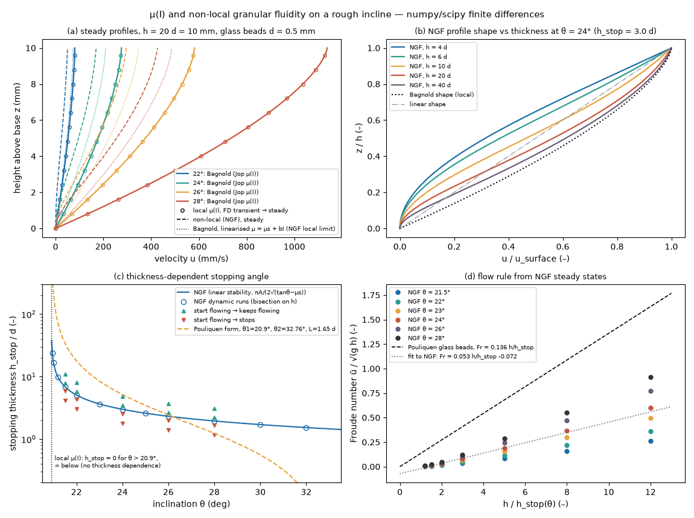

# mui-rheology: local μ(I) and non-local granular fluidity on a rough incline

## What it models and why it matters here

Dense granular flow down a rough inclined plane, which is the simplest continuum analogue of the doser:
powder sliding down a tilted auger trough and through a narrow exit. Two constitutive models are solved:

- the **local μ(I) rheology** (Jop, Forterre & Pouliquen 2006), where the friction coefficient depends
  only on the inertial number I = γ̇ d / √(p/ρs);
- the **non-local granular fluidity (NGF) model** (Kamrin & Koval 2012; Henann & Kamrin 2013), which adds
  a grain-size length through a diffusion term for the fluidity g = γ̇/μ.

The local law predicts that a layer flows at any angle above atan μs, whatever its thickness. Real layers
need a steeper tilt when they are thin (the stopping thickness h_stop of Pouliquen 1999). Only the non-local
model gives this. For the doser, that is the question of whether thin layers (the powder in the
flight channel, or a few grains across the Ø3 mm exit annulus) need extra tilt to flow. It also bears on
whether the tilt at which delivery starts can be read as a friction angle.

## Code and version

Self-written Python 3.12.3: numpy 2.5.4, scipy 1.18.1 (`solve_banded`), numba 0.68.1, matplotlib 3.11.2.
One script, [`run.py`](run.py).

## Setup

- **Geometry:** a 1D layer of thickness h on a rough plane at inclination θ. Flow is steady and fully developed,
  so the stresses are statically determinate: p = φ ρs g cosθ (h − z), and μ = τ/p = tanθ at every depth.
  Units: d, √(d/g), √(g d).
- **(a) Local μ(I):** μ(I) = μs + (μ2 − μs) I/(I0 + I). An explicit finite-difference start-up flow from almost
  rest (initial shear rate 10⁻³ √(g/d)) on N = 100 nodes over h = 20 d. No slip at the base, no traction at the
  surface, rate regularisation 10⁻⁷. Δt = 0.2 φ Δz²/η_t,max (1.5·10⁻³ √(d/g)), run to t = 4000 √(d/g).
  The numerical result is compared with the analytic Bagnold profile.
- **NGF:** the dynamic form of Kamrin & Henann (2015):
  t0 ∂g/∂t = A² d² ∂²g/∂z² − (μs − μ) g − b μ √(ρs d²/p) g², with γ̇ = μ g.
  Near the local fluidity g_loc = √(p/ρs d²)(μ − μs)/(bμ), its steady state reduces to the steady NGF equation
  of Henann & Kamrin (2013). Discretisation: cell-centred finite differences, with g = 0 at the rough base and
  ∂g/∂z = 0 at the free surface. Time stepping is semi-implicit (implicit diffusion, linearised implicit
  quadratic term). Steady states come from pseudo-time stepping plus a Newton polish (N = 200).
- **h_stop:** for each θ, a 40-step bisection on h. Each step asks whether a 10⁻⁹ fluidity seed grows under the
  full nonlinear dynamic equation (N = 120). A cross-check starts from a flowing (local Bagnold) state at
  h = 0.6, 0.85, 1.15 and 1.6 × h_stop and records whether the flow persists.
- **Parameters (glass beads, d = 0.5 mm):** ρs = 2500 kg/m³, φ = 0.6, μs = tan 20.9° = 0.382,
  μ2 = tan 32.76° = 0.644, I0 = 0.279 (Jop et al. 2006). b = (μ2 − μs)/I0 = 0.938, the slope of μ(I) at
  I = 0 (the value 0.9377 used by Henann & Kamrin 2013). A = 0.48 (Henann & Kamrin 2013).
- **Pouliquen h_stop form** for comparison: tanθ = tanθ1 + (tanθ2 − tanθ1)/(1 + h/L), with θ1 = 20.9°
  and θ2 = 32.76°. L = 1.65 d is derived here by equating the Bagnold mean velocity to the flow rule
  Fr = β h/h_stop, which gives I0 = 5βd/(2L√(φ cosθ)), with β = 0.136 (glass beads; Pouliquen 1999,
  Forterre & Pouliquen 2003) and θ = 25°.

## How to rerun

```bash
python3 -m venv /tmp/venv-continuum && /tmp/venv-continuum/bin/pip install numpy scipy numba matplotlib
OMP_NUM_THREADS=1 NUMBA_NUM_THREADS=1 /tmp/venv-continuum/bin/python run.py   # writes result.json, mui_rheology.png
```

## Runtime

100 s wall clock on 1 core (44 s CPU; the 4-core runner was shared with other jobs). The run breaks down as:
local start-up flows 40 s, h_stop bisections 49 s, everything else under 3 s.

## Result



- **(a) Verification of the local μ(I) solver:** the transient solution reaches the analytic Bagnold profile
  to an rms error of 1.0·10⁻⁵ of the surface velocity at all four tilts. Surface velocities for a 10 mm
  (20 d) layer: 0.080, 0.276, 0.582 and 1.137 m/s at 22°, 24°, 26° and 28°. Time to reach 95 % of the steady
  surface velocity: 0.99, 1.38, 2.13 and 3.91 s.
- **NGF vs its local limit:** the local limit is the Bagnold profile with the linearised law μs + bI (dotted in (a)).
  For h = 20 d, the NGF surface velocity is 0.68, 0.81, 0.86 and 0.88 of it at 22°, 24°, 26° and 28°. At
  h = 200 d the ratio is 0.98, so the non-local correction fades for thick layers.
- **(b) Profile shape:** for thick layers (40 d) the NGF profile approaches the Bagnold shape. It is close to
  linear near 10 d. Close to h_stop (4 to 6 d at 24°, h_stop = 3.0 d) it develops a slowly sheared basal layer.
  That basal layer follows from the g = 0 base condition.
- **(c) Stopping thickness:** the dynamic NGF runs reproduce the linear-stability result
  h_stop = πAd / (2√(tanθ − μs)) to a relative difference of 7·10⁻⁶. They are grid independent: 2.9952,
  2.9952 and 2.9953 d at 24° for N = 60, 120 and 480. All 20 finite-amplitude runs keep flowing if and only if
  h > h_stop, so this model has no h_start/h_stop hysteresis. h_stop/d for NGF (Pouliquen form) at
  22°, 24°, 26°, 28° and 32°: 5.07 (17.9), 3.00 (5.17), 2.32 (2.43), 1.95 (1.23) and 1.53 (0.13).
  The NGF curve is much flatter: it diverges as (tanθ − μs)^−1/2 rather than (tanθ − tanθ1)^−1, and it has no
  upper angle θ2. The two curves cross near 26°. The local μ(I) law has no thickness dependence at all.
- **(d) Flow rule:** the NGF steady states (42 runs, 21.5° to 28°, h = 1.2 to 12 h_stop) do **not** collapse
  onto Pouliquen's Fr = 0.136 h/h_stop. A linear fit gives Fr = 0.053 h/h_stop − 0.072 with R² = 0.78, and the
  points fan out systematically with angle.
- **Salt-like what-if (assumed, not calibrated):** shift μs to tan 34° and keep the glass-bead A, θ2 − θ1 span
  and L. The predicted stopping angle (NGF / Pouliquen form) is then 37.4° / 37.9° for a layer 2.5 d thick
  (the exit-annulus arching scale found by the DEM twin), 34.5° / 35.9° for 7 d, and 34.1° / 35.0° for 15 d
  (the flight-channel depth for d50 = 0.425 mm). If this holds, thickness adds roughly 3 to 4° at the exit
  annulus scale but less than about 1° in the flight channel.

## Status

**Ran** (full scale for this 1D problem). All numbers above come from `result.json` from this run.

## Limitations

- The setup is 1D, fully developed incline flow: no sidewall friction (which matters in narrow channels;
  Jop et al. 2005), no auger, no funnel. Its numbers are not predictions of mg per revolution.
- The parameters are a glass-bead calibration. A, b and μs have not been measured for salt or AlSi10Mg, so the
  salt numbers are only a what-if.
- The NGF dynamic form and its boundary conditions are modelling choices. With g = 0 at both the base and the
  surface, h_stop doubles (π instead of π/2 in the formula). Kamrin & Henann (2015) report good agreement with
  glass-bead h_stop and flow-rule data; the flow-rule mismatch here (β = 0.053 vs 0.136) may come from different
  boundary conditions or parameters, and this run does not resolve which.
- The start-up times depend on the near-rest initial state and on the explicit scheme. They are indicative only.
