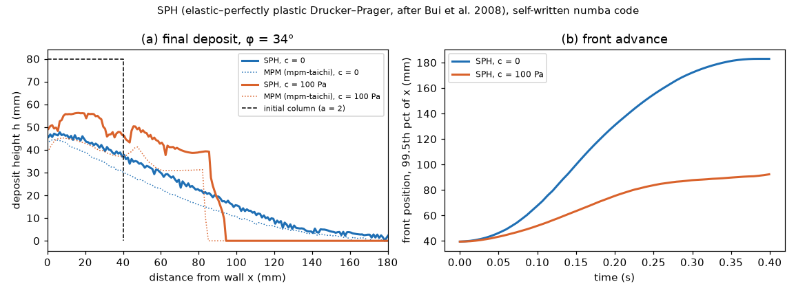

# sph-granular: SPH for granular flow (elastic–perfectly plastic Drucker–Prager)

## What it models and why it matters here
Smoothed-particle hydrodynamics (SPH) treats the powder as a continuum carried by Lagrangian particles,
which suits large deformations and free surfaces such as avalanching, run-out and spreading. We ran
a 2D granular column collapse, cohesionless and cohesive. It is the same test as `mpm-taichi`, so the two
continuum methods can be compared directly; both relate friction and cohesion to the slope and run-out of
an angle-of-repose or spreading test.

## Code and version
**Route used: a self-written 2D SPH code in numba (`run.py`), not PySPH.**
- **PySPH:** PySPH 1.0b2 built and installed from the PyPI sdist in a separate venv
  (`/tmp/sims-scratch/sph-granular/venv-pysph`). The build took about 5 min at low priority and pulled in
  Cython 3.3 and compyle 0.9.1. However, PySPH ships no granular or Drucker–Prager scheme: its examples
  are fluids plus `solid_mech` (elastic rings, Taylor bar, impact, oscillating plate). Writing custom
  PySPH equations for soil plasticity did not fit in the time box, so we wrote the model directly.
  A stock PySPH example (`elliptical_drop`) does run; see Status.
- **Scheme:** follows Bui et al. 2008 (Int. J. Numer. Anal. Meth. Geomech. 32:1537). Linear elasticity
  with a Jaumann stress rate, and Drucker–Prager fitted to Mohr–Coulomb in plane strain
  (α = tan φ/√(9 + 12 tan²φ), k = 3c/√(9 + 12 tan²φ)).
- **Return mapping:** tension cracking (shift to the apex) plus Bui's stress-scaling return.
- **Numerics:** Monaghan artificial viscosity, continuity equation for density, Wendland C2 kernel
  (h = 1.3 dp), cell-list neighbour search, and symplectic Euler time stepping.
- **Walls:** 3 layers of fixed particles. Their stress is extrapolated from the soil by a Shepard average
  plus a hydrostatic correction (Adami et al. 2012). Wall velocity is zero, so the walls act as rough
  boundaries.
- **Software:** numba 0.68.1, numpy 2.5.4, Python 3.12.

## Setup
- **Column:** 40 mm wide and 80 mm tall (a = 2), dp = 1 mm, giving 3200 soil and 1239 wall particles.
  The left wall and the floor are both rough.
- **Initial stress:** geostatic, σ_yy = −ρg(H − y), with σ_xx = σ_zz = K0 σ_yy and K0 = 1 − sin φ (Jaky).
- **Material:** ρ = 1250 kg/m³ (assumed salt bulk density), E = 0.3 MPa, ν = 0.3 (soft for speed, as in
  `mpm-taichi`), φ = 34°, and c = 0 or 100 Pa.
- **Time step and viscosity:** dt = 0.2 h/c_p = 1.45e-5 s, run to t = 0.40 s (27 652 steps).
  The artificial viscosity is α_Π = 0.5.

## How to rerun
```
python3 -m venv /tmp/venv-continuum && /tmp/venv-continuum/bin/pip install numba numpy scipy matplotlib imageio imageio-ffmpeg
OMP_NUM_THREADS=1 NUMBA_NUM_THREADS=1 /tmp/venv-continuum/bin/python run.py 0.4   # raw output in /tmp/sims-scratch/sph-granular
/tmp/venv-continuum/bin/python plots.py                                          # figure, GIF, MP4, result.json (overlays MPM if present)
```

## Runtime
138 s wall clock on 1 core of a shared 4-core runner: 71 s and 68 s for the two cases, plus numba
compilation. That is about 2.5 ms per step for 4.4k particles.

## Result


Animation: [sph_granular.gif](sph_granular.gif) / [sph_granular.mp4](sph_granular.mp4).

| case | runout (L∞ − L0)/L0 | H∞/H0 | mean slope atan(H∞/L∞) | fitted slope, 20–80 % of H∞ | max speed at 0.40 s |
|---|---|---|---|---|---|
| c = 0 | 4.23 (L∞ = 209 mm, thin tail; 99.5th-percentile front 183 mm) | 0.58 | 12.4° | 19.5° | 0.22 m/s (a few particles) |
| c = 100 Pa | 1.35 (L∞ = 94 mm) | 0.63 | 28.1° | 42.2° (steep front) | 0.13 m/s |

- **Cohesionless deposit:** comes to rest with a 19.5° mid-slope, below the 34° friction angle. That matches
  the `mpm-taichi` deposit (18.5°) and the general finding that collapse deposits settle below the angle
  of repose.
- **Cohesion:** 100 Pa cuts the runout by a factor of 3 and leaves a thick, blocky deposit with a steep
  front, the same qualitative result as MPM. Panel (a) overlays the MPM profiles.
- **SPH vs MPM:** SPH deposits are a little thicker, and the cohesionless SPH tail runs further: runout
  ratio 4.2 against 3.1 in MPM. Both exceed the roughly 2.4 (1.2a) quoted for quasi-2D experiments (Lube et al. 2005, quoted from memory). The
  numerical boundary friction and the thin-tail threshold matter at this resolution.
- **Lesson for the paper:** the slope a powder heap settles at after a dynamic collapse is a different
  quantity from the friction angle.

## Status
**Ran (own code); PySPH installed but not used for the granular case.**
- **First attempt failed:** with α_Π = 0.1 (Bui et al.'s value), the cohesionless run became unstable near
  the rough floor at t ≈ 0.02 s. Particles were ejected at 10 m/s and the density ratio fell to 0.32.
  α_Π = 0.5 and 1.0 were both stable over a 0.04 s diagnostic, and the production runs use 0.5. The higher
  artificial viscosity adds numerical dissipation and probably shortens runout somewhat.
- **PySPH smoke test:** the stock `pysph run elliptical_drop --tf 0.0008` ran with exit code 0 on 1 thread:
  5025 fluid particles, 11.7 s of setup (code generation and compilation), 4.3 s of run time. So PySPH
  works on this runner. A granular case would need custom Drucker–Prager or μ(I) equations written in
  PySPH, which were not attempted.

## Limitations
- **Model:** 2D plane strain, rate-independent plasticity with no μ(I) rate dependence, a soft E, and
  coarse resolution (40 particles across the column).
- **Numerics:** no artificial-stress correction for tension, and simple symplectic Euler time stepping.
  The rough walls come from zero-velocity wall particles, not a calibrated basal friction.
- **Not run:** no convergence study and no comparison against an experimental collapse. These are
  qualitative cross-checks of `mpm-taichi`, not validated predictions.
