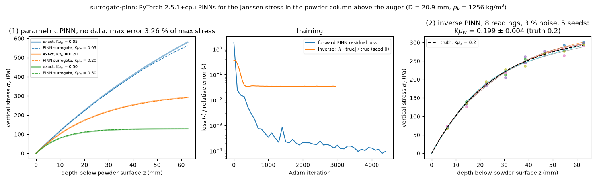

# surrogate-pinn: physics-informed neural networks for the powder-column (Janssen) stress

## What it models and why it matters here

Physics-informed neural networks (PINNs; Raissi, Perdikaris & Karniadakis, 2019, *J. Comput. Phys.* 378:686) train a network on the residual of a governing equation. They can be used in two ways:
- with no data, as a fast parametric surrogate;
- with sparse data, to infer an unknown coefficient.

This run is the optional "surrogate-pinn" item. It applies both modes to the simplest continuum model relevant to the doser: the **Janssen equation** for the vertical stress in the powder column above the auger inlet. That stress sets how the screw fills. The unknown is the wall-friction group K·μ_w. This is a **1D continuum stand-in, not a doser or DEM model**. It tests whether the PINN machinery works and what it costs, using a problem with a closed-form answer to check against.

## Code and version

Self-written PyTorch PINNs ([`run.py`](run.py)), torch 2.5.1+cpu, numpy 1.26.4, Python 3.12.3.

## Setup

**Governing equation**: dσ/dz = ρ_b g − (4 K μ_w / D) σ, with σ(0) = 0.
- Nondimensionalised with s = σ/(ρ_b g D) and ζ = z/D, it becomes ds/dζ = 1 − 4λs with λ = K μ_w.
- Exact solution: s = (1 − e^(−4λζ))/(4λ).
- Values: D = 20.9 mm (auger bore), ρ_b = 1256 kg/m³ (salt, packing 0.58), column height 3D = 63 mm.

**(1) Forward parametric PINN**:
- s(ζ, λ) = ζ · N(ζ, λ), which enforces the boundary condition exactly.
- N is a 3 × 32 tanh MLP.
- Loss: ODE residual only, at 512 random (ζ, λ) collocation points per step, with λ ∈ [0.05, 0.5].
- Adam, 4500 iterations, learning rate 3×10⁻³ with step decay.
- No data is used.

**(2) Inverse PINN**:
- s(ζ) = ζ · M(ζ) with a trainable λ = softplus(θ).
- Loss: residual + 10 × normalised data misfit.
- Data: 8 synthetic stress readings at z = 6–63 mm with 3 % multiplicative noise.
- Truth λ = 0.2, from K = 0.5 (Jaky, 1 − sin 30°) × μ_w = 0.4 (salt–PLA wall friction of the LIGGGHTS twin).
- 5 noise seeds, 3000 Adam iterations each.
- Reference answer: a least-squares fit of the exact solution to the same data.

## How to rerun

```bash
python3 -m venv /tmp/venv-bayes && /tmp/venv-bayes/bin/pip install numpy matplotlib
/tmp/venv-bayes/bin/pip install torch==2.5.1 --index-url https://download.pytorch.org/whl/cpu
OMP_NUM_THREADS=1 /tmp/venv-bayes/bin/python run.py          # writes pinn_janssen.png, result.json
```

## Runtime

47 s wall clock on 1 thread: 12 s for the forward surrogate and about 7 s per inverse run.

## Result



- **Forward surrogate (no data)**: over the whole (z, K μ_w) box, the worst error is **3.3 % of the maximum stress** and the relative L2 error is **0.77 %**. The worst case is the low-friction end (K μ_w = 0.05) at the bottom of the column, where the stress is still rising almost linearly. At the nominal K μ_w = 0.2 the PINN curve sits on the exact one, which saturates near 290 Pa at 63 mm depth.
- **Inverse**: K μ_w = **0.199 ± 0.004** over 5 noise seeds (truth 0.2). Per seed the values are 0.193, 0.198, 0.196, 0.206 and 0.201. Least squares on the exact solution gives 0.195, 0.199, 0.197, 0.207 and 0.202, so the PINN matches it to within 0.0015. The noise in the data, not the PINN, sets the spread.

## Status

**ran** (optional item). Both modes ran and were checked against the closed-form solution.

## Limitations

- **Toy problem.** The Janssen ODE has an analytic solution, so a PINN adds nothing over a curve fit here. The point is only to show the workflow and its cost and accuracy on CPU. A PINN earns its keep on PDEs with no closed form, such as μ(I) or critical-state continuum flow in the hopper and screw. Those need 2D/3D domains, moving boundaries and much longer training, which were not tried.
- Only K·μ_w can be identified from σ(z). K and μ_w enter as a product, the same kind of degeneracy that `bayes-gp-emulator-mcmc` finds for the dosing fingerprint.
- The stress readings are synthetic. Janssen assumes a constant K, a fully mobilised wall friction and a slice-uniform stress.
