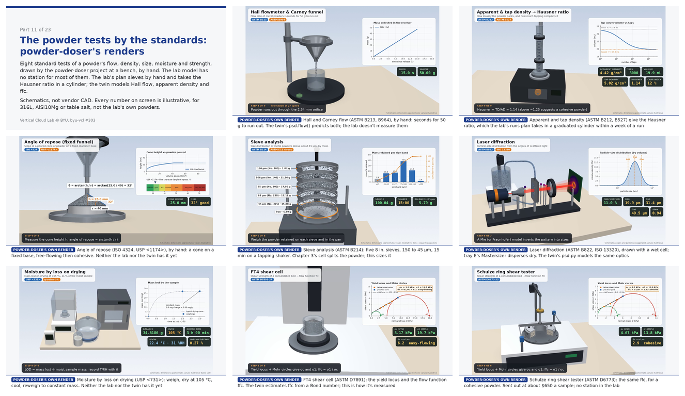

# The powder-test animations, ready for the vertical lab (byu-vcl)

Sterling on [PR #190](https://github.com/vertical-cloud-lab/powder-doser/pull/190#issuecomment-7236930099)
(28 Nov 2026): "get these ready for and link to the PRs for vertical lab on byu-vcl."

The vertical lab is byu-vcl's 3-D model of an automated alloy lab built around a Kardex vertical lift module:

- [byu-vcl #303](https://github.com/vertical-cloud-lab/byu-vcl/issues/303) is the issue.
- [PR #318](https://github.com/vertical-cloud-lab/byu-vcl/pull/318) has the model and the long-form video. Round 16 is
  [YWbplBXPC84](https://www.youtube.com/watch?v=YWbplBXPC84) (1:31:05, 69 chapters, unlisted).
- [PR #390](https://github.com/vertical-cloud-lab/byu-vcl/pull/390) is the 3:37 highlight
  ([b3kamYpyCpo](https://www.youtube.com/watch?v=b3kamYpyCpo), public).
- The digital twin starts at [PR #393](https://github.com/vertical-cloud-lab/byu-vcl/pull/393) (rounds 1 and 2,
  where the simulated instruments, `psd.py` among them, come in). Round 6 is
  [PR #427](https://github.com/vertical-cloud-lab/byu-vcl/pull/427).

Its powder checks (chapter 4 of the long-form, "the powder, checked") show the Mastersizer, XRD, XRF and SEM. Chapter
3's sieving cell splits the powder into the cuts it prints. No clip in the long-form shows a flow, density, moisture
or shear test. The twin has a model for three of their results (`psd.flow()`: Hall and Carney flow times, apparent density
and *ff*<sub>c</sub>), though round 6 calls it only from a test. The eight clips here fill that gap.

## Where each clip fits

"Lab model" is what the long-form shows. "The lab's plan" is the real lab's schedule,
[DAL #256](https://github.com/vertical-cloud-lab/digital-alloy-lab/issues/256), and the
[runs plan](https://github.com/vertical-cloud-lab/byu-vcl/blob/cad4e6d/atomizer-runs/plan-adv-mater/measurements.md)
it cites. "Twin" is round 6's code at
[`938115f`](https://github.com/vertical-cloud-lab/byu-vcl/tree/938115f/vertical-lab/twin).

| Clip | Lab model | The lab's plan | Twin |
|---|---|---|---|
| Hall and Carney flow (B213, B964) | Not shown | Not planned; its flow numbers come from the doser ([`docs/flowability/` at `0030e0d`](https://github.com/vertical-cloud-lab/powder-doser/blob/0030e0d/docs/flowability/README.md)) | [`psd.flow()`](https://github.com/vertical-cloud-lab/byu-vcl/blob/938115f/vertical-lab/twin/instruments/psd.py#L408-L443) predicts both times. The proposals' lab books powder QC at a station named "Powder size and flow (sieve analysis, Hall funnel)" ([`facility.py` L76](https://github.com/vertical-cloud-lab/byu-vcl/blob/938115f/vertical-lab/twin/facility.py#L76)) |
| Apparent and tap density, Hausner ratio (B212, B527) | Not shown | "Doser flowability, Hausner ratio" within a week of each run, 0.5–1 h; the Hausner ratio from a graduated cylinder | `psd.flow()` returns an apparent density ([L425](https://github.com/vertical-cloud-lab/byu-vcl/blob/938115f/vertical-lab/twin/instruments/psd.py#L425)); no tapped density |
| Angle of repose (ISO 4324, USP <1174>) | Not shown | Not planned | None |
| Sieve analysis (B214) | Chapter 3's sieving cell (Retsch AS 200), which splits rather than sizes | No. 60, 230, 325 and pan, by hand, 10–20 g at a time, within 48 h of a run | The proposals' `psd` station (above); the vertical lab's sieve cell with its wash ([L132](https://github.com/vertical-cloud-lab/byu-vcl/blob/938115f/vertical-lab/twin/facility.py#L132)) |
| Laser diffraction (B822, ISO 13320) | Chapter 4: the Mastersizer 3000 with the Aero S dry disperser on tray E | One half as a cross-check, "if a laser-diffraction instrument can be used without an ME Order" | [`psd.py`](https://github.com/vertical-cloud-lab/byu-vcl/blob/938115f/vertical-lab/twin/instruments/psd.py) simulates the Mastersizer |
| Moisture, loss on drying (USP <731>) | Not shown | Not planned | None |
| FT4 shear cell (D7891) | Not shown | Not planned | `psd.flow()` sets *ff*<sub>c</sub> from a Bond number ([L424](https://github.com/vertical-cloud-lab/byu-vcl/blob/938115f/vertical-lab/twin/instruments/psd.py#L424)) and gates Hall and Carney flow on it |
| Ring shear tester (D6773) | Not shown | Not planned | As for the FT4 |

So the clips can do two jobs in the long-form. They show the steps the real lab does by hand (sieving, the Hausner
ratio), and they show how the numbers the twin models are measured (Hall and Carney times, apparent density,
*ff*<sub>c</sub>). `manifest.json` has the same mapping per clip, with links.

## What changed for the vertical lab

- **The MP4s are now 1280 × 720 at 30 fps**, the long-form's own format. `longform.py` re-encodes every part to 30 fps
  before the join, and the first renders here were 24 fps, so the join would have shown every fourth frame twice. The
  scenes are functions of time, so the 30 fps renders show the same thing with more frames. The GIFs and posters were
  redrawn from the same frames.
- **[`build.py`](build.py)** writes the pieces the long-form needs, in its own formats:
  - [`manifest.json`](manifest.json): each clip's file at a pinned commit, sha256, frames, fps, step list, caption
    for the band, a suggested highlight shot, and the mapping above.
  - [`credits.json`](credits.json): entries in the format of byu-vcl's `out/mp4/ext/credits.json`.
  - [`narration.json`](narration.json): one line for the chapter card and one per clip, in the format of byu-vcl's
    `vertical-lab/narration.json`.
  - [`longform_chapter.py`](longform_chapter.py): the chapter for `longform.py`'s `CHAPTERS`, eight "ext" parts after
    `alloy4`.
  - Given a byu-vcl checkout, it also writes [`longform_preview.png`](longform_preview.png) with `longform.py`'s own
    `card_image()` and `ext_png()`, after its `caption_fits()` has passed every caption.
- **[`fetch.py`](fetch.py)** copies the clips into a byu-vcl checkout and checks each one's sha256 against the
  manifest. It uses the standard library only.



*The chapter card and one still from each clip, drawn by byu-vcl's `longform.py` (PR #318 at `0425020`): each clip
scaled into the area above the caption band, with the band's blue badge naming whose render it is, as the long-form
does for this repo's v10 doser render.*

## Pulling them into the long-form

From the root of a byu-vcl checkout on PR #318's branch, or a branch stacked on it:

```bash
REF=<a powder-doser commit with docs/powder-tests/vertical-lab/>    # PR #190's head, or main once it's merged
B=https://raw.githubusercontent.com/vertical-cloud-lab/powder-doser/$REF/docs/powder-tests/vertical-lab
mkdir -p /tmp/powder-tests
for f in fetch.py manifest.json credits.json longform_chapter.py narration.json; do
  curl -fsSL "$B/$f" -o "/tmp/powder-tests/$f"
done
python3 /tmp/powder-tests/fetch.py        # -> vertical-lab/out/mp4/ext/powder_tests/*.mp4 and credits.json
```

Then:

1. Paste `BADGE_POWDER_DOSER` and `CHAPTER` from `longform_chapter.py` into `vertical-lab/longform.py`, with the
   chapter right after `alloy4` in `CHAPTERS`. Each part has a label, which `longform.py` turns into a YouTube
   chapter inside the chapter.
2. Add the lines of `narration.json` to `vertical-lab/narration.json`. Each one starts at a step of its clip and ends
   before the clip does.
3. Run `python3 longform.py plan` to see the parts in order and their lengths.

The clips come to about 4 min (25–31 s each). They are already rendered, so the long-form needs no new 3-D work
for them.

**For the highlight ([PR #390](https://github.com/vertical-cloud-lab/byu-vcl/pull/390))**, `manifest.json` gives
one shot per clip (`highlight_shot`: in and out points and a still, in seconds of the clip). `band_top` is 640: each
clip's own step caption box starts at y = 642 at 720p, so a band from there down covers it. `highlight.py` only cuts
from YouTube streams, so it would need either a local-file source or the clips on the lab's channel first. Neither
is done here.

## What the clips claim and don't

- **They are schematics, not vendor CAD**, and every number on screen is illustrative. The powders are
  316L-like, AlSi10Mg-like and, for moisture, table salt. None is the lab's own powder: the twin's campaigns are an
  Al alloy cut at 20–63 µm and Cu at 45–150 µm.
- **Each test is done by hand at a bench.** There is no arm, no tray and no station, and the lab model has a station
  for only two of these tests (sieving, which it does as a split, and laser diffraction).
- **Laser diffraction is drawn with a wet cell,** because its plumbing is easier to see. Tray E's Mastersizer
  disperses dry, as does Utah's PSSC lab (Sympatec HELOS with RODOS), the send-out in this PR's costs.
- **The sieve clip is ASTM B214's analysis** with five sieves from 150 to 45 µm, not chapter 3's split.
- **The procedures are paraphrased** from public summaries of the standards, as in the main [README](../README.md).
