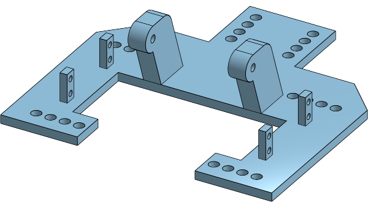
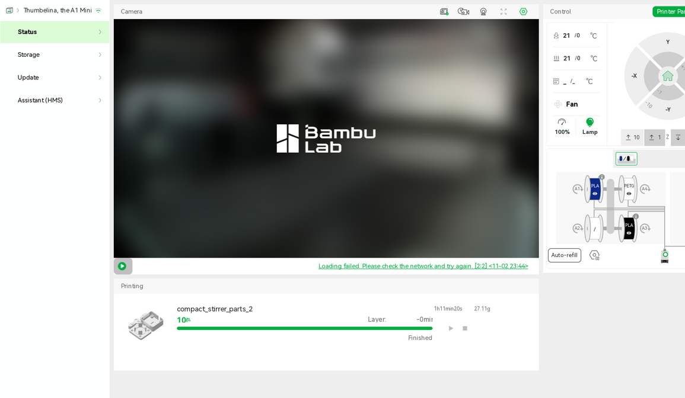

# Baseplate on the A1 mini, 2026-11-02: not sent

Asked for in [#197](https://github.com/vertical-cloud-lab/powder-doser/issues/197#issuecomment-6591022955):
"Start a print of the Baseplate file found in issue #193 on the A1 mini". The
[print run](https://github.com/vertical-cloud-lab/powder-doser/actions/runs/41544866804) logged in to
Bambu Studio and checked the printer, but it sent nothing, for three reasons.

**1. The Baseplate does not fit the A1 mini.** The Baseplate in
[#193](https://github.com/vertical-cloud-lab/powder-doser/issues/193) is the Onshape part studio
"Base" ([document](https://cad.onshape.com/documents/68b18e694d8672d95f496279/w/ca6615cd1f43e41c93dbf2f5/e/9f7a9b5e682bc05529f15125),
modified 2026-11-01). Its base sketch is 190 × 190 mm, and one of its dimensions is
`(190/2) mm`. The A1 mini's plate is 180 × 180 mm, and
[`bed_fit_check.py`](bed_fit_check.py) finds no rotation that fits: the smallest square
around the outline is 190.0 mm at every angle. The second sketch, the holes and cut-outs, spans
161 × 175 mm by itself, so the plate can't be much smaller than its sketch says. Older baseplate
exports on other branches are 190 mm long too, but #197 asks for the current Onshape files only,
so they weren't considered.

**2. This run can't export the current geometry.** The Onshape document is public, and anonymous
API calls get its feature list, part metadata and thumbnail, but parts, bounding boxes and STL
export answer 401. `ONSHAPE_ACCESS_KEY` and `ONSHAPE_SECRET_KEY` are in `claude.yml` (plain
`@claude` runs) and not in `claude-print.yml`.

**3. No camera frame.** Studio logged in at the first try (password, then the authenticator code)
and selected "Thumbelina, the A1 Mini", whose serial matched `A1_MINI_SERIAL`. The Device
page showed it idle, with the last job (`compact_stirrer_parts_2`) at 100 % and "Finished",
both heaters at 21 °C and off, no HMS alerts, and a **0.4 mm stainless standard-flow nozzle**
(*Printer Parts*). The live view failed on every try, five in all, including one after
restarting Studio, with "Loading failed. Please check the network and try again. [2:2]".
That message is Studio's 15 s loading timeout. Studio opened connections to the stream relay
for about a second, then dropped them. Outbound UDP from the runner worked (STUN replies from
Google and Cloudflare), so the problem seems to be on the printer's or relay's side. Earlier
print runs from GitHub runners did get frames this way. The plate was never seen, and since
the last job finished, its parts may still be on it.

## Next step

Print it on the **H2D** (350 × 320 mm plate), or split the part in Onshape if it has to be the A1 mini:

1. A plain `@claude` run exports `Base` from Onshape as STL with the Onshape keys, commits it,
   and reads the H2D's nozzles over LAN. They must be 0.2 or 0.4 mm. The H2D may still have
   tensegrity-optimization's 0.6 mm nozzles, the cause of the failed auger print in #193.
   It then slices for those nozzles and asks for `@claude-print` with the branch, path and printer.
2. `@claude-print` naming that file and the H2D.

Someone near the printer could also clear the A1 mini's plate, and power-cycle it if its camera
still won't stream in Studio or Bambu Handy.
