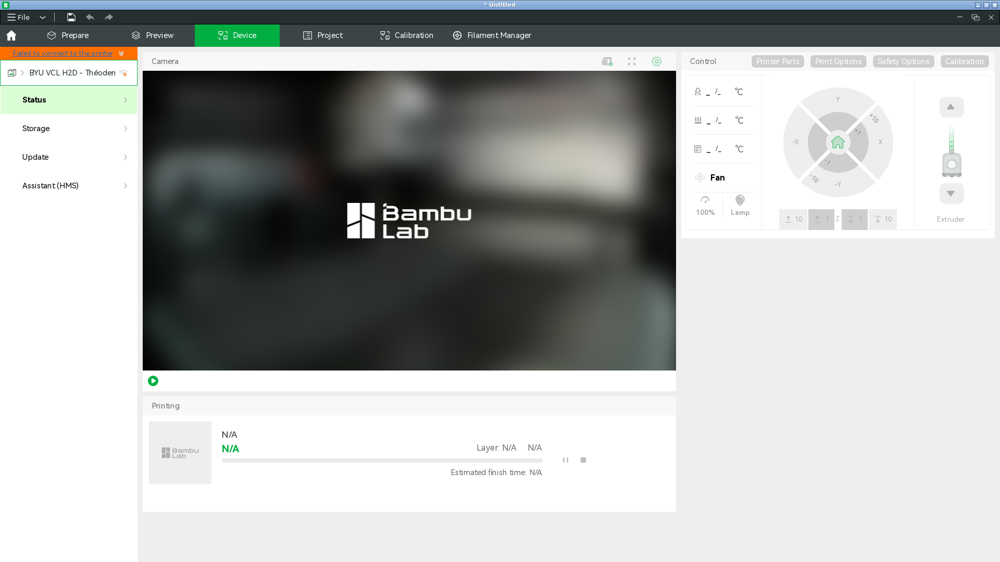
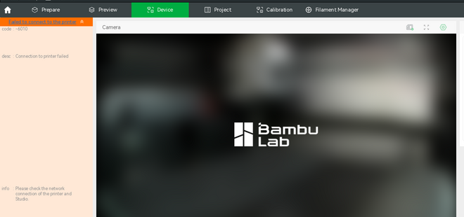
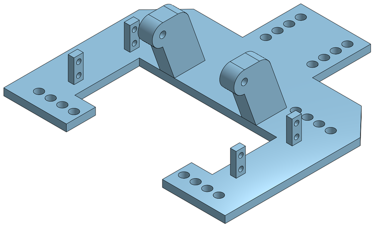

# Baseplate on the H2D, 2026-11-03: not sent

Asked for in [#197](https://github.com/vertical-cloud-lab/powder-doser/issues/197#issuecomment-6592408544):
"Print the baseplate on the H2D with the .4mm nozzle". The
[print run](https://github.com/vertical-cloud-lab/powder-doser/actions/runs/41555674109) logged in to
Bambu Studio, but sent nothing. The H2D was offline in Bambu's cloud for the whole run, and the
run had no way to export the current Onshape part.

**1. The H2D was offline.** Studio 02.08.02.61 logged in at 01:02 UTC: password, then the first
authenticator code from `bambu-totp`, with no e-mailed code. It selected the A1 mini by itself;
*Thumbelina* was online and idle, with `stub_holder_A1mini_blackPLA` at 100 % and *Finished*.
In the printer list, *BYU VCL H2D - Théoden* had Bambu's grey "offline" mark. When it was
selected, its serial matched `H2D_SERIAL`, but the Device page showed *"Failed to connect to the
printer"*, code **-6010** (*"Connection to printer failed. Please check the network connection of
the printer and Studio"*). Every reading stayed N/A, and there was no camera, state, HMS or
nozzle information. The run re-selected the printer every 3 minutes and checked the page every
20 s (see `print.json` for the times). The A1 mini stayed reachable on the same account the whole
time, so the problem is on the H2D's side: it is off, off Wi-Fi, or in LAN-only mode.

**2. No Onshape export in a print run.** The Baseplate in
[#193](https://github.com/vertical-cloud-lab/powder-doser/issues/193) is the part studio "Base"
([document](https://cad.onshape.com/documents/68b18e694d8672d95f496279/w/ca6615cd1f43e41c93dbf2f5/e/9f7a9b5e682bc05529f15125)),
unchanged since 2026-11-01 02:10:28 UTC. Anonymous requests to this public document get its
feature list, metadata and rendered views, but STL export, tessellation, body details, bounding
boxes and mass properties all return 401. `claude-print.yml` has no `ONSHAPE_ACCESS_KEY` or
`ONSHAPE_SECRET_KEY`. Older baseplate exports on other branches weren't used, since #197 asks
for the current Onshape files only.

**Size, from Onshape's own renders.** Orthographic shaded views at 0.2 mm per pixel
(`shadedviews`, top, front and right) put the part at **190.4 × 190.4 × 52.6 mm**. It's a
cross-shaped 6 mm plate with four rows of holes, two upright pivot blocks and four small servo
tabs. That fits the H2D's left-nozzle area (325 × 320 mm) easily, flat side down.

## Next step

1. **Get the H2D back online.** Check it's powered on, on Wi-Fi, and not in LAN-only mode, and
   that Bambu Handy shows it online.
2. **Prepare in a plain `@claude` run.** Ask it to:
   - export "Base" from the Baseplate document as STL with the Onshape keys;
   - read both of the H2D's nozzle diameters over LAN from the Pi. Both must be 0.2 or 0.4 mm,
     and the H2D may still have the 0.6 mm nozzles that spoiled the auger print in #193;
   - slice it for those nozzles with the repo's print specs: PLA, 0.20 mm layers, 3 walls,
     25 % infill, supports only where needed, textured PEI;
   - commit the slice and name its branch and path.
3. **Then `@claude-print`,** naming that file and the H2D.

A shortcut that skips step 2: in a reply on #197 (without `@claude`), attach the Onshape STL
export of "Base", zipped, since GitHub doesn't accept `.stl` attachments. A print run can check
it against Onshape's renders with [`check_stl.py`](check_stl.py) and slice it for the H2D's
nozzles.
