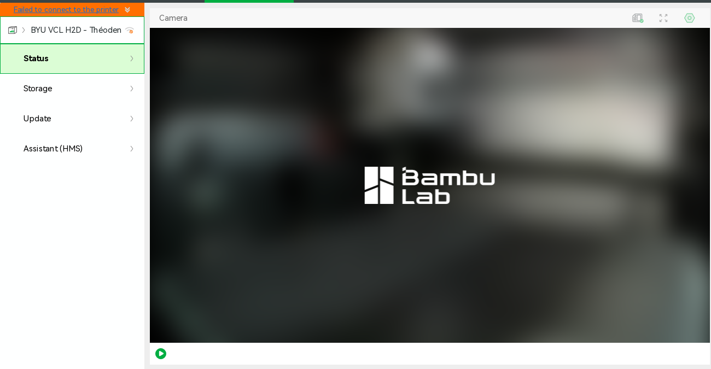

# Baseplate on the H2D, 2026-11-03: not sent

Asked for in [#197](https://github.com/vertical-cloud-lab/powder-doser/issues/197#issuecomment-6592408544):
"Print the baseplate on the H2D with the .4mm nozzle". The
[print run](https://github.com/vertical-cloud-lab/powder-doser/actions/runs/41555674109) logged in to
Bambu Studio, but sent nothing, for two reasons:
- the H2D was offline in Bambu's cloud for the whole run;
- the run had no way to export the current Onshape part.

Nothing on any printer was changed.

**1. The H2D was offline from 01:03 to 02:30 UTC.**
- **Login.** Studio 02.08.02.61 logged in at 01:02 UTC with the password, then the first
  authenticator code from `bambu-totp`. No e-mailed code was asked for.
- **The A1 mini was online.** Studio selected it by itself: *Thumbelina* was idle, with
  `stub_holder_A1mini_blackPLA` at 100 % and *Finished*.
- **The H2D was not.** In the printer list, *BYU VCL H2D - Théoden* had Bambu's grey "offline"
  mark. Once selected (its serial matched `H2D_SERIAL`), the Device page showed *"Failed to
  connect to the printer"*, code **-6010**: *"Connection to printer failed. Please check the
  network connection of the printer and Studio"*. Every reading stayed N/A: no camera, state,
  HMS or nozzle information.
- **Retries.** From 01:06 to 02:30 UTC the run checked the page every 20 s and re-selected the
  H2D every 3 min, 24 times. Each retry showed *Connecting…* and then *Failed to connect* again.
  The thread was polled every minute over the same time and got no replies.
- **Where the fault is.** The A1 mini stayed reachable on the same account, so the problem is
  at the H2D's end: it is off, off Wi-Fi, or in LAN-only mode.

At 02:30 UTC, the last check before signing out:

**2. A print run has no Onshape export.** The Baseplate in
[#193](https://github.com/vertical-cloud-lab/powder-doser/issues/193) is the part studio "Base"
([document](https://cad.onshape.com/documents/68b18e694d8672d95f496279/w/ca6615cd1f43e41c93dbf2f5/e/9f7a9b5e682bc05529f15125)),
unchanged since 2026-11-01 02:10:28 UTC. For this public document, anonymous requests get the
feature list, the metadata and rendered views. STL export, tessellation, body details, bounding
boxes and mass properties all return 401, and `claude-print.yml` has no `ONSHAPE_ACCESS_KEY` or
`ONSHAPE_SECRET_KEY`. #197 asks for the current Onshape files only, so the older baseplate exports
on other branches weren't used.

**Size, from Onshape's own renders.** Orthographic shaded views at 0.2 mm per pixel
(`shadedviews`: top, front and right) put the part at **190.4 × 190.4 × 52.6 mm**.
- **Shape:** a cross-shaped 6 mm plate with four rows of holes, two upright pivot blocks and four
  small servo tabs.
- **Fit:** it fits the H2D's left-nozzle area (325 × 320 mm) easily, flat side down.

**Clean-up.** Signed out of the Bambu account at 02:30:31 UTC, then closed Studio and deleted
its config. The screen recording was deleted without publishing it, because nothing printed and
it showed the login.

## Follow-up, 05:45 to 06:15 UTC (plain `@claude` run on PR #200)

- **The H2D was still unreachable at 05:45 UTC.** Checked over the LAN from the Pi, which shares
  a Wi-Fi subnet with both printers. The A1 mini's MQTT port answered in 13 ms, but the H2D's
  address gave *No route to host* on its MQTT, FTPS and camera ports: nothing on the network
  answered for it. So the H2D is off, off the network, or on a new address. A plain run has no
  Bambu login, so this is the LAN view, not the cloud one.
- **No second reading.** The Pi itself went offline on the tailnet at 06:00:00 UTC (23:00 MST),
  14 minutes after the run's last command on it, and was still offline at 06:12. The run's
  commands only read status, and nothing on the Pi was changed.
- **The Onshape keys are capped.** They sign in, but every document request returns HTTP 402
  (the yearly API cap), and anonymous requests can't export geometry. Onshape's own renders,
  feature lists and versions of all ten #193 documents are in
  [`cad/onshape-193/`](../../../cad/onshape-193/README.md), as reference views for `check_stl.py`.
  There is still no STL or STEP.

## Next step

1. **Get the H2D back online.** Check it's powered on, on Wi-Fi, and not in LAN-only mode, and
   that Bambu Handy shows it online.
2. **Prepare in a plain `@claude` run.** Ask it to:
   - export "Base" from the Baseplate document as STL with the Onshape keys;
   - read both of the H2D's nozzle diameters over LAN from the Pi. Both must be 0.2 or 0.4 mm,
     and the H2D may still have the 0.6 mm nozzles that spoiled the auger print in #193;
   - slice it for those nozzles with the repo's print specs: PLA, 0.20 mm layers, 3 walls,
     25 % infill, supports only where needed, textured PEI;
   - commit the slice and name its branch and path.
3. **Then `@claude-print`,** naming that file and the H2D.

**A shortcut that skips step 2.** Export "Base" from Onshape as STL yourself, zip it (GitHub
doesn't accept `.stl` attachments), and attach the zip to the `@claude-print` comment that asks
for the print, so the approver sees the exact file. The print run can check it against Onshape's
renders with [`check_stl.py`](check_stl.py), read the nozzles on the Device page, and slice it
for them.
