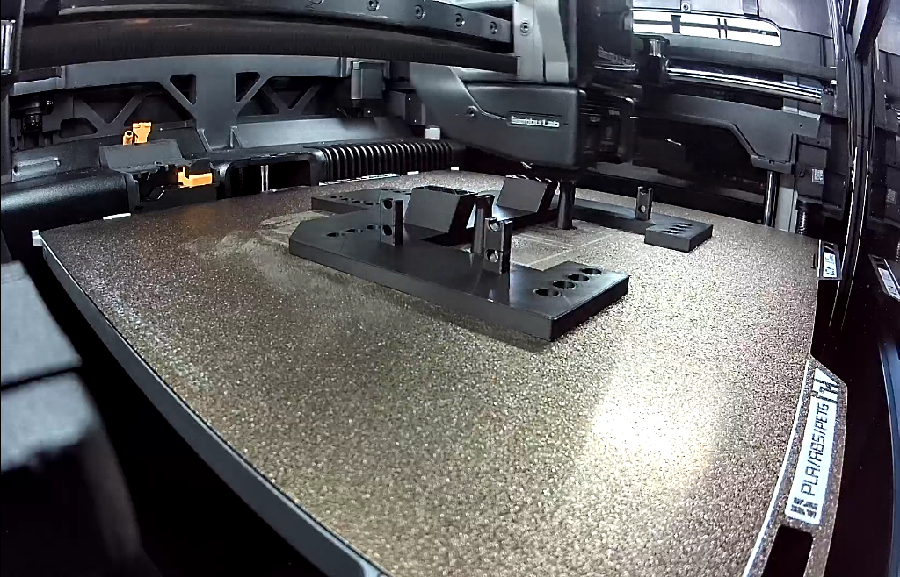

# Baseplate on the H2D, 2026-11-04: the manual print, read only

[Brandon at 21:09 UTC](https://github.com/vertical-cloud-lab/powder-doser/pull/200#issuecomment-6642168123):
"Started manual print on the H2D for the baseplate. Estimated print time is roughly 2.5hrs."
[Sterling at 21:38](https://github.com/vertical-cloud-lab/powder-doser/pull/200#issuecomment-6642779777)
asked a `@claude-print` run for "the link / the details of the manual print", read only.

The [run](https://github.com/vertical-cloud-lab/powder-doser/actions/runs/41918039553) logged in
to Bambu Studio 02.08.02.61 and only looked: the Device page, the *Printer Parts* and HMS views,
and Studio's cloud *Print History*. It sent nothing, and touched none of the print controls
(pause, stop, speed, temperatures, lamp, axes, AMS). It also did not press *Refresh* in
*Printer Parts*.

## The job

From the lab account's *Print History* in Studio (home page → *Print History* → *Base*;
[screenshot](print-history-base-20261104T215051Z.png)):

| | |
|---|---|
| Project | **Base**, Plate 1 |
| Printer | BYU VCL H2D - Théoden |
| Started | 2026-11-04 19:38 UTC (12:38 MST) |
| Build plate | Textured PEI Plate |
| Filament | PLA, 79.42 g, from AMS slot A2 (black), left nozzle |
| Kind | "Gcode": sliced in someone's Studio and sent as a sliced file, not sliced in the cloud or printed from a MakerWorld profile |

From the Device page at 21:46:42–21:47:22 UTC:
- **Progress:** 80 %, layer 109 → 112 of 261, 30 → 29 min left, estimated finish **22:16 UTC**
  (15:16 MST). The job's estimate is 2 h 32 min 27 s.
- **Temperatures:** left nozzle 220/220 °C, right nozzle 38/38 °C, bed 55/55 °C, chamber 26 °C.
  Speed 100 %, lamp on.
- **AMS:** left AMS (16 % humidity) has black PLA in A2, feeding the left nozzle, and blue PLA in
  A4. A1 and A3 are empty. The right AMS (6 %) is empty, and TPU on the external spool feeds the
  right nozzle.
- **HMS:** only the maintenance reminder seen this morning, *"Please clean and lubricate the
  X-axis linear rail, YZ-axis linear rods, and the extruder lift linear rail."* No faults.

## Nozzles

[*Printer Parts* at 21:48:32 UTC](printer-parts-20261104T214832Z.png):
- hardened steel, **0.4 mm**, Standard flow;
- hardened steel, **0.6 mm**, TPU High flow.

At 04:32–05:41 UTC both read 0.6 mm (Standard and TPU High flow,
[record](../2026-11-04-baseplate-h2d/README.md)), so the Standard nozzle has been swapped for a
0.4 mm one since. The dialog doesn't say which side is which. The job prints from the left
nozzle, and the right one is fed TPU, so the 0.4 mm Standard nozzle is most likely the left one.

## The camera at 21:47:22 UTC

The part is black and partway up (layer 112 of 261) on the textured PEI plate. It shows the
flat base with its rows of holes, the two hinge blocks and the slotted tabs. Nothing is loose or
stringing that I can see. Mean luma 94/255.

## Where the file came from

- **Onshape.** The job's name and thumbnail match the "Base" Part Studio of the
  [Baseplate document](https://cad.onshape.com/documents/68b18e694d8672d95f496279/w/ca6615cd1f43e41c93dbf2f5/e/9f7a9b5e682bc05529f15125):
  the same C-shaped plate, four rows of four holes, two hinge blocks and four slotted tabs
  ([Onshape's render](../../../cad/onshape-193/baseplate/base/iso.png)).
- **Unchanged since 2026-11-01 02:10:28 UTC.** An anonymous check at 21:51 UTC gave the same
  document `modifiedAt` and Part Studio microversion (`2a508062f03fe6fb748aaf74`) as the
  [2026-11-03 snapshot](../../../cad/onshape-193/README.md). So any export made today is that
  version: 190.4 × 190.4 × 52.6 mm.
- **No public link.** A print sent from Studio is a task in the lab account's cloud history,
  visible in Studio (*Print History*) or Bambu Handy when logged in to that account. Bambu gives
  it no shareable URL, and Studio's details view offers none.
- **Not in this repo.** No STL or 3MF of this print has been committed.
