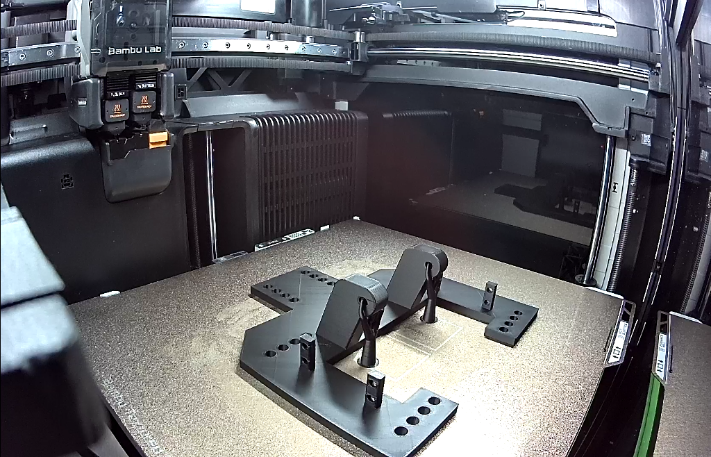
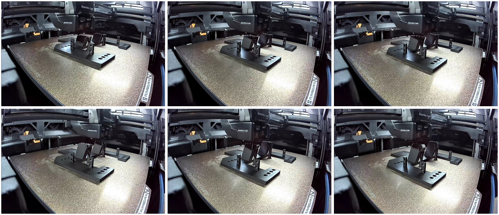
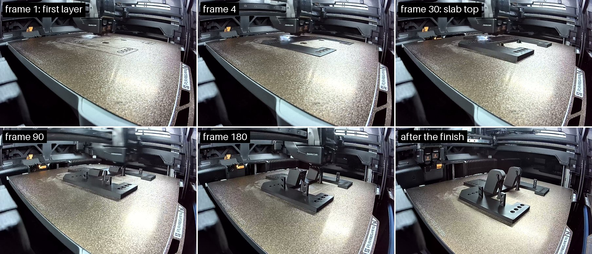
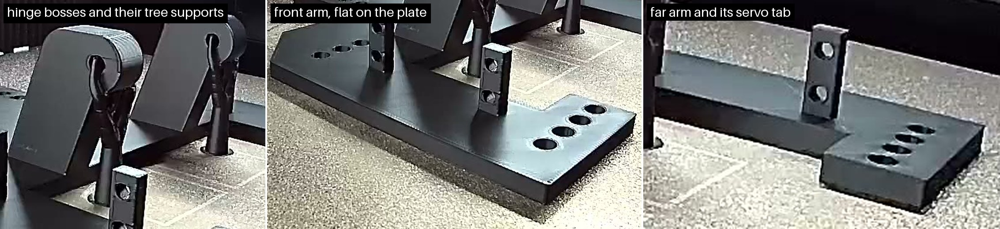

# Baseplate on the H2D, 2026-11-04: the manual print, read only

[Brandon at 21:09 UTC](https://github.com/vertical-cloud-lab/powder-doser/pull/200#issuecomment-6642168123):
"Started manual print on the H2D for the baseplate. Estimated print time is roughly 2.5hrs."
[Sterling at 21:38](https://github.com/vertical-cloud-lab/powder-doser/pull/200#issuecomment-6642779777)
asked a `@claude-print` run for "the link / the details of the manual print", read only.

The [run](https://github.com/vertical-cloud-lab/powder-doser/actions/runs/41918039553) logged in
to Bambu Studio 02.08.02.61 and only looked: the Device page, the *Printer Parts* and HMS views,
and Studio's cloud *Print History*. It sent nothing, and touched none of the print controls
(pause, stop, speed, temperatures, lamp, axes, AMS). It also did not press *Refresh* in
*Printer Parts*.

## The job

From the lab account's *Print History* in Studio (home page → *Print History* → *Base*;
[screenshot](print-history-base-20261104T215051Z.png)):

| | |
|---|---|
| Project | **Base**, Plate 1 |
| Printer | BYU VCL H2D - Théoden |
| Started | 2026-11-04 19:38 UTC (12:38 MST) |
| Build plate | Textured PEI Plate |
| Filament | PLA, 79.42 g, from AMS slot A2 (black), left nozzle |
| Kind | "Gcode": sliced in someone's Studio and sent as a sliced file, not sliced in the cloud or printed from a MakerWorld profile |

From the Device page at 21:46:42–21:47:22 UTC:
- **Progress:** 80 %, layer 109 → 112 of 261, 30 → 29 min left, estimated finish **22:16 UTC**
  (15:16 MST). The job's estimate is 2 h 32 min 27 s.
- **Temperatures:** left nozzle 220/220 °C, right nozzle 38/38 °C, bed 55/55 °C, chamber 26 °C.
  Speed 100 %, lamp on.
- **AMS:** left AMS (16 % humidity) has black PLA in A2, feeding the left nozzle, and blue PLA in
  A4. A1 and A3 are empty. The right AMS (6 %) is empty, and TPU on the external spool feeds the
  right nozzle.
- **HMS:** only the maintenance reminder seen this morning, *"Please clean and lubricate the
  X-axis linear rail, YZ-axis linear rods, and the extruder lift linear rail."* No faults.

## Nozzles

[*Printer Parts* at 21:48:32 UTC](printer-parts-20261104T214832Z.png):
- hardened steel, **0.4 mm**, Standard flow;
- hardened steel, **0.6 mm**, TPU High flow.

At 04:32–05:41 UTC both read 0.6 mm (Standard and TPU High flow,
[record](../2026-11-04-baseplate-h2d/README.md)), so the Standard nozzle has been swapped for a
0.4 mm one since. The dialog doesn't say which side is which. The job prints from the left
nozzle, and the right one is fed TPU, so the 0.4 mm Standard nozzle is most likely the left one.

## The camera at 21:47:22 UTC

The part is black and partway up (layer 112 of 261) on the textured PEI plate. It shows the
flat base with its rows of holes, the two hinge blocks and the slotted tabs. Nothing is loose or
stringing that I can see. Mean luma 94/255.

## The finish, about 22:18 UTC

- **Watching.** From 21:55 to 22:18 UTC the run read the Device page every 30 s by OCR and
  saved a frame every 4 min ([log](watch-log.jsonl), [frames](frames/)). It never clicked, and no
  dialog appeared. It also polled the thread every 30 s; nobody commented.
- **Progress.** Layer 147 at 21:55, 188 at 22:03, 229 at 22:11, 254 at 22:16. The estimated
  finish held at 22:16–22:17 throughout.
- **Finish.** At 22:17:33 it was at layer 261/261. By 22:18:36 the job panel showed 100 %,
  *Finished*, and no *Printing* label. The bed and nozzle targets had gone to 0. That's about
  2 h 40 min from the 19:38 start; Studio's 2 h 32 min estimate leaves out heating and
  calibration.

**The last frame, 22:18:54 UTC:**

The part looks complete, with the toolhead parked top left. What looks like a slim support
stands under each hinge block. Nothing loose or stringy that I can see. The part is still on the
plate.

## Where the file came from

- **Onshape.** The job's name and thumbnail match the "Base" Part Studio of the
  [Baseplate document](https://cad.onshape.com/documents/68b18e694d8672d95f496279/w/ca6615cd1f43e41c93dbf2f5/e/9f7a9b5e682bc05529f15125):
  the same C-shaped plate, four rows of four holes, two hinge blocks and four slotted tabs
  ([Onshape's render](../../../cad/onshape-193/baseplate/base/iso.png)).
- **Unchanged since 2026-11-01 02:10:28 UTC.** An anonymous check at 21:51 UTC gave the same
  document `modifiedAt` and Part Studio microversion (`2a508062f03fe6fb748aaf74`) as the
  [2026-11-03 snapshot](../../../cad/onshape-193/README.md). So any export made today is that
  version: 190.4 × 190.4 × 52.6 mm.
- **No public link.** A print sent from Studio is a task in the lab account's cloud history,
  visible in Studio (*Print History*) or Bambu Handy when logged in to that account. Bambu gives
  it no shareable URL, and Studio's details view offers none.
- **Not in this repo.** No STL or 3MF of this print has been committed.
- **Not readable from here either.** The H2D's *Storage → Model* list holds only five files, all
  from 2026-08. A job sent from Studio is kept in the printer's cache, which that list doesn't
  show and which only LAN FTPS can read. A print run has no LAN route. Studio's cloud login is
  encrypted on disk, so the run didn't fetch the task's file through Bambu's API either.
- **To keep the exact file,** whoever sliced it can attach the 3MF from Studio (*File → Export →
  Export plate sliced file*), zipped, to a comment.

## Clean-up

See [`print.json`](print.json): Studio was signed out and closed, and its config deleted, at the
end of the run. Nothing was recorded, because nothing was to be sent.

## Follow-up, 2026-11-10: the printer's own timelapse

[Sterling at 01:08 UTC](https://github.com/vertical-cloud-lab/powder-doser/pull/200#issuecomment-6755950292):
"how did this print go?" Nobody had posted about the part since 11-04: there was nothing on #197,
#193, #191 or this PR. The closest is
[a note on #181](https://github.com/vertical-cloud-lab/powder-doser/pull/181#issuecomment-6671271179)
(2026-11-05 22:32 UTC), "Started first assembly", which doesn't say which baseplate was used. So
this [plain `@claude` run](https://github.com/vertical-cloud-lab/powder-doser/actions/runs/42733613285)
read the H2D's storage over the LAN from the doser Pi, read only.

- **The H2D was busy.** At 01:13 UTC it was printing another lab job (layer 2 of 556), so the run
  only listed folders and downloaded two small files. Each read used FTPS on port 990, with
  `curl` on the Pi capped at 400 KB/s and the access code passed on stdin. Nothing was sent to
  the printer, and nothing on the Pi was installed or changed.
- **The Base job's timelapse was still on the printer:** `/timelapse/video_2026-11-05_03-49-46.mp4`,
  5,309,160 bytes, last written 2026-11-04 22:18 UTC. Its name is in the printer's UTC+8 clock,
  so the recording started at **19:49:46 UTC**, 11 minutes after the job started at 19:38, once
  heating and calibration were done. The video is 1680 × 1080, 24 fps and 300 frames: one per
  layer for the 261 layers, then a 39-frame hold on the finished part.
  - [the video, unchanged](timelapse/video_2026-11-05_03-49-46.mp4) (sha256 `5090e7e8…b9f3`) and
    the printer's [thumbnail](timelapse/video_2026-11-05_03-49-46.jpg);
  - [a GIF](timelapse/timelapse.gif) of every third frame, cropped to the bed.
- **The continuous recording is there too, but wasn't downloaded.** It is 19 files in `/ipcam/`,
  `ipcam-record.2026-11-05_03-49-14.32.mp4` to `….50.mp4`, 4.73 GB in all. The first started at
  19:49:14 UTC and the last was written at 22:18. That is too much to pull over the Pi's Wi-Fi.
- **The sliced file still isn't readable.** The FTPS root has no cache folder, and its only
  `.gcode.3mf` files are from August.

**What the timelapse shows.** The camera saw a clean print from the first layer to the last:
- **First layer:** the outline went down flat, with two round support bases inside the C-shaped
  cut-out. By frame 4 the slab is solid black, and nothing is lifting.
- **No failures:** no layer shift, no spaghetti and no knocked-over support. The large
  frame-to-frame jumps (frames 31, 130 and 262) are the toolhead passing through the shot, and
  parking at the end.
- **Supports:** each hinge boss has one tree support, standing on the plate inside the cut-out
  and touching the boss at its pivot hole. Both stood to the end. The pivot holes are where to
  look for support scars.
- **Flat:** no corner of any arm or tab is lifted in the last frame.
- **What a camera can't tell:** the dimensions and hole sizes, the underside, and whether the
  supports came off cleanly. Only someone holding the part can check those.

**Nozzles, read over LAN MQTT at 01:13 and 01:21 UTC** with
[`scripts/bambu_lan_status.py`](../../../scripts/bambu_lan_status.py):
- **Left** (device nozzle 1): **0.4 mm** `HS01`, hardened steel, standard flow, at 220 °C for the
  other job.
- **Right** (device nozzle 0): **0.6 mm** `HU01`, hardened steel, TPU high flow, cold.

Bambu Studio shows nozzle 1 as the left one and nozzle 0 as the right one
([`wgtDeviceNozzleSelect.cpp`](https://github.com/bambulab/BambuStudio/blob/1ca1aadfc0a4894430194abbe4e51f077288cc02/src/slic3r/GUI/DeviceTab/wgtDeviceNozzleSelect.cpp#L126-L127)).
The pair is the same one *Printer Parts* showed on 11-04, and the Base printed from the left
nozzle, so it was printed with the 0.4 mm nozzle, as guessed above. The right nozzle is still
0.6 mm, so under CLAUDE.md a `@claude-print` run would still hold an H2D print until it is
swapped.
