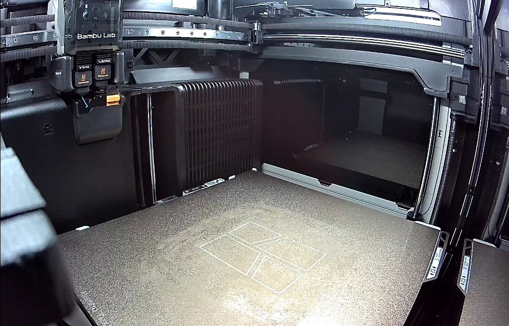

# Baseplate on the H2D, 2026-11-04: not sent

Asked for on [PR #200](https://github.com/vertical-cloud-lab/powder-doser/pull/200#issuecomment-6622491382)
at 04:23 UTC: "The H2D should be back online, try printing the downloaded baseplate file with a
.4mm nozzle". The [print run](https://github.com/vertical-cloud-lab/powder-doser/actions/runs/41772878995)
logged in to Bambu Studio and reached the H2D, but sent nothing, for two reasons:
- both of the H2D's nozzles report 0.6 mm;
- no baseplate file exists. The Onshape keys still get HTTP 402, so nothing was ever downloaded.

Nothing on any printer was changed.

## The H2D is back online

- **Login.** Studio 02.08.02.61 logged in with the password and then the first authenticator
  code from `bambu-totp`. *Log In* was pressed at 04:29:59 UTC and *Confirm* at 04:30:16. No
  e-mailed code was asked for.
- **Selection.** Studio picked the A1 mini by itself. The H2D, *BYU VCL H2D - Théoden*, had
  Bambu's green online mark this time. It was selected at 04:30:59 and connected at once.
- **State at 04:31 UTC:**
  - idle, heaters off: left nozzle 26 °C, right nozzle 24 °C, bed 23 °C, chamber 25 °C;
  - the last job, "Part 1", at layer 457/457, 100 % and *Finished* (3 h 8 min, 175.70 g);
  - filament: black PLA in A2 and blue PLA in A4 of the left AMS; TPU on the external spool.
    The other AMS slots are empty.
- **HMS:** one maintenance reminder and no faults
  ([screenshot](hms-20261104T043225Z.png)). It reads *"Please clean and lubricate the X-axis linear
  rail, YZ-axis linear rods, and the extruder lift linear rail."*
- **Nozzles: two hardened-steel nozzles, both 0.6 mm.**
  - One is "Standard" flow and the other "TPU High flow"
    ([04:32](printer-parts-20261104T043246Z.png), [05:41](printer-parts-20261104T054108Z.png)).
  - The *Printer Parts* dialog doesn't say which is left and which is right.
  - All 17 reads from 04:32 to 05:41 UTC gave the same.
  - This repo needs 0.2 or 0.4 mm in every nozzle, so the run did not slice or send. It also did
    not press the dialog's *Refresh*.

**The first frame, 04:31:54 UTC**, posted at the top of the tracking comment at 04:34:33:

**Reading the plate.**
- The frame is bright enough to tell (mean luma 96/255).
- It shows a textured PEI plate with its printed logo outline, and the toolhead parked top
  left. Nothing is on it, so the 175.7 g "Part 1" had been taken off.
- The plate's front-left corner is just out of frame.
- The full Device page is in [this screenshot](device-page-h2d-20261104T043154Z.png).

## No baseplate file

- **The Onshape keys still get HTTP 402**, "API limit exceeded":
  - at 04:27 UTC;
  - at 04:42:46 and 04:43:09, on the Baseplate and Auger documents;
  - then every 5 min from 04:49 to 05:41, 11 more tries.
- **The keys still sign in:** `sessioninfo` returned 200.
- **Without a key, Onshape still refuses export**, as on 2026-11-03.
- **Brandon's reply.** At 04:42 he replied that the limit "should be fixed now". The keys this
  run received at 04:23 still hit it. Either the fix hadn't reached them, or new keys were saved
  after the job started; GitHub hands a job its secrets when it starts.
- **What [`cad/onshape-193/`](../../../cad/onshape-193/README.md) holds** is renders and feature
  lists, not geometry, so it was not used as the "downloaded" file.

## Waiting for a person

- **Polling.** The tracking comment set a cutoff of 05:45 UTC (22:45 MST), and the thread was
  polled every 30 s until then.
  - The one reply was Brandon's, about Onshape. None came about the nozzles.
  - The branch didn't move, so no other run committed an STL.
- **Checks every 4 to 5 min:** a camera frame, a nozzle read and an Onshape retry
  ([log](poll-log.txt)).
- **The plate didn't change.** The mean absolute difference from the first frame stayed at 5.1
  to 5.4 of 255.
  - The 04:39:55 frame (88.4) caught Studio's live view closed: *"Temporarily closed because
    there is no printing for a while"*.
  - From then on, the poll pressed ▶ before each frame.

**The last frame, 05:45:35 UTC:**

## Clean-up

- **Sign-out.** Signed out of the Bambu account at 05:46:05 UTC, then closed Studio and deleted
  its config, which holds the printers' LAN access codes.
- **Recording.** The screen recording was deleted unpublished, because nothing printed and it
  showed the login.
- **GitHub token.** It was re-minted at 05:15 with `scripts/refresh_github_app_token.py`.

## Next step

1. **Nozzles.** Fit 0.4 mm nozzles on both sides of the H2D and set them on its screen. The run
   reads them off the printer, and every installed nozzle must be 0.2 or 0.4 mm.
2. **The STL.** Either:
   - export "Base" from the
     [Baseplate document](https://cad.onshape.com/documents/68b18e694d8672d95f496279/w/ca6615cd1f43e41c93dbf2f5/e/9f7a9b5e682bc05529f15125)
     in Onshape's UI (right-click the part → *Export* → STL), zip it and attach the zip; or
   - ask a plain `@claude` run to export it with the Onshape keys and commit it to this branch.
     That run gets the secrets as they are when it starts.

   The print run can check it against Onshape's renders with
   [`check_stl.py`](../2026-11-03-baseplate-h2d/check_stl.py).
3. **Then `@claude-print`,** naming the file (branch and path) and the H2D. Ask during working
   hours, with someone who can get to the printer.
