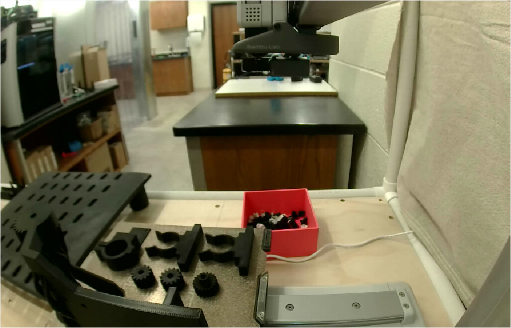

# Doser parts on the A1 mini, gears flat (2026-11-13): sent at 04:31:39 UTC, finished by 09:32

The plate in [`../2026-11-13-a1mini-doser-parts-gears-flat/`](../2026-11-13-a1mini-doser-parts-gears-flat/README.md),
sent by the [04:16 run](https://github.com/vertical-cloud-lab/powder-doser/actions/runs/43364415428)
at [Joshua's request](https://github.com/vertical-cloud-lab/powder-doser/pull/200#issuecomment-6843740987).
That run was cancelled at 06:07:48 UTC while it was watching, so it never wrote this record. This
README was added by the [06:08 H2D run](https://github.com/vertical-cloud-lab/powder-doser/actions/runs/43376636768),
from that run's tracking comment
([PR #200](https://github.com/vertical-cloud-lab/powder-doser/pull/200#issuecomment-6843750582)), the
files here, and its own read-only checks of the A1 mini.

## Before Send (from the 04:16 run)

- [Device page, 04:27:04 UTC](a1mini-device-page-no-camera-20261113T042704Z.png), posted at
  04:28:22: *Thumbelina, the A1 Mini*, idle, heaters off; **0.4 mm** stainless nozzle, standard flow
  ([Printer Parts](printer-parts-20261113T042542Z.png)); no HMS alerts ([HMS](hms-20261113T042600Z.png));
  black PLA in A3.
- The camera gave no picture (*"Loading failed… [2:2]"*), so the plate check rested on Joshua's
  word at 04:16 UTC: *"The workspace and build plate are clear and ready."*
- The 90 s window ended at 04:29:52 with no replies; a second check at 04:31:09 found it still idle.

## Send, 04:31:39 UTC

Thumbelina, 0.4 mm, PEI plate, PLA → **A3**, timelapse off, levelling and flow calibration on. The
G-code was the committed file's (MD5 `180b1cd9…`), not re-sliced.

## Progress

| UTC | | Source |
|---|---|---|
| 04:39:59 | Layer 1 | 04:16 run ([watch log](watch/watch-log.jsonl)) |
| 04:48:18 | Layer 2 | 04:16 run |
| 05:22:22 | Layer 20 | 04:16 run |
| 05:51:16 | Layer 36/541, 25 %, finish estimate 09:30 | 04:16 run |
| 06:07:48 | The 04:16 run was cancelled | Actions API |
| 06:16:19 | 32 %, nozzle 219/220 °C, bed 64/65 °C | 06:08 run ([Device page](../2026-11-13-h2d-doser-parts-send/a1mini-device-page-20261113T061619Z.png)) |
| 07:39:25 | Layer 189/541, 62 % | 06:08 run ([Device page](../2026-11-13-h2d-doser-parts-send/a1mini-device-page-20261113T073925Z.png)) |
| 09:09:46 | Layer 498/541, 94 %, finish estimate 09:26 | 06:08 run ([Device page](../2026-11-13-h2d-doser-parts-send/a1mini-device-page-20261113T090946Z.png)) |
| 09:32:07 | **100 %, layer 541/541, *Finished*,** cooling (nozzle 74 °C, bed 50 °C), no HMS alerts | 06:08 run ([Device page](../2026-11-13-h2d-doser-parts-send/a1mini-device-page-20261113T093207Z.png)) |

Nobody watched it from 06:07:48 to 06:16:19, or between the 06:08 run's checks, but no HMS alert
or error dialog showed at any check.

## After

The camera played at 09:32:29 UTC, for the first time since 11-12:

The tap collar, the two C-clips and the three pinions are on the plate, flat and whole, with no
spaghetti. The mounting plate is at the left edge of the frame, partly out of view. Still to check
by hand: the support scars under the mounting plate's top gear, and how the parts come off.
