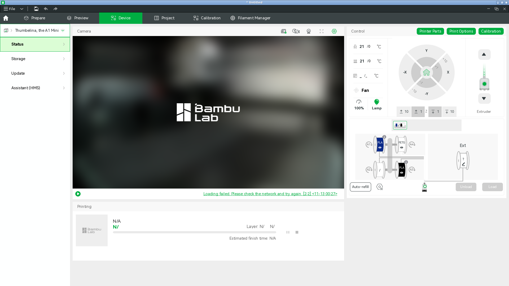
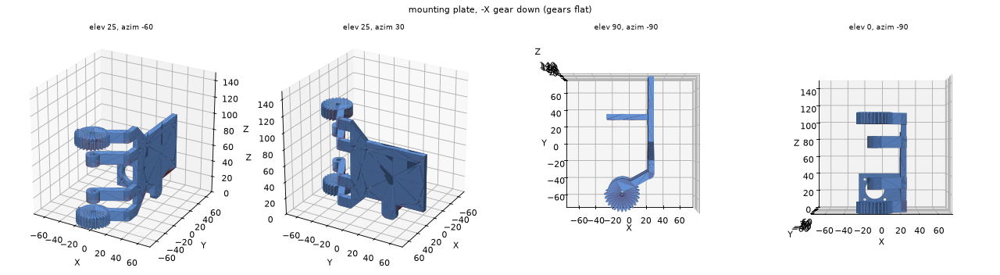
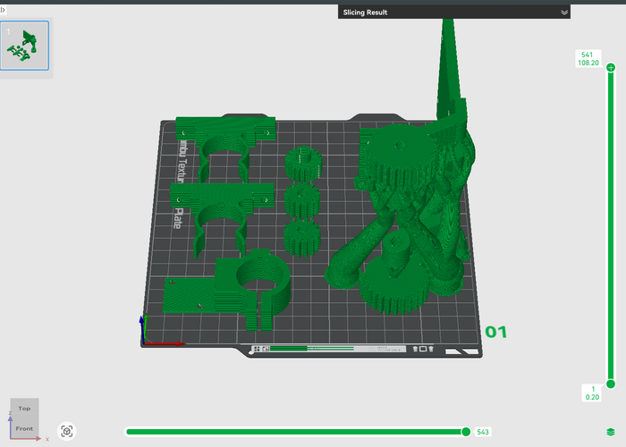

# Doser parts on the A1 mini, gears flat (2026-11-13): sliced, not sent

[Clayton at 00:14 UTC](https://github.com/vertical-cloud-lab/powder-doser/pull/200#issuecomment-6839800610),
with `@claude-print`, re-ran [the 11-12 request](https://github.com/vertical-cloud-lab/powder-doser/pull/200#issuecomment-6839188674)
(A1 mini, black PLA: one mounting plate, one tap collar, all the gears; no brackets or wood legs)
with three changes:

> print all gears sideways (it's better for the cross section of the teeth) including the mounting
> plate should be printed in an orientation that makes the gears flat (circle sides down). Also,
> print the clips - if all parts don't fit on one plate, then prepare both plates so we can quickly
> print the next plate when the time comes.

**Outcome: sliced and committed, not sent.** Everything fits on one A1 mini plate, so there is no
plate 2. The A1 mini's camera gave no picture all session, so the run couldn't see the plate, and
nobody replied that it was clear before the stated cutoff (02:00 UTC). The sliced file below is
ready to send.

## The printer, 00:22–00:27 UTC

- *Thumbelina, the A1 Mini*: online, idle, heaters off (nozzle 21 °C, bed 21 °C). The 11-12
  run was cancelled at 00:05:10 UTC, before its planned 00:06 Send, so nothing from it printed.
- Nozzle **0.4 mm** stainless steel, standard flow ([Printer Parts](printer-parts-20261113T002700Z.png)).
- No HMS alerts ([HMS tab](hms-20261113T002715Z.png)).
- AMS lite: A1 blue PLA, A2 empty, A3 black PLA, A4 PETG.
- **The camera:** every live-view try from 00:22 to 02:01 UTC failed with *"Loading
  failed. Please check the network and try again. [2:2]"*. Studio retried by itself every couple of
  minutes. 192 checks of the camera pane, every 20 s from 00:55 to 02:01, never saw a picture. The
  same printer failed the same way for byu-vcl on 11-05 and 11-06, but worked for the 11-12 run at
  23:46 UTC. *Camera Setting* only offers *Auto-record Monitoring* (on; not touched).
- **The wait:** the Device page was posted at 00:28:29 UTC, asking someone at the printer to reply
  that the plate was clear (or to power-cycle the printer), with a 02:00 UTC cutoff. The thread
  was read every 20 s until 02:01, and nobody replied. At 02:00:53 the printer was still idle with
  the camera failing ([Device page](a1mini-device-page-no-camera-20261113T020053Z.png)).
- **Login and clean-up:** password, then the first authenticator code (no e-mailed code asked
  for). Signed out at 02:01:26 UTC, then Studio closed and its config deleted. Nothing was printed
  and the screen recording showed the login, so it was deleted unpublished. See
  [`print.json`](print.json) for the timeline.

## The parts

All are unchanged in Onshape since the 11-12 export (anonymous `sourceMicroversion` checks at
00:31 UTC). The C-clip was exported today (2 counted API calls; [record](../../../cad/onshape-193/brackets-for-auger/bracket-recreation/export-20261113.json)).

| Part | Count | Onshape source | STL here |
|---|---|---|---|
| Mounting plate | 1 | Mounting plate → Part Studio 1 | [`stl/mounting_plate_gears_flat.stl`](stl/mounting_plate_gears_flat.stl) |
| C-clip (the auger's flexible bracket) | 2 | Flexible Bracket → *Bracket Recreation* (the Part Studio #193 links; the #193 assembly holds the auger in 2 of these) | [`stl/c_clip_flat.stl`](stl/c_clip_flat.stl) |
| Servo pinion, 14T | 2 | Servo pinion → *Servo_pinion* (imported STEP) | [`stl/servo_pinion_14T.stl`](stl/servo_pinion_14T.stl) |
| Stepper pinion, 20T, module 1.0 | 1 | Stepper pinion → *stepper_pinion* (imported STEP) | [`stl/stepper_pinion_20T_m1.stl`](stl/stepper_pinion_20T_m1.stl) |
| Tap collar | 1 | Tap collar → *tapcollar* (imported STEP; the #193 assembly's collar) | [`stl/tap_collar_split.stl`](stl/tap_collar_split.stl) |

Three differ from the 11-12 plate:
- **Stepper pinion.** The native *Stepper Pinion* (used on 11-12, and linked by the #193 assembly)
  is module 1.3, tip Ø28.4 mm. The auger's 44T gear is module 1.0 (the auger STL measures
  Ø46.0 = 1.0 × (44 + 2)), and the assembly puts the shafts 32 mm apart, which is (20 + 44)/2 at
  module 1.0. The imported *stepper_pinion* is module 1.0 (tip Ø22.0) and meshes. #181's
  assembly check found the same.
- **Servo pinion.** The native *Complete Servo Pinion* has six features (spur gear, *Hole 1*,
  *Hole Extrude*, *Chamfer Hole*, *Chamfer Hole Extrude*, *Chamfer 1*), but its rollback bar sits
  after the first, so its export is the bare gear with a 3.4 mm bore all the way through. An export
  with `rollbackBarIndex=6` gave the same geometry. The imported *Servo_pinion* has a Ø5.5 mm
  socket on one face (the servo spline), the 3.4 mm screw hole, and a Ø6.0 mm counterbore on the
  other face.
- **Tap collar.** In the *Tap Collar Recreation* (used on 11-12) the clamp slot stops about 4 mm
  short of the bore, so the ring isn't split and the screw can't close it. The imported
  *tapcollar* is split, and is the one the #193 assembly uses.

## Orientation

Every gear prints with its circular face on the bed, so each layer holds the whole tooth profile.

- **Mounting plate:** rotated −90° about Y, so the hinge axis, which is also the axis of both
  28T gears, is vertical. The −X gear's face and the plate's −X edge lie in one plane, about
  1,240 mm² on the bed; the other way up, the plate's edge would hang 14–20 mm above the bed.
  It stands 108.2 mm tall on a 54.7 × 149.5 mm footprint. The top gear is directly above the
  bottom one, so its underside (about 1,200 mm² at z 96 mm) and the two arms (z 25 and 70 mm)
  need supports, which reach them from the bed around the bottom gear.
- **C-clips:** the C profile flat on the bed, 12 mm tall (909 mm² on the bed).
- **Pinions:** as exported, axis vertical. The servo pinion's socket face is down; the stepper
  pinion's hub is up.
- **Tap collar:** bore vertical, its flat back face down (1,473 mm² on the bed), as on 11-12.

[`stl/orientation.json`](stl/orientation.json) has each rotation, extent, bed contact and
overhang area; [`stl/layout.json`](stl/layout.json) has where each part sits on the plate.

## The slice

| | |
|---|---|
| File | [`doser_parts_gears_flat_A1mini_PLA.gcode.3mf`](doser_parts_gears_flat_A1mini_PLA.gcode.3mf) (Studio's *Export plate sliced file*; the account's `DesignerUserId` blanked; plate G-code MD5 `180b1cd977b02eaa8f75c07b46b17bfe`, the same before and after) |
| Studio | Bambu Studio 02.08.02.61 on the runner; printer preset set by *Sync info* to *Bambu Lab A1 mini 0.4 nozzle* |
| Process | *0.20mm Standard @BBL A1M* with 3 walls and 25 % sparse infill, as on 11-12. Tree (auto) supports, 30°, on the build plate only. Brim *auto*: none generated |
| Filament | *Bambu PLA Basic @BBL A1M*: 220 °C nozzle, 65 °C on the textured PEI plate. At Send, map it to AMS A3 (black PLA) |
| Layout | Seven parts loaded as one object (Studio names it *c_clip_1*), spaced by hand: the small parts at least 20 mm from the mounting plate, so its trees have room. With separate objects and Studio's *Arrange*, Studio warned of colliding paths between the tap collar and the mounting plate's supports at layer 2 |
| Estimate | 541 layers, 108.2 mm, 120.17 g (17.34 g of it support), 39.65 m. Model 4 h 47 min; total 4 h 53 min with preparation |

- [Layer 477, z 95.4 mm](slice-preview-layer477-z95.4-top-gear-support.png): the support roof
  under the top gear, carried by trees from the bed.
- [Layer 1](slice-preview-layer1.png): the bottom gear and the plate's edge on the bed, the tree
  bases around them, no brim.

## Sending it

Open the file in Bambu Studio (or send it from Bambu Handy), choose *Thumbelina, the A1 Mini*,
the textured PEI plate, PLA → AMS **A3**, timelapse off, bed levelling and flow dynamics
calibration on. Check the plate is empty first. Someone checking the 108 mm mounting plate in the
first hour would help, since it's the tallest and least stable part on the plate.

## Not on this plate

The auger (250 mm long) and the baseplate (190 × 190 mm) don't fit the A1 mini's 180 mm bed. They
need the H2D, whose right nozzle was still 0.6 mm on 11-10.
