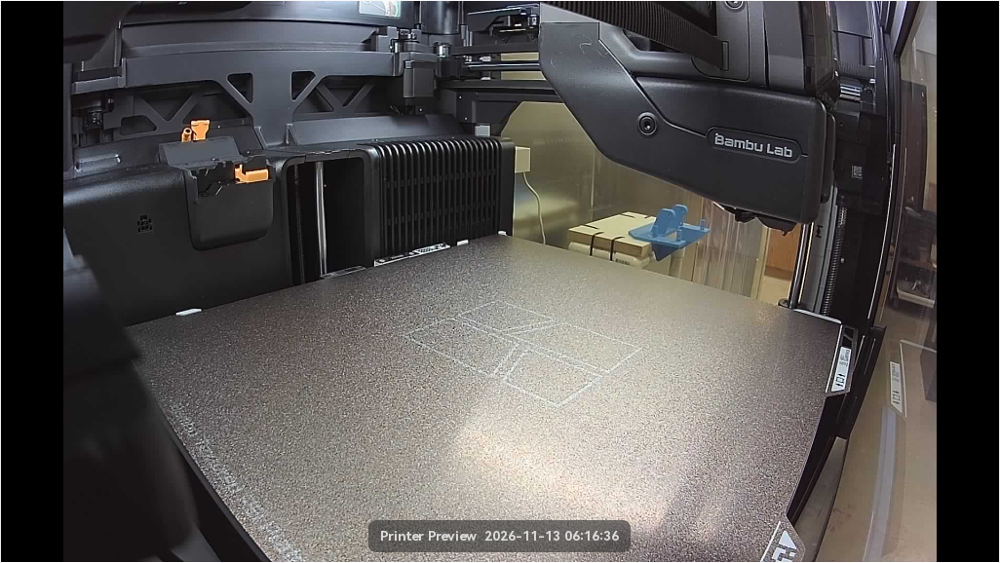
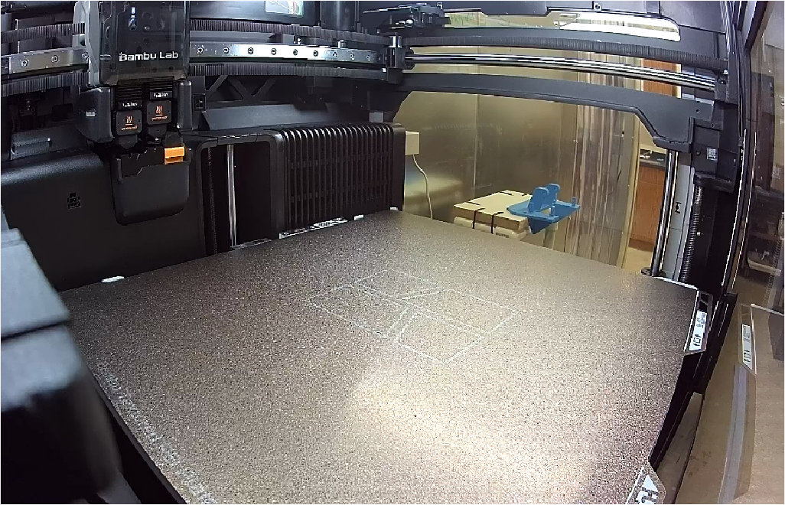
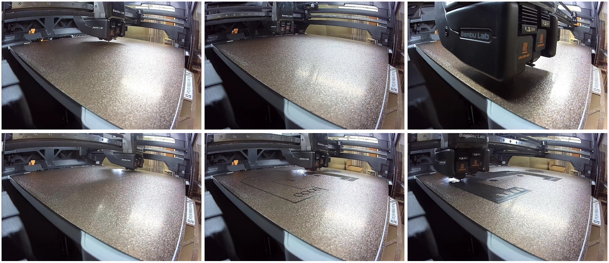
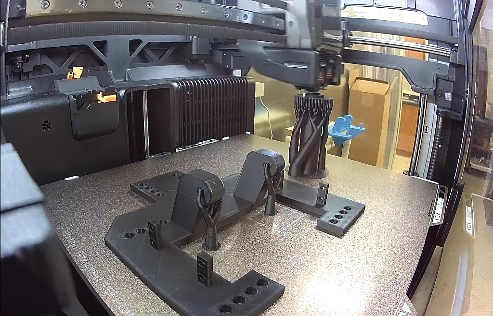
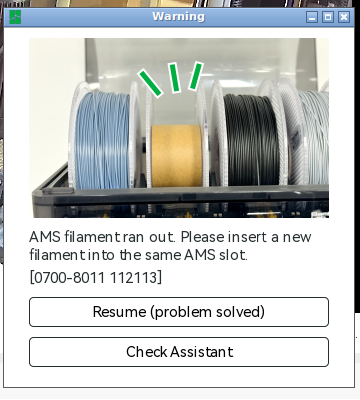
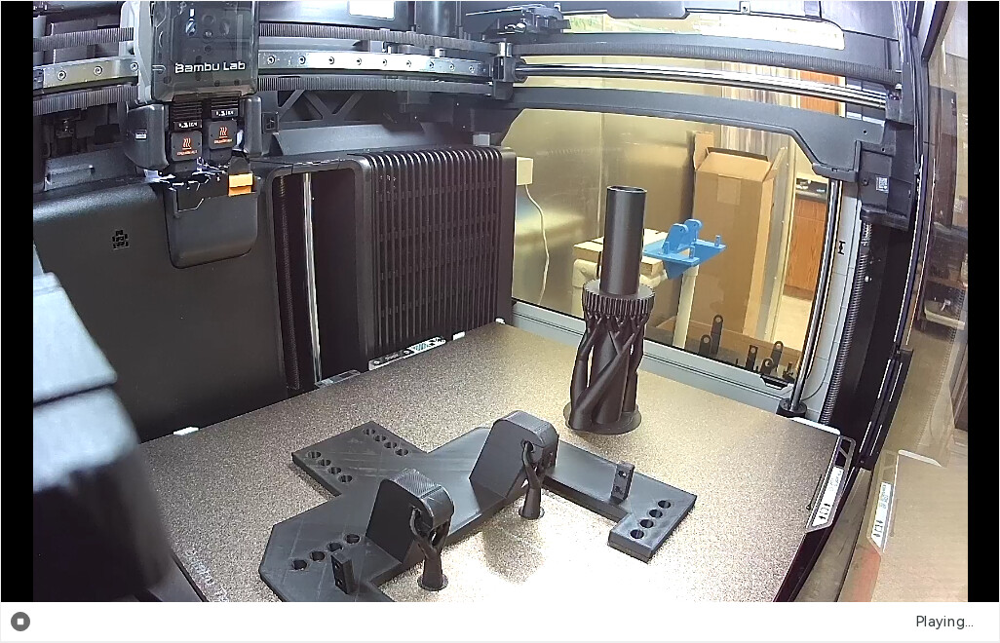
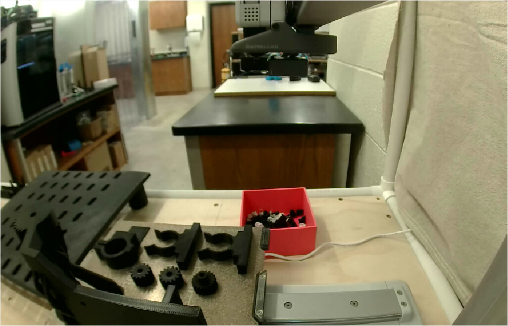

# Baseplate and auger on the H2D, black PLA (2026-11-13): sent at 06:25:24 UTC, paused at layer 751/1250 out of filament

[Joshua at 06:08 UTC](https://github.com/vertical-cloud-lab/powder-doser/pull/200#issuecomment-6845617257), with
`@claude-print`: "re-run last ping. Print immediatly. Note the nozzles have been replaced." The
last ping was [his 04:39 request](https://github.com/vertical-cloud-lab/powder-doser/pull/200#issuecomment-6844173130):
print what was left of Clayton's list on the H2D in black PLA, without the stand brackets or wood
legs. The [04:39 run](https://github.com/vertical-cloud-lab/powder-doser/actions/runs/43366921258)
had sliced the baseplate and the auger onto one plate
([`../2026-11-13-h2d-doser-parts/`](../2026-11-13-h2d-doser-parts/)) and held the Send because
the H2D's right nozzle still read 0.6 mm. It, and the run watching the A1 mini, were cancelled at
06:07 UTC.

**Outcome:** the right nozzle was set to 0.4 mm on the printer at 06:18–06:19 UTC, while this
run was posting its first frame. Both nozzles then read 0.4 mm, the plate was empty, nobody
replied, and the plate was sent at 06:25:24 UTC. It printed cleanly until **11:21:58 UTC, when the
black PLA in AMS slot A2 ran out and the H2D paused itself at layer 751 of 1250** (HMS
0700-8011). The baseplate and the auger's gear were finished by then; the top 100 mm of the
auger tube, 41 min of printing, is left. It was still paused when this run signed out at 11:47:14.
See [The pause](#the-pause-at-layer-751) for how to finish it.

## The first frame, 06:16:36 UTC

- Committed and posted at the top of the tracking comment at 06:18:56 UTC, before any other prep.
- *BYU VCL H2D - Théoden*, online and idle. The last job, *aurora_camera_mounts_zero_hq_H2D*,
  showed 100 %, layer 556/556, *Finished*. Left nozzle 28 °C, right nozzle 30 °C with a 30 °C
  target, bed 25 °C, chamber 27 °C ([Device page](device-page-h2d-20261113T061636Z.png)).
- HMS: only *"Please clean and lubricate the X-axis linear rail, YZ-axis linear rods, and the
  extruder lift linear rail."* ([HMS tab](hms-20261113T061814Z.png)). No faults.
- AMS 2 Pro (left nozzle): A1 empty, A2 black PLA, A3 white PLA, A4 light-blue PLA. AMS HT (right
  nozzle) empty; external spool unknown.
- **Read of the plate: empty.** Mean luma 83/255 (with the letterbox bars). The textured PEI plate
  with its printed logo outline, and the toolhead at the top right. The blue part past the bed's
  back edge is outside the chamber.

## The nozzles

| UTC | Left | Right |
|---|---|---|
| 06:17:43 ([dialog](printer-parts-20261113T061743Z.png)) | 0.4 mm hardened steel, standard flow | **0.6 mm hardened steel, TPU high flow** |
| 06:19:58 ([dialog](printer-parts-20261113T061958Z.png)) | 0.4 mm hardened steel, standard flow | **0.4 mm hardened steel, standard flow** |
| 06:24:00 ([dialog](printer-parts-20261113T062400Z.png)) | 0.4 mm hardened steel, standard flow | 0.4 mm hardened steel, standard flow |

- Read from Studio's *Printer Parts* dialog, which shows what the printer reports. *Refresh* was
  never pressed.
- The 06:17:43 read held the Send under CLAUDE.md (every installed nozzle must be 0.2 or 0.4 mm),
  and the tracking comment said so at 06:18:56. Someone at the printer set the right hotend to
  0.4 mm standard flow before 06:19:58. The 0.6 mm TPU high-flow reading had been there since at
  least 11-04.
- The slice is for the left nozzle only (`filament_map = 1`, `nozzle_diameter = 0.4,0.4`). Its
  `nozzle_volume_type` is `Standard,TPU High Flow`, from when it was sliced, but the right nozzle
  isn't used, and the Send dialog raised no mismatch.

## The wait and the Send

- **06:20:50, a second frame** ([live view](h2d-live-20261113T062050Z.png),
  [Device page](device-page-h2d-20261113T062050Z.png)), posted at 06:21:32. The bed was lower and
  the toolhead had moved since 06:16:36, and a hand showed at the bottom right, past the bed's
  edge. The plate was still empty. The run treated it as a new frame and waited 90 s from 06:21:32,
  to 06:23:02.
- **06:22:16, the file opened in Studio:** *Slice ok*, 5 h 26 min, 160.71 g, the filament on the
  left nozzle. Not re-sliced: the plate G-code is the committed file's (MD5
  `744a58793916bd43ce7dbd456284821f`).
- **06:22:46, Send dialog** set up, then closed to take the last frame from the Device page.
- **06:23:55 and 06:24:22, final frames:** plate empty, the two identical (MAE 0.04/255), so
  nothing was moving.

- **06:24:33, Send dialog again** ([screenshot](send-dialog-20261113T062456Z.png)):
  - *BYU VCL H2D - Théoden*, "Bambu Lab H2D 0.4/0.4mm", PEI plate;
  - left nozzle: PLA from **A2** (black). The dialog defaulted to A3 (white PLA) both times;
  - timelapse **off**, auto bed levelling **on**, flow dynamics calibration **on**, nozzle offset
    calibration **off** (the default; one nozzle prints).
- **06:25:24, Send,** after a last thread check: no comment from anyone but the bots since the
  06:08 request. Studio uploaded it ("Sending print job with LAN acceleration") and showed it on
  the printer by 06:25:49: layer 0/1250, finish estimated at 11:50
  ([Device page](device-page-h2d-sent-20261113T062601Z.png)).

## Progress

| UTC | |
|---|---|
| 06:25:24 | Send |
| 06:27–06:37 | Heating, homing, calibration |
| 06:37:17 | Layer 1 (881 s in the slice: the baseplate's whole footprint) |
| 06:52:54 | Layer 2, 6 % ([Device page](device-page-h2d-layer2-20261113T065254Z.png)) |
| 07:37:37 | Layer 22, 19 % |
| 07:46–08:00 | Layer 26, the slab's first top-surface layer (14 min, as in the slice) |
| 08:23:18 | Layer 30, 32 % |
| 09:10:16 | Layer 143, 46 %, finish estimate 12:03 |
| 09:31:21 | Layer 204, 53 % |
| 09:50:36 | Layer 261 (52.2 mm), the baseplate's last; the auger alone from here |
| 10:14:49 | Layer 372, 67 % |
| 10:59:13 | Layer 458, 80 %: the auger's 44T gear done on its tree supports |
| 11:21:35 | Layer 751, 87 %, 41 min left, finish estimate 12:02 |
| **11:21:58** | **Paused: AMS filament ran out (0700-8011)** |
| 11:46:45 | Still paused; nozzle 42 °C, bed 55 °C held |

*06:27, 06:31, 06:35 (top); 06:37, 06:44, 06:52 (bottom).*

- The watcher ([`monitor.jsonl`](watch/monitor.jsonl)) read the Device page every 10 s by OCR,
  saved camera frames, and polled the thread every minute. Selected frames are in
  [`watch/`](watch/).
- No HMS fault or dialog until the run-out, and no reply on the thread all session.

*Layer 458, 10:59:13 UTC: the baseplate finished, the auger's gear on its tree supports.*

## The pause at layer 751

- **11:21:58 UTC:** Studio's *Warning*: *"AMS filament ran out. Please insert a new filament into
  the same AMS slot. [0700-8011 112113]"*, with *Resume (problem solved)* and *Check Assistant*
  ([Device page](device-page-h2d-runout-20261113T112212Z.png)). The job panel showed 87 %, layer
  751/1250, 41 min left.
- **A2 read *Empty* afterwards.** It was the only black PLA loaded (A3 white PLA, A4 light-blue
  PLA, A1 empty), so the AMS had no backup to switch to. By the G-code, layers 1–751 take 143.9 g
  of the plate's 160.7 g, so about 17 g is left to print.
- **While paused,** the bed held 55 °C and the left nozzle cooled to 42 °C
  ([11:46:45](device-page-h2d-paused-20261113T114645Z.png)).
- **Nothing was clicked.** *Resume* would have had no filament to feed, and the run can't load a
  spool. The *Warning* window was moved aside, not closed.

**To finish it:** put a new spool of black PLA in **A2** of the left AMS (the same slot), let the
AMS load it, then press **Resume** on the H2D's screen or in Bambu Handy on the lab account.
Expect a seam on the auger tube at 150 mm, where it paused. Finishing in A3's white PLA instead
would make the top 100 mm of the tube white; that is a person's call.

## Clean-up

- **Signed out** of the Bambu account at 11:47:14 UTC (Home → account menu → *Log out*), then
  closed Studio (11:47:33) and deleted its config (`~/.config/BambuStudio`, which holds the
  printers' LAN access codes) and its slice cache, `/tmp/bamboo_model`.
- **Recording.** The screen was recorded from 06:12 to 11:47 UTC. The raw segments, which show the
  login, were deleted on the runner. [`recording-cut-20261113.mp4`](recording-cut-20261113.mp4)
  (3 min 21 s, 720p) is cut from them by wall-clock time: 06:16:25–06:26:10 at 4× speed (the H2D's
  Device page, the nozzle reads, the Send dialog, Send), then the print as a timelapse of the
  recorder's keyframes, about one every 25 s, to 11:46:48. It leaves out the login, the account menu
  and the three A1 mini checks (07:38:50–07:40:00, 09:09:25–09:10:10 and 09:31:45–09:33:20).
  The camera pane's upper corners, where the room shows, are blurred. There's no YouTube token in a
  print run, so it isn't uploaded.
- **GitHub token** re-minted with `scripts/refresh_github_app_token.py` at 06:53, 07:40, 08:24,
  09:09, 10:17, 11:02 and 11:46 UTC.

## The A1 mini's plate (read only)

The gears-flat plate on the A1 mini
([`../2026-11-13-a1mini-doser-parts-gears-flat/`](../2026-11-13-a1mini-doser-parts-gears-flat/README.md))
was sent at 04:31:39 UTC by run [43364415428](https://github.com/vertical-cloud-lab/powder-doser/actions/runs/43364415428),
which was cancelled at 06:07:48 while watching it. This run looked in on it, read only:

| UTC | |
|---|---|
| 06:16:19 | 32 %, nozzle 219/220 °C, bed 64/65 °C ([Device page](a1mini-device-page-20261113T061619Z.png)) |
| 07:39:25 | Layer 189/541, 62 % ([Device page](a1mini-device-page-20261113T073925Z.png)) |
| 09:09:46 | Layer 498/541, 94 %, finish estimate 09:26 ([Device page](a1mini-device-page-20261113T090946Z.png)) |
| 09:32:07 | **100 %, layer 541/541, *Finished*,** cooling, no HMS alert ([Device page](a1mini-device-page-20261113T093207Z.png)) |

Its camera, which had given no picture since 11-12, played at 09:32:29:

The tap collar, the two C-clips and the three pinions are on the plate, flat and whole, with no
spaghetti. The mounting plate is at the left edge, partly out of frame. The red box and the room
are outside the printer. Nobody has checked the parts off the plate yet.
