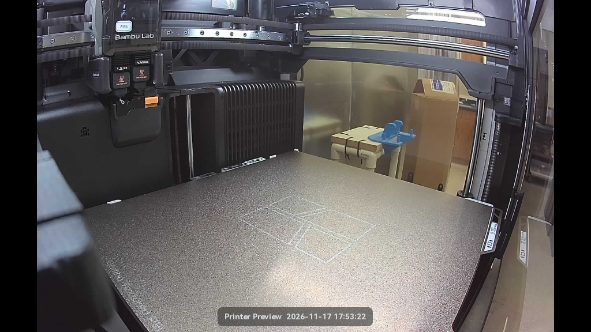
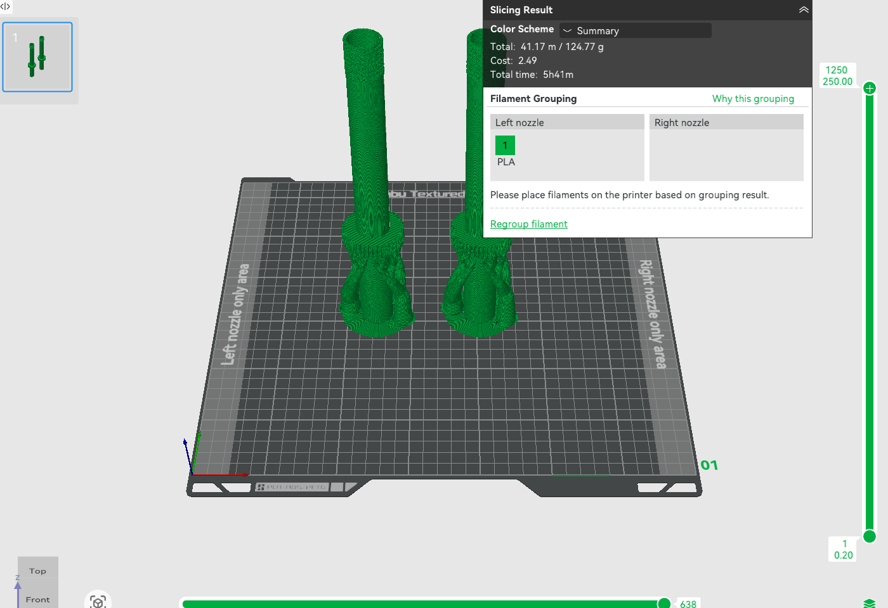
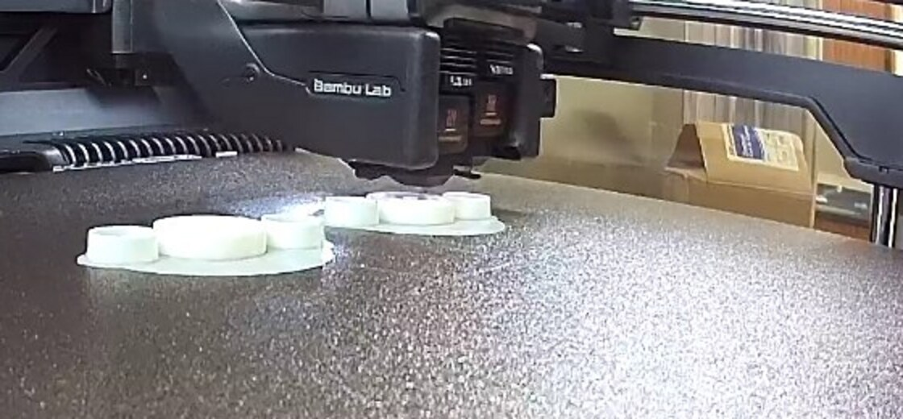
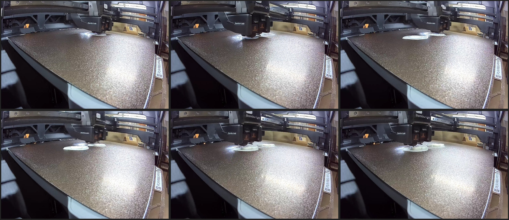
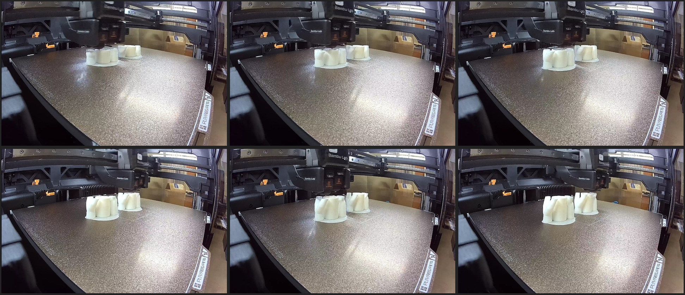
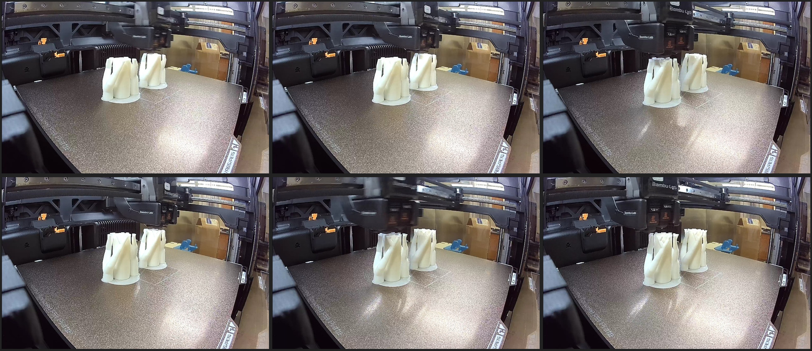
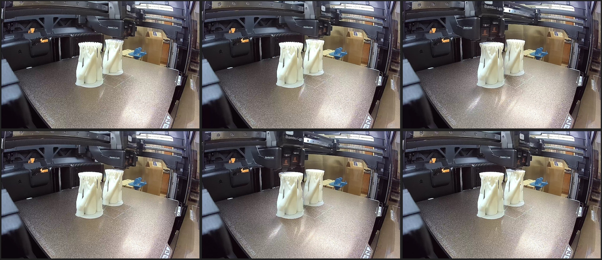
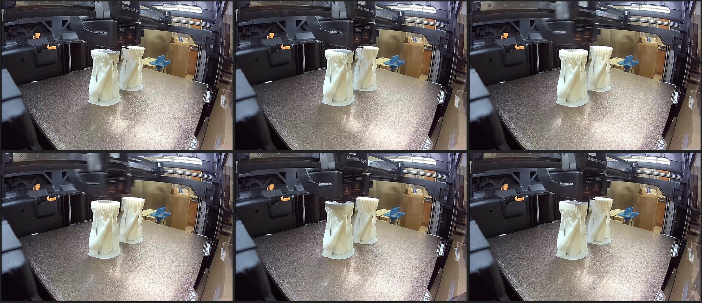
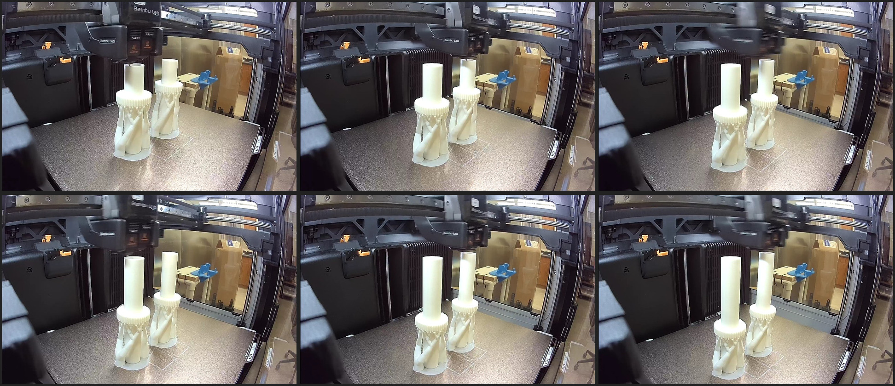
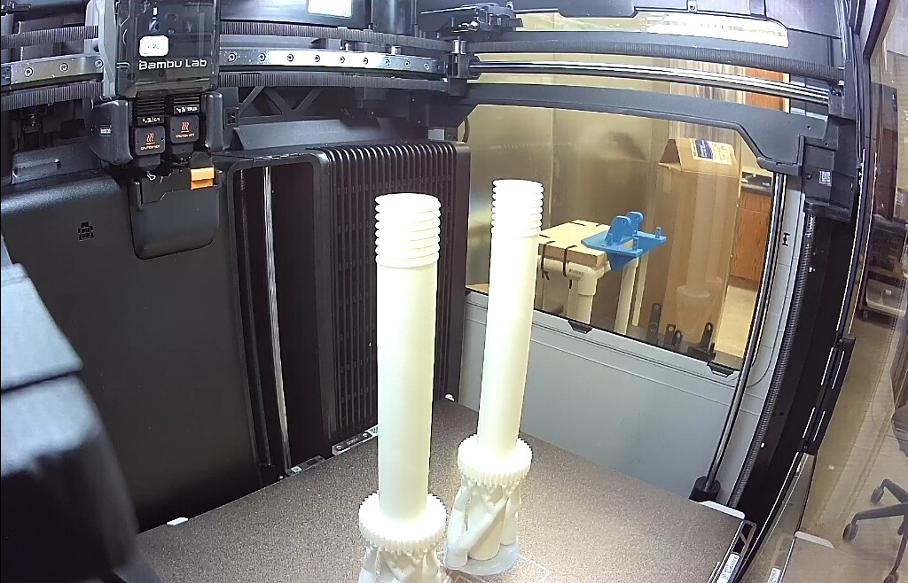

# Two augers on the H2D (2026-11-17): sent at 18:12:11 UTC, finished at 23:30 UTC (in white PLA)

[Brandon at 17:41:59 UTC](https://github.com/vertical-cloud-lab/powder-doser/pull/200#issuecomment-6956025690),
with `@claude-print`: "Print 2 augers on the H2D". The run
([44139848563](https://github.com/vertical-cloud-lab/powder-doser/actions/runs/44139848563)) was approved and started at
17:46:43 UTC. Its tracking comment is
[here](https://github.com/vertical-cloud-lab/powder-doser/pull/200#issuecomment-6956144503).

**Outcome:** both augers printed to the end. At 23:30:51 UTC the job showed layer 1250/1250 and 100 %, with the bed heater off and both tubes standing with their threaded tops, and no HMS fault or dialog all print. The run signed out at 23:31:30, just before the job's 6 h limit, so nobody has yet checked the parts off the plate.

**The filament came out white, not black.** The Send dialog mapped the PLA to AMS slot **A2**, which Studio labelled black
PLA, and the AMS panel showed the feed coming from A2. But the parts are white from the first layer on. The spool now in A2
seems to be a white (or natural) one, and the slot's info is left over from the black spool that ran out on 11-13 (A2 has
a pencil icon: the info was set by hand, not read from an RFID tag). The request named no colour, so the run let it print
and said so in the thread at 18:38. Nobody replied. See [The filament](#the-filament-white-not-black).

## The first frame, 17:53:22 UTC

- Committed (`9f96c1c`) and posted at the top of the tracking comment at 17:55:13 UTC, before any slicing.
- *BYU VCL H2D - Théoden*, online and idle. Studio's selected printer matched `H2D_SERIAL`. The last job,
  *vial_holder_20ml_x6*, showed 100 %, layer 115/115, *Finished*. Left nozzle 28 °C, right 26 °C, bed 25 °C, chamber
  26 °C, all with 0 targets ([Device page](device-page-h2d-20261117T175322Z.png)).
- HMS: two maintenance reminders, no faults: *"Please clean and lubricate the X-axis linear rail, YZ-axis linear rods, and
  the extruder lift linear rail."* and *"Threaded rods need lubrication now."* ([HMS](hms-20261117T175440Z.png)).
- AMS 2 Pro (left nozzle): A1 empty, A2 PLA labelled black (pencil icon), A3 white PLA (RFID), A4 light-blue PLA. AMS HT
  (right nozzle) empty; external spool unknown. Humidity 24 % and 8 %.
- **Read of the plate: empty.** Mean luma 91/255 (104 without the letterbox bars). The textured PEI plate with its printed
  logo outline, and the toolhead parked top left. The lit table, boxes and blue part past the bed's far edge are outside
  the chamber.

## The nozzles

| UTC | Left | Right |
|---|---|---|
| 17:54:14 ([dialog](printer-parts-20261117T175414Z.png)) | 0.4 mm hardened steel, standard flow | 0.6 mm hardened steel, TPU high flow |
| 17:57:43 ([*Switch diameter*](switch-diameter-dialog-20261117T175743Z.png)) | "Left nozzle: 0.4mm" | "Right nozzle: 0.6mm" |
| 18:10:42 ([dialog](printer-parts-20261117T181042Z.png)) | 0.4 mm hardened steel, standard flow | 0.6 mm hardened steel, TPU high flow |

- *Printer Parts* doesn't label the sides. Studio's *Switch diameter* prompt does: after *Sync info* it said it can't slice
  for two diameters and asked which nozzle to use, naming the left as 0.4 mm and the right as 0.6 mm. The left was chosen.
- Under the 2026-11-13 rule in CLAUDE.md, every nozzle the print uses must be 0.2 or 0.4 mm, and an unused one can be any
  size. This print uses only the left 0.4 mm nozzle (see below). *Refresh* was never pressed.

## The plate

File: [`augers_x2_H2D_PLA.gcode.3mf`](augers_x2_H2D_PLA.gcode.3mf) (`8159b5f`), sliced in Bambu Studio 02.08.02.61 on the
runner and exported with *Export plate sliced file*. The account's `DesignerUserId` is blanked; the plate G-code is untouched.

- **Geometry:** two copies of [`../2026-11-13-h2d-doser-parts/stl/auger_44T.stl`](../2026-11-13-h2d-doser-parts/stl/auger_44T.stl),
  the auger standing upright (46 × 46 × 250 mm) so its 44T gear prints flat. The Auger Part Studio still had microversion
  `e7c79c28b4efc1804f70ebe5`, last modified 2026-10-29 18:15 UTC, when checked without a key at 17:57 UTC, the same as
  the 11-13 export.
- **Layout:** centres at (122.5, 160) and (202.5, 160) mm, 80 mm apart. Studio's *Arrange* had put them diagonally with
  the two Ø46 gears about 2 mm apart (centres 47.9 mm apart), and a half-moved layout made Studio warn of conflicting
  G-code paths, so both were placed by hand in the Move panel. All extrusion is between X 92.3 and 232.5 mm and Y 133.0 and
  187.0 mm: inside the left nozzle's area (X 0–325).
- **Settings:** *Bambu Lab H2D 0.4 nozzle*, *0.20mm Standard @BBL H2D*, 3 walls, 25 % sparse infill (grid), tree (auto)
  supports at 30° on the build plate only, auto brim, *Bambu PLA Basic @BBL H2D* at 220 °C, textured PEI plate at 55 °C.
  Studio turned arc fitting off by itself ("curve planning enhancement" on the printer). The file's
  `project_settings.config` has 581 keys and **none differ** from the 11-13 file's
  ([`../2026-11-13-h2d-doser-parts/`](../2026-11-13-h2d-doser-parts/)).
- **One nozzle:** custom filament grouping with filament 1 on the left extruder and nothing on the right
  ([grouping](filament-grouping-left-20261117T180116Z.png)); `filament_maps = 1`. No prime tower (no *Prime tower* feature
  in the G-code; the only wipe-tower lines are config comments). The tool-change and temperature commands of the start
  sequence are identical to the 11-13 file's, which printed on the left nozzle.
- **Estimate:** prediction 20445 s (5 h 40 min 45 s), first layer 270 s, **124.77 g / 41.17 m**, 1,250 layers to 250 mm.
  Plate G-code MD5 `cfb8127e0452f32aa99ec70ff6164a96`.

## The wait and the Send

- **Window:** the frame was posted at 17:55:13; the 90 s ended at 17:56:43. The thread was polled at 17:56:54, 18:02:24,
  18:08:21, 18:09:57, 18:10:53 and 18:12:10. No comment from anyone after the request, other than the approval notice.
- **18:10:20, second frame** ([frame](h2d-frame-20261117T181020Z.png), [Device page](device-page-h2d-20261117T181020Z.png)):
  plate unchanged (mean absolute difference 3.0/255 over the plate against 17:53:22), printer still idle.
- **18:11:19, Send dialog** ([screenshot](send-dialog-20261117T181158Z.png)): *BYU VCL H2D - Théoden*, "Bambu Lab H2D
  0.4/0.6mm", PEI plate; PLA on the left nozzle mapped to **A2** (the dialog defaulted to A3, white PLA); timelapse **off**,
  auto bed levelling **on**, flow dynamics calibration **on**, nozzle offset calibration **off** (the default). Job name
  *auger_44T*.
- **18:12:11, Send.** "Sending print job with LAN acceleration"; on the printer by 18:12:38: *auger_44T*, layer 0/1250,
  homing, left nozzle heating to 140 °C, bed to 55 °C, estimated finish 23:52
  ([Device page](device-page-h2d-sent-20261117T181238Z.png)).
- **Same file:** Studio's sent 3MF (`/tmp/bamboo_model/.../.5141.0.3mf`) has the same plate G-code MD5 as the committed
  file, so nothing was re-sliced.

## The filament: white, not black

- The bases came out white from layer 1 ([montage](watch/start-montage-L1-L31.jpg)).
- At 18:37:57 the AMS panel showed the feed path from **A2** to the left nozzle ([AMS](ams-feed-a2-20261117T183757Z.png)).
  So the printer used the mapped slot, and the spool in it is white (or natural), not black.
- The run let it print: the request named no colour, and the layers looked normal for PLA. The tracking comment said so at
  18:38:55 and asked for a `stop` reply if black was wanted. Nobody replied.
- **To do on the printer:** correct A2's slot info (type and colour), so the next job isn't mapped to it as black.

## Progress

| UTC | |
|---|---|
| 18:12:11 | Send |
| 18:12–18:22 | Homing, hotend type detection, flow calibration, bed levelling |
| 18:23:15 | Layer 1 |
| 18:35:25 | Layer 31, 5 % |
| 18:59:43 | Layer 105, 13 % |
| 19:25:26 | Layer 192, 21 % |
| 20:14:52 | Layer 338, 37 % |
| 20:42:28 | Layer 380, 46 %: the support interfaces under the gears (slower layers) |
| 21:07:30 | Layer 397, 53 %: the gears begin |
| 21:54:36 | Layer 438, 66 % |
| 22:03:13 | Layer 460, 69 %: past the gears, about 11 layers a minute from here |
| 22:43:25 | Layer 911, 84 %, finish estimate 23:36 |
| 23:28:52 | Layer 1244, 99 % |
| 23:30:51 | **Layer 1250/1250, 100 %**, bed heater off, *Finished* ([Device page](device-page-h2d-finished-20261117T233051Z.png)) |

*Layers 1, 1, 6, 13, 19, 25, 18:23–18:33 UTC: the first layers, white*

*Layers 105–192, 18:59–19:25 UTC: the bases and tree supports*

*Layers 269–338, 19:49–20:14 UTC: the supports climbing toward the gears*

*Layers 380–397, 20:42–21:07 UTC: support interfaces, then the gears*

*Layers 415–438, 21:29–21:54 UTC: the gear teeth*

*Layers 629–911, 22:18–22:43 UTC: the tubes above the gears*

*Layer 1250/1250, 23:30:51 UTC: both augers finished*

- The watcher ([`watch/monitor.jsonl`](watch/monitor.jsonl)) is byu-vcl's `watch_studio.py` (49677cf) with a thread poll
  added: it read the Device page by OCR every 10 s, saved a camera frame every 2–5 min, polled this thread every minute, and
  stopped on a new window. OCR misreads (for example "1597" for layer 159, "247%" from the weight) are left as logged.
- No HMS fault, no dialog and no reply during the watch.

## Clean-up

- **Signed out** of the Bambu account at 23:31:30 UTC (Home → account menu → *Log out*). Studio then closed and its config (`~/.config/BambuStudio`, which holds the printers' LAN access codes) and slice cache (`/tmp/bamboo_model`) were deleted at 23:31:52.
- **Recording.** The screen was recorded from 17:49 to 23:32 UTC. [`recording-cut-20261117.mp4`](recording-cut-20261117.mp4) (4 min 57 s, 1280 × 720) is cut by wall-clock time: 17:53:00–17:56:30 at 4× (Device page, frame, nozzles, HMS), 17:56:30–18:10:00 at 8× (slicing), 18:10:00–18:14:30 at 4× (second frame, Send dialog, Send), then the print as a timelapse of the recorder's keyframes (one every 16.7 s, labelled with UTC) to 23:30:55. It leaves out the login (17:52) and the account menu (23:31). The camera pane's right side, where the room shows, is blurred. The raw segments were deleted on the runner. There's no YouTube token in a print run, so it isn't uploaded.
- **GitHub token** re-minted with `scripts/refresh_github_app_token.py` at 18:37, 19:27, 20:19, 21:08, 21:56 and 22:44 UTC.

## Left for a person

- **Take the augers off the plate** and check them: the tree supports under each gear and the brims need removing, and the support scars will be on the gears' undersides. Nobody has seen the parts off the plate.
- **They're white,** not black. If black was wanted, load black PLA into A2 and send [`augers_x2_H2D_PLA.gcode.3mf`](augers_x2_H2D_PLA.gcode.3mf) again.
- **Fix A2's slot info** on the H2D (type and colour of the spool now in it).
- **Maintenance:** the H2D asks for its X rail, YZ rods, extruder-lift rail and threaded rods to be lubricated.
