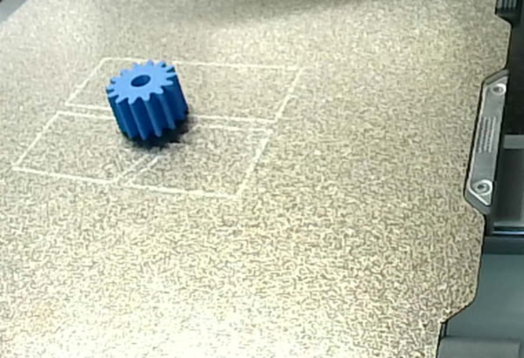
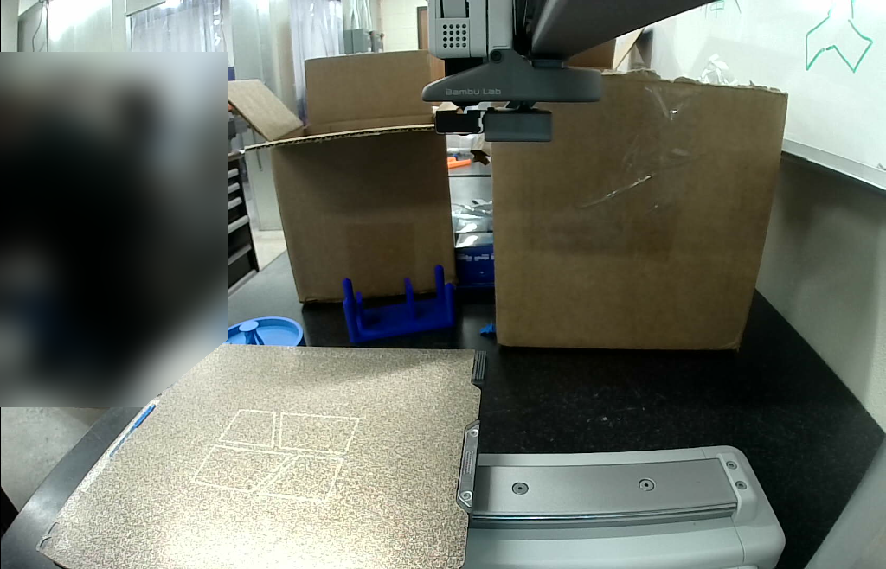
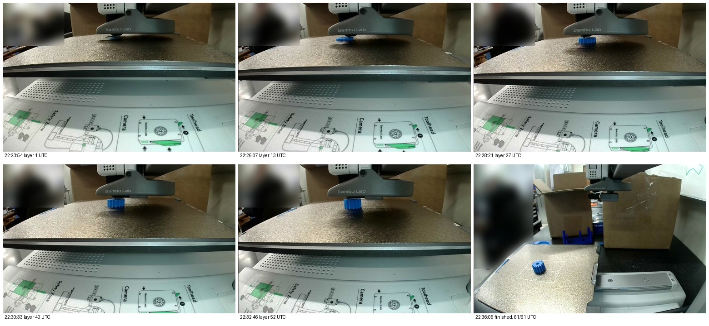
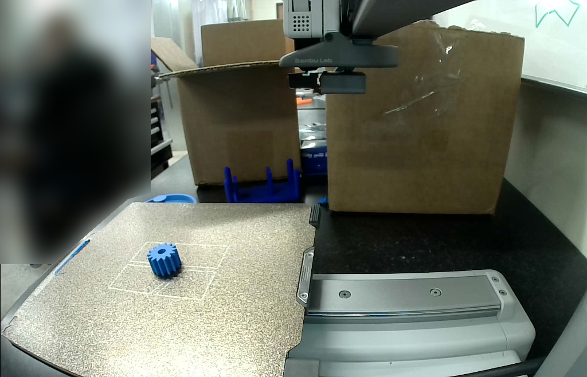

# One servo pinion on an A1 mini, *Tinkerbell* (2026-11-19): sent at 22:17:00 UTC, finished by 22:34:59 UTC

[Brandon at 21:57:02 UTC](https://github.com/vertical-cloud-lab/powder-doser/pull/200#issuecomment-7023330997),
with `@claude-print`: "Print 1 servo pinion as found in issue #193 on any available A1 mini". The run
([44623850888](https://github.com/vertical-cloud-lab/powder-doser/actions/runs/44623850888)) was approved and started at
21:57:40 UTC. Its tracking comment is
[here](https://github.com/vertical-cloud-lab/powder-doser/pull/200#issuecomment-7023351189).

**Outcome:** the pinion printed to the end. At 22:34:59 UTC *Tinkerbell* showed 100 %, layer 61/61, *Finished*, with
the heater targets at 0. There was no HMS alert or dialog, and nobody replied in the thread. It came out **blue**: the
spool on Tinkerbell's external holder is blue PLA. Nobody has checked the part off the plate yet.

## Which A1 mini

The account has three printers: *BYU VCL H2D - Théoden*, *Thumbelina, the A1 Mini* and **Tinkerbell**, which no
earlier record here mentions.
- **Thumbelina was busy.** Studio selected it at login, and it had someone else's job, *Part Studio 2 - AOR tester*,
  downloaded (100 %) and its bed heating to 65 °C. It wasn't touched.
- **Tinkerbell is an A1 mini.** Its Update tab says *Bambu Lab A1 mini*, firmware 01.03.30.01 with 01.08.01.00 on
  offer. Nothing on that tab was clicked, and its serial is in no file here; the recording leaves that stretch out.
  It was idle, and its last job, *Part Studio 2 - AOR_tester* (207 layers, 32.77 g), showed *Finished*.
- **Its filament:** no AMS. The external spool was set by hand to PLA, blue (`#0186D6` on the Device page).

## The first frame, 22:06:02 UTC

- Committed (`ea4ceb9`) and posted at the top of the tracking comment at 22:08:55 UTC, before any export or slicing.
- Idle, nozzle 22 °C and bed 21 °C with 0 targets ([Device page](device-page-tinkerbell-20261119T220602Z.png)).
- Nozzle: **0.4 mm** stainless steel, standard flow ([22:06:56](printer-parts-tinkerbell-20261119T220656Z.png),
  [22:16:21](printer-parts-tinkerbell-20261119T221621Z.png)). HMS: none ([HMS](hms-tinkerbell-20261119T220711Z.png)).
- **Read of the plate: empty.** Mean luma 108/255. The textured PEI plate with its printed logo outline, nothing on it.
  The toolhead is parked high (the gantry, and the camera on it, sat up after the last job's 207 layers, so the view
  looks down from above and shows the bench). The boxes, blue rack and blue dish are on the bench past the plate.
- People in the room are blurred in every committed frame and in the recording. The plate is never blurred.

## The part

#193 links the *Servo Pinion* document without a tab, so the link opens its default tab, **Complete Servo Pinion**.
- **It changed today.** The document was modified at 21:52:17 UTC, 5 minutes before the request. Its feature list
  (*Spur gear*, *Hole 1*, *Hole Extrude*, *Chamfer Hole*, *Chamfer Hole Extrude*, *Chamfer 1*) now has its rollback
  index at 6, the end. On 11-13 it sat after the first feature, so the export was a bare gear with a Ø3.4 mm bore
  ([11-13 record](../2026-11-13-a1mini-doser-parts-gears-flat/README.md)).
- **Exported fresh** at 22:09:23–22:09:25 UTC with the repo's keys: 2 counted calls (a 307, then the file). The element's
  `sourceMicroversion` was `9639e023684ca369c23986d0` before and after
  ([log](stl/onshape-export-20261119.json), [as exported](stl/complete-servo-pinion-as-exported.stl)).
- **It now matches the imported *Servo_pinion*:** 14 teeth, Ø20.8 × 12.3 mm, 2.886 cm³, watertight. Sections along its
  axis give a tapered spline socket (Ø6.88 at the face to Ø5.2 at 1.5 mm), a Ø3.4 mm screw hole, and a Ø6.0 mm
  counterbore over the last 3.6 mm. The imported part's counterbore starts 0.2 mm higher; otherwise the two agree.
- **Orientation:** flat, socket face on the bed and counterbore up (+90° about X), as the 11-13 plate printed its servo
  pinions ([`stl/servo_pinion_14T.stl`](stl/servo_pinion_14T.stl), [`stl/orientation.json`](stl/orientation.json)).

## The plate

File: [`servo_pinion_A1mini_PLA.gcode.3mf`](servo_pinion_A1mini_PLA.gcode.3mf) (`79c8f32`), sliced in Bambu Studio
02.08.02.61 on the runner and exported with *Export plate sliced file*. The account's `DesignerUserId` is blanked; the
plate G-code is untouched.

- **Printer preset:** *Sync info* against Tinkerbell set *Bambu Lab A1 mini 0.4 nozzle* (the Prepare page had started on
  *Bambu Lab A1*), textured PEI plate.
- **Process:** *0.20mm Standard @BBL A1M* with **3 walls** and **25 % infill** (grid), as on 11-13. No supports
  (`enable_support = 0`), auto brim, which gave none (no brim lines in the G-code), no prime tower.
- **Filament:** *Bambu PLA Basic @BBL A1M*, 220 °C nozzle, 65 °C bed.
- **Estimate:** 1058 s (17 min 38 s; 11 min 39 s of model printing), **2.86 g / 0.94 m**, 61 layers to 12.2 mm.
  Plate G-code MD5 `487bd46dabd93baa2d031a1c35684de5`, the same as Studio's own slice.

## The wait and the Send

- **Window:** the frame was posted at 22:08:55; the 90 s ended at 22:10:25. The thread was polled at 22:09:49, 22:12:59,
  22:15:09 and 22:16:55. No comment from anyone after the request, other than the approval notice.
- **22:16:03, second frame** ([frame](tinkerbell-frame-20261119T221603Z.png), [Device page](device-page-tinkerbell-20261119T221603Z.png)):
  plate unchanged and empty (mean absolute difference 3.9/255 over the plate against 22:06:02), printer still idle.
- **22:16:54, Send dialog** ([screenshot](send-dialog-20261119T221654Z.png)): *Tinkerbell*, "Bambu Lab A1 mini 0.4mm",
  PEI plate; PLA → **Ext**; timelapse **off**, auto bed levelling **on**, flow dynamics calibration **on**. Job name
  *servo_pinion_14T*.
- **22:17:00, Send.** By 22:17:40 the Device page showed *servo_pinion_14T*, layer 0/61, *Heatbed preheating*, estimated
  finish 22:34.
- **Same file:** nothing was changed or re-sliced between the export and Send. Studio's copy of the sent 3MF wasn't read
  before its cache was deleted at clean-up.

## Progress

| UTC | |
|---|---|
| 22:17:00 | Send |
| 22:17–22:23 | Heating, bed levelling, flow calibration |
| 22:23:43 | Layer 1 |
| 22:28:21 | Layer 27, 60 % |
| 22:32:46 | Layer 52, 86 % |
| 22:34:26 | Layer 61/61 |
| 22:34:59 | **100 %, *Finished***, nozzle and bed targets 0 |

- While printing, the gantry is low and the camera looks across the plate at the A1 mini's base sticker; after the
  finish it parks high again.
- The watcher ([`watch/monitor.jsonl`](watch/monitor.jsonl), frames in [`watch/`](watch/)) is byu-vcl's
  `watch_studio.py` (49677cf) with a one-minute thread poll added, as on 11-17. It read the Device page by OCR every
  10 s and saved a camera frame every minute. All 17 thread polls found no new comment.
- It stopped at 22:36:05 on an OCR misread ("541" for the cooling nozzle), after the finish. OCR misreads of the bed
  (for example "165" for 65) are left as logged.

## After

One whole 14-tooth gear standing flat in the middle of the plate, counterbore up, with no spaghetti, stringing or
lifted edge ([Device page](device-page-tinkerbell-finished-20261119T223645Z.png)). HMS still empty at 22:37:24
([HMS](hms-tinkerbell-finished-20261119T223724Z.png)). The camera can't show the spline socket underneath.

## Clean-up

- **Signed out** of the Bambu account at 22:37:51 UTC (Home → account menu → *Log out*). Studio was closed without
  saving, and its config (`~/.config/BambuStudio`, which holds the printers' LAN access codes) and slice cache
  (`/tmp/bamboo_model`) were deleted at 22:38:27.
- **Recording.** The screen was recorded from 22:00:43 to 22:38:30 UTC.
  [`recording-cut-20261119.mp4`](recording-cut-20261119.mp4) (3 min 21 s, 1280 × 720) is cut by wall-clock time:
  22:04:20–22:06:20 at 4× (Device page, Thumbelina busy, Tinkerbell, first frame), 22:06:58–22:07:40 at 4× (nozzle,
  HMS), 22:07:40–22:10:50 at 16×, 22:10:50–22:15:45 at 8× (slicing), 22:15:45–22:18:30 at 4× (second frame, Send),
  then the print at 16× to 22:37:20. It leaves out the login (22:03:14–22:04:07), Tinkerbell's Update tab with its
  serial (22:06:34–22:06:49) and the account menu at sign-out. The room on the left of the camera pane, and behind
  the boxes, is blurred. The raw segments were deleted on the runner. There's no YouTube token in a print run, so it
  isn't uploaded.
- **Onshape:** 2 counted API calls (the STL export). The document and feature reads were anonymous.

## Left for a person

- **Take the pinion off Tinkerbell's plate** and check the spline socket underneath against the MG-996R's spline.
- **It's blue.** If it should be black like the 11-13 parts, send the same file to an A1 mini with black PLA loaded
  (Thumbelina had black PLA in A3 on 11-13).
