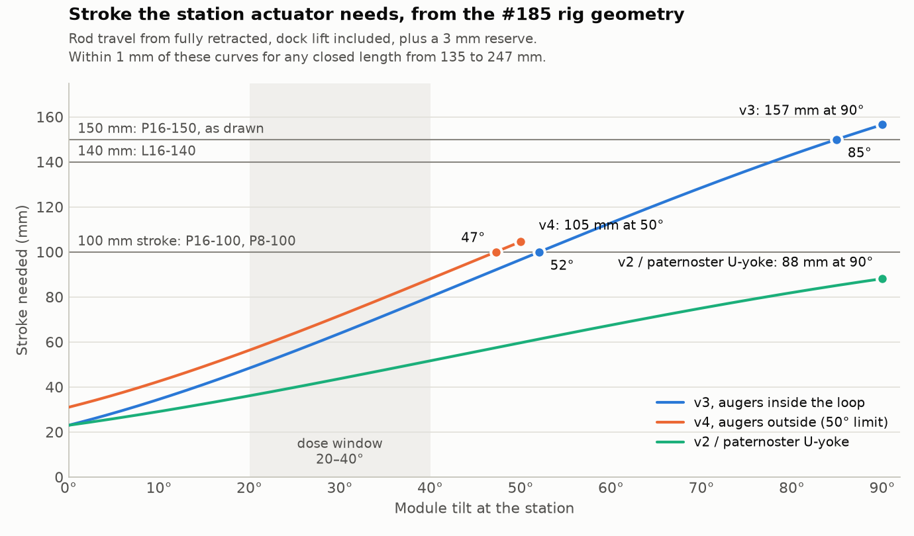

# Linear actuator for the dosing station: parameters and parts

For [#202](https://github.com/vertical-cloud-lab/powder-doser/issues/202). The numbers come from the carousel designs in
[PR #185](https://github.com/vertical-cloud-lab/powder-doser/pull/185) (branch `claude/issue-128-20261013-2050` at
[`a94824f`](https://github.com/vertical-cloud-lab/powder-doser/tree/a94824f)): its CAD parameters, rig scripts and
MuJoCo station runs. Vendor specs, prices and stock were read on the makers' own datasheets and product pages on
2026-11-03. Prices drift, so treat the links as the source of truth.

## Recommendation

Order the part the designs are already drawn around:

| Qty | Part | Price | Stock (2026-11-03) |
|---|---|---|---|
| 1 | [Actuonix P16-150-22-12-P](https://www.actuonix.com/p16-150-22-12-p): 150 mm stroke, pot feedback, 22:1 | $90.00 | 82 |
| 1 | [Actuonix LAC control board](https://www.actuonix.com/lac) | $30.00 | 166 |
| 1 | [Actuonix 12 V, 2 A supply](https://www.actuonix.com/dcpowersupply) (choose 12 V) | $10.00 | 149 |
| 1 | [LAC case](https://www.actuonix.com/case) (optional) | $12.00 | 171 |
| 1 | [USB Mini-B cable](https://www.actuonix.com/usb-mini-b) for the LAC's USB setup and readback | $4.00 | 79 |
| | **Total** before shipping and import duty | **$146.00** | |

- The P16-150-22-12-P meets every parameter below.
- v2, v3, v4 and the paternoster all use it, with Actuonix's own STEP in the CAD (`cad/vendor/actuonix.py` on the
  #185 branch). Their clevises, pins, frame height and MuJoCo runs are all sized for it.
- **Optional:** add a [P16-150-64-12-P](https://www.actuonix.com/p16-150-64-12-p) ($90, 92 in stock). It has the same
  body, ends and stroke, so it swaps in with no CAD change. It is slower (18 mm/s) but has 90 N and 200 N back-drive
  instead of 50 N and 75 N. Testing both on the bench (T6 in the v3/v4 test plans) answers the speed-versus-holding
  question with real parts.
- **Checked against ac-dev-lab (2026-11-04):** this is the order Sterling placed for the SEM door opener, with a P16
  in place of the L16 and a USB cable added. Nothing in the order list changes. Three things around it do: v4 needs a
  stroke limit, the rig scripts need Raspberry Pi OS bookworm, and ac-dev-lab already has working position-readback
  code. See [Checked against ac-dev-lab](#checked-against-ac-dev-lab).

## Checked against ac-dev-lab

Sterling asked for the pick to be checked against his Actuonix work in
[AccelerationConsortium/ac-dev-lab](https://github.com/AccelerationConsortium/ac-dev-lab) (read at `ffbbb01`). That
work is the SEM door opener ([#132](https://github.com/AccelerationConsortium/ac-dev-lab/issues/132),
[#455](https://github.com/AccelerationConsortium/ac-dev-lab/issues/455)), the position-feedback issue
([#148](https://github.com/AccelerationConsortium/ac-dev-lab/issues/148)), the tensile tester
([#140](https://github.com/AccelerationConsortium/ac-dev-lab/issues/140),
[#351](https://github.com/AccelerationConsortium/ac-dev-lab/issues/351),
[#352](https://github.com/AccelerationConsortium/ac-dev-lab/issues/352),
[#353](https://github.com/AccelerationConsortium/ac-dev-lab/issues/353)) and the digital pipette's
[firmware](https://github.com/AccelerationConsortium/ac-dev-lab/blob/ffbbb01/src/ac_training_lab/picow/digital-pipette/main.py).
Two repos linked from those issues were read too: Yang Cao's
[`actuonix_lac`](https://github.com/cyrilcaoyang/actuonix_lac/tree/122a034) and Kelvin Chow's
[feedback demo](https://github.com/kelvinchow23/actuonix-actuator-feedback-demo/tree/b019148). Issue numbers in this
section are ac-dev-lab's, except #185 (this repo's carousel PR).

**The order list matches what Sterling bought for the SEM door.** On 2025-09-05 he ordered an
[L16-140-35-12-P](https://www.actuonix.com/l16-140-35-12-p), an LAC, an LAC case and the Actuonix 12 V supply, all
from Actuonix direct ([#132](https://github.com/AccelerationConsortium/ac-dev-lab/issues/132#issuecomment-3258858134)).
Kelvin's demo BOM uses the same LAC and supply with an L16-100-150-12-P. The list above swaps in the P16 and adds the
USB cable.

| | ac-dev-lab | This pick | Result |
|---|---|---|---|
| Actuator | Actuonix `-P` (pot feedback), 12 V: L16-140-35-12-P (SEM door), L16-100-150-12-P (feedback demo), T16-P (tensile tester). The pipette's L16-R has its own controller and no readback | P16-150-22-12-P | Same family, connector and controller. The P16 is the pick because the CAD is drawn round it, and it holds 75 N with power off (the L16-140-35 holds 31 N) |
| Controller, supply, case, vendor | LAC, Actuonix 12 V supply, LAC case, bought from Actuonix | Same | Same |
| Max force | 50 N. "Probably best to use the lower force actuator" ([#132](https://github.com/AccelerationConsortium/ac-dev-lab/issues/132#issuecomment-2785084743)); 64:1 is "safer" ([#140](https://github.com/AccelerationConsortium/ac-dev-lab/issues/140#issuecomment-3028308541)), and the 256:1's 300 N is a pinch hazard, which he put at about 150 N ([#140](https://github.com/AccelerationConsortium/ac-dev-lab/issues/140#issuecomment-2609740937)) | 50 N; 100 N or less preferred | Agrees |
| Stroke | 140 mm, picked just under the door's 170 mm travel "as a built-in safety" ([#132](https://github.com/AccelerationConsortium/ac-dev-lab/issues/132#issuecomment-3114727668)) | 150 mm | Agrees for v3; v4 needs a limit (point 2) |
| Drive | RC pulses from a Pi Zero 2 W's GPIO 18 through pigpio ([#455](https://github.com/AccelerationConsortium/ac-dev-lab/issues/455#issuecomment-3335230218)). The Pi's 3.3 V pulses work, though the LAC datasheet describes 5 V ones | The same, in the #185 rig scripts | Same, so it has the same OS problem (point 3) |
| Position readback | SEM door: none (fixed waits). Tensile tester: pot wiper into an ADS1115. Feedback demo: a Pico's ADC. Yang: over USB | Wanted, not wired yet | Working code exists for each route (point 4) |
| Speed | The 32 mm/s door move was slowed to 25% by stepping the RC pulse ([#455](https://github.com/AccelerationConsortium/ac-dev-lab/issues/455#issuecomment-3386546161)); Sterling then suggested slowing it about 3x more ([#132](https://github.com/AccelerationConsortium/ac-dev-lab/issues/132#issuecomment-3677049372)) | 46 mm/s, slowed on the LAC | Use the LAC's speed setting, not stepped pulses (point 4) |

**What changes:**

1. **The order list stays the same, but check that the part number ends in `-P`.** Sterling mixed up R and P while
   planning the SEM door
   ([#132](https://github.com/AccelerationConsortium/ac-dev-lab/issues/132#issuecomment-3258858134)). The P16 comes
   only as `-P` or `-S`, and its datasheet says the `-S` can't run on the LAC.
2. **v4 needs a stroke limit.** Sterling's rule from the SEM door is that the stroke should end just short of the
   mechanism's travel.
   - **v3 meets it.** The P16-150 tops out at 87°, before the 90° hinge stop.
   - **v4 doesn't.** The module's cap reaches the top run at about 55° (110 mm of rod), and the P16-150 has 40 mm of
     stroke beyond that. The v4 rig script refuses tilts over 50°, but only in software: `actuator()` itself stops
     at 150 mm.
   - **Fix for v4:** set the LAC's extend limit to about 700 counts (102.5 mm: 50° plus the 1 mm slot push). Either
     use the extend-limit pot (the one further from the USB socket, then power-cycle), or set it over USB and save it
     to EEPROM with `DISABLE_MANUAL`. Check it on the bench in T5.
   - **Hardware alternative:** a [P16-100-22-12-P](https://www.actuonix.com/p16-100-22-12-p) tops out at 49° in v4, so
     it can't reach the top run. The frame then has to drop 50 mm.
   - The angles and counts come from [`stroke_vs_tilt.py`](stroke_vs_tilt.py) (`full_stroke_tilt_*` and `v4_limit`
     in [`stroke_vs_tilt.json`](stroke_vs_tilt.json)).
3. **The rig scripts need Raspberry Pi OS bookworm.**
   - Raspberry Pi's trixie package archive has no `pigpio` or `pigpiod` package; bookworm's has both (arm64 and
     armhf lists checked 2026-11-04). Debian's own archive has only the client side (`python3-pigpio`, `pigpio-tools`),
     not the daemon. Imager's default is now trixie.
   - The SEM rig hit this on its Pi Zero 2 W ("doesn't let me enable pigpio",
     [#455](https://github.com/AccelerationConsortium/ac-dev-lab/issues/455#issuecomment-3564053746)) and fell back
     to `RPi.GPIO` software PWM.
   - The #185 scripts need `pigpiod` for the LAC pulses, the CL86T step waves, the auger's hardware PWM and the
     sensor callbacks.
   - Flash the station Pi with **Raspberry Pi OS (Legacy) Lite**, which is bookworm, or port the scripts off pigpio.
4. **Reading the position back: ac-dev-lab has two working routes.**
   - **USB.** Yang's [`actuonix_lac`](https://github.com/cyrilcaoyang/actuonix_lac/blob/122a034/src/pylac.py) (MIT,
     pyusb) wraps the LAC's USB commands: `set_position`, `get_feedback`, `set_speed`, the limits and
     `disable_manual`. Its README covers an L16-P and Windows setup, and confirms the USB ID `04d8:fc5f`. Sterling
     relayed that Yang thought it could run on Linux or Raspberry Pi OS "with some tweaking"
     ([#455](https://github.com/AccelerationConsortium/ac-dev-lab/issues/455#issuecomment-3312499186)). No one has
     tried that yet. All-USB control also takes pigpio out of the actuator's path. It lets the rig set a slow speed
     for the dock and a faster one for the tilt, which RC can't do without stepping the pulses.
   - **ADC.** The pot's wiper is on the LAC's X4 pin 2: 0-3.3 V, measured against pins 1 and 5. Kelvin read it with
     a Pico's ADC ([#148](https://github.com/AccelerationConsortium/ac-dev-lab/issues/148#issuecomment-2669931151)).
     Chance read it with an ADS1115 on a Pi Zero 2 W
     ([#353](https://github.com/AccelerationConsortium/ac-dev-lab/issues/353#issuecomment-3084437608)) while the Pi
     drove the LAC from GPIO 18.
   - **Use one route per power-up.** The LAC locks onto the first valid input it sees after power-up and ignores the
     others until the next power cycle (LAC datasheet). A USB `SET_POSITION` disables RC until a reboot (advanced
     configuration guide). Neither document covers driving by RC while reading over USB, and nobody has tried it.
5. **Measure move times instead of trusting fixed waits.** On Yang's bench, an L16-P at full LAC speed moved about
   30 mm/s mid-sweep. But it took 6.3 s to retract 97 mm and 10.2 s to extend it, because the LAC slows near the
   target ([README](https://github.com/cyrilcaoyang/actuonix_lac/blob/122a034/README.md)). The #185 rig waits the
   move ÷ 30 mm/s + 0.3 s, which is 3.5 s for that move. Time the real moves in T6, or poll the position.
6. **The bundled screws are #8-32, not M4.**
   - The P16 and L16 datasheets both say each actuator ships with two brackets and #8-32 hardware. That fits the SEM
     build, whose bundled screws were too big for M4 inserts
     ([#132](https://github.com/AccelerationConsortium/ac-dev-lab/issues/132#issuecomment-3307783859)).
   - The v3/v4 BOMs already pin both ends with 4 mm shoulder screws (item 43), so nothing changes. Just don't swap
     the bundled screws in.
7. **Power the LAC from its 12 V supply, even for USB setup.** It wouldn't connect over USB alone
   ([#148](https://github.com/AccelerationConsortium/ac-dev-lab/issues/148#issuecomment-2588703099)). The SEM wiring
   powers the LAC first, then the Pi, with the grounds tied together and no 12 V on the Pi
   ([#455](https://github.com/AccelerationConsortium/ac-dev-lab/issues/455#issuecomment-3335230218)).

## What the actuator does

There is one actuator at the station on the bottom run, pinned at both ends (a two-force member). In v3 and v4 it:

1. lifts the electronics carriage (EC) out of its guide cradle and docks it under the module's plate (20 mm in v3,
   28 mm in v4);
2. keeps pushing, so that module and EC tilt together about the hinge to the dose angle (30° by default; the window is
   20-40°; v3 goes to 90°, v4 to 50°);
3. holds still while the auger turns and the solenoid taps;
4. tilts back, then pulls the EC off its seat magnets and parks it.

## Parameters

| Parameter | Target | Why |
|---|---|---|
| Type | Brushed-DC lead-screw **rod** actuator with **absolute position feedback** (potentiometer) and a clevis eye at each end | Sterling asked for an Actuonix with position feedback (#185). Every design pins it at both ends. A pot needs no homing after a power cut |
| Stroke | **At least 100 mm** for the 20-40° window. **150 mm** keeps each design's full range | With 3 mm in reserve: v3 needs 64 mm at 30°, 80 at 40°, 97 at 50° and 157 at 90°. v4 needs 72 at 30° and 105 at its 50° limit. 100 mm reaches 52° in v3 and 47° in v4. 150 mm reaches 85° in v3 and all 50° in v4 (plot below) |
| Closed length (hole to hole) | **About 200 mm or less** | The frame was raised so the P16-150 (197.4 mm) stands under the hinge (the `Z_RUN` note in v3/v4 `params.py`). Every mm longer raises the hinge by a mm; shorter lets the frame drop. The stroke needed hardly depends on the closed length (within 0.7 mm from 135 to 247 mm) |
| Max force | **40-50 N or more**; **100 N or less** preferred | MuJoCo: 9.2 N peak over v3's dock-tilt-dose-undock cycle, 19.3 N transient in the paternoster, 3.2 N to hold 30° with an empty module. When the EC toppled in v3 as drawn, the P16 was driven to its 50 N limit, so extra force mostly goes into printed parts during a jam |
| Continuous force (peak-efficiency point) | **20 N or more** | Covers the 19.3 N transient. It also covers pulling the EC off stronger seat magnets: about 13-14 N if each seat ball gets the 8 N that v3's simulation proposes. That is my estimate: 2 × 8 N, plus 0.8 N at ball C, less the EC's 3 N weight |
| Back-drive (holds with power off) | **30 N or more** | Three times the 10 N steady load, so the tilt holds through taps and the motor can sit idle while the balance settles, with no controller dither |
| Speed | **20-50 mm/s** with no load, adjustable | A 30° dose moves the rod 126 mm (v3) or 141 mm (v4) in the rig's sequence. At 46 mm/s that is 3-3.5 s. The simulation docked at 18 mm/s, and the LAC's speed setting slows the approach |
| Duty cycle | 20% or more (every candidate is 20%) | At 20%, a 46 mm/s actuator allows a dose every 15-17 s, and an 18 mm/s one every 37-42 s |
| Repeatability | **±0.6 mm or better** | The EC's pin rides in 2 mm lost-motion slots, and 1 mm of rod is 0.63° of tilt near 30° |
| Feedback the Pi can read | yes | The rig scripts drive the LAC open loop with RC pulses and wait a fixed time. Reading the position back confirms the dock and the tilt, and catches a jam |
| Side load | 10 N or more | Pinned at both ends, it swings at most 7° about its base pin in v3/v4, so the side load is pin friction plus its own weight |
| Ingress | IP54 or better (IP65 is better still) | It stands under the dose point, in the powder |
| Supply | 12 V DC, 1 A stall or less | The station already has 12 V for the solenoid and the NEMA 11 driver, and the LAC needs the actuator's rated voltage |
| Envelope | No bigger than the P16's 20 × 36 mm body; vendor STEP available | Its column already stands inside the HR-100A's breeze break, which is why the scale doesn't fit (v3/v4 item 6) |
| Ends | Ø4.25 mm holes, 8 mm rear tab, 6 mm rod-end tab | The base clevis (8.4 mm gap), the EC's clevis and the 4 mm shoulder screws (McMaster 90265A123) are drawn round the P16's ends. Another model means redrawing those parts |
| Cost | $150 or less with its controller, and in stock | |

### Stroke against tilt

- **The stroke depends on where the rod pins to the EC, not on which actuator is used.**
  - In v3/v4 the EC's pin is 95 mm from the hinge, with a moment arm of 91 mm at 30°.
  - v2's and the paternoster's U-yoke pin was 46 mm out, with a 45 mm arm. There, 90° took only 88 mm of stroke, but
    each N·m of moment took twice the force.
- A future station that moves the pin is trading stroke for force in that ratio.
- [`stroke_vs_tilt.py`](stroke_vs_tilt.py) recomputes the plot and [`stroke_vs_tilt.json`](stroke_vs_tilt.json) from
  the rig scripts' geometry.

## Candidates

All have potentiometer feedback, 12 V, a 20% duty cycle, and $78-90 each. Reach is the furthest tilt with 3 mm kept
back. Dose spacing is the shortest time between 30° doses at the 20% duty limit, at the speed under 10 N.

| Part | Stroke / closed | Max force / back-drive | Speed, no load | Side load | Body | Reach v3 / v4 | Dose spacing v3 / v4 | Price, stock | Verdict |
|---|---|---|---|---|---|---|---|---|---|
| [Actuonix P16-150-22-12-P](https://www.actuonix.com/p16-150-22-12-p) | 150 / 197 mm | 50 / 75 N | 46 mm/s | 10 N | 20 × 36 mm, IP54, 125 g | 85° / 50° | 15 / 17 s | $90, 82 | **Order this** (as drawn) |
| [Actuonix P16-150-64-12-P](https://www.actuonix.com/p16-150-64-12-p) | 150 / 197 mm | 90 / 200 N | 18 mm/s | 10 N | same | 85° / 50° | 37 / 42 s | $90, 92 | Drop-in if holding or magnet pull-off needs more |
| [Actuonix P16-100-22-12-P](https://www.actuonix.com/p16-100-22-12-p) | 100 / 147 mm | 50 / 75 N | 46 mm/s | 15 N | same | 52° / 47° | 15 / 17 s | $90, 78 | If dosing stays at 20-40°: frame 50 mm lower |
| [Actuonix L16-140-63-12-P](https://www.actuonix.com/l16-140-63-12-p) | 140 / 208 mm | 100 / 46 N | 20 mm/s | 20 N | 18 × 20 mm, IP54, 84 g | 78° / 50° | 34 / 38 s | $80, 118 | Slimmest at full stroke; frame 11 mm higher; ends redrawn |
| [Actuonix L16-140-35-12-P](https://www.actuonix.com/l16-140-35-12-p) | 140 / 208 mm | 50 / 31 N | 32 mm/s | 20 N | same | 78° / 50° | 22 / 25 s | $80, 142 | Same, faster; back-drive only just meets 30 N |
| [Actuonix P8-100-165-12-P](https://www.actuonix.com/p8-100-165-12-p) | 100 / 135 mm | 110 / 40 N | 9.2 mm/s | 2 N | 11 × 25 mm, IP54, 41 g | 52° / 47° | 73 / 82 s | $85, 103 | Actuonix's smallest, but slow, and only 2 N side load |
| [Progressive Automations PA-MC1-6-8-POT-12VDC](https://www.progressiveautomations.com/products/ip65-micro-linear-actuator-potentiometer) (choose 12 VDC / 6 inch / 8 lbs) | 152 / 223 mm | 35 / 20 N (static) | 48 mm/s | not given | 18 × 20 mm, **IP65** | 86° / 50° | 15 / 17 s | $77.99, in stock | Non-Actuonix option; dust-tight, but frame 26 mm higher and 20 N holding |

Datasheets: [P16](https://www.actuonix.com/assets/images/datasheets/ActuonixP16Datasheet.pdf) (rev B),
[L16](https://www.actuonix.com/assets/images/datasheets/ActuonixL16Datasheet.pdf) (rev E),
[P8](https://www.actuonix.com/assets/images/datasheets/Actuonix%20P8%20Datasheet.pdf),
[PA-MC1](https://7717445.fs1.hubspotusercontent-na1.net/hubfs/7717445/PDF%20Manuals/Actuator%20datasheets/PA-MC1-POT%20Datasheet.pdf).
The P16 sheet is byte-identical (sha256 `070deb5f…`) to the copy #185 pinned in `cad/vendor/manifest_actuonix.json`.

**Considered and not recommended:**
- [Actuonix S20-100-38-B](https://www.actuonix.com/s20-100-38-b) stepper ($80): 13 N maximum on its product page, and
  its [datasheet](https://actuonix-com.3dcartstores.com/assets/images/datasheets/ActuonixS20-38MMDatasheet.pdf) advises
  running at 50-75% of that. That is under the 19 N peak, and it has no position feedback.
- [Actuonix T16-P](https://www.actuonix.com/t16) track actuators: their datasheet lists no ingress protection, and a
  sliding carriage doesn't fit the pinned two-force mount.
- P16-200 (4 N side load, 247 mm closed). P8-100-50 (10 N back-drive, about the holding load). The 150:1 and 256:1
  gearings (5-8 mm/s, and 200-300 N into printed parts on a jam).
- Pololu Glideforce LACT4P and Progressive Automations PA-14P: 150-670 N class, far larger than needed, $145-195.

## Controller

- **[Actuonix LAC](https://www.actuonix.com/lac) ($30)** closes the loop on the pot. It takes RC, PWM, 0-3.3 V, 4-20 mA
  or USB input, and has stall detection and soft stroke limits.
  - The #185 rig scripts already drive it with RC pulses from GPIO 18 through pigpio, as ac-dev-lab's SEM door does.
    pigpio needs Raspberry Pi OS bookworm ([point 3](#checked-against-ac-dev-lab)).
  - In RC mode the Pi never reads the position. To read it, either drive the LAC over USB (`SET_POSITION` returns the
    current position, `GET_FEEDBACK` is `0x10`), in the 3-byte protocol of the
    [advanced configuration guide](https://www.actuonix.com/assets/images/datasheets/ActuonixLACAdvancedConfigurationDatasheet.pdf),
    or read the pot's wiper on X4 pin 2 with an ADC. ac-dev-lab has working code for both ([point 4](#checked-against-ac-dev-lab)).
  - Actuonix ships a Windows DLL for USB. ac-dev-lab uses Yang Cao's pyusb package
    [`actuonix_lac`](https://github.com/cyrilcaoyang/actuonix_lac/tree/122a034) instead (USB ID `04d8:fc5f`). It is
    untested on Linux.
  - Set the limits 1-2 mm short of the end stops, as Actuonix advises, and keep the stall time short so a jam stops
    the motor. In v4, set the extend limit at 50° (about 700 counts), short of where the cap hits the top run.
- **Alternative: [Pololu Jrk G2 21v3](https://www.pololu.com/product/3142) ($54.95).** It reads the same pot as 0-5 V
  feedback, talks USB, TTL serial or I²C with Linux-supported tools, and reports position and current, with software
  current limiting.

## Where to buy

- **Actuonix direct** (prices above): ships from Canada by DHL. Its shipping page says US duties and tariffs are not
  included, and points to US Customs for China-origin products.
- **DigiKey Marketplace** (shipped by Actuonix): [P16-150-22-12-P](https://www.digikey.com/en/products/result?keywords=P16-150-22-12-P)
  2495-P16-150-22-12-P-ND at $100 (48 in stock), P16-150-64-12-P at $100 (50), LAC 2495-LAC-ND at $50 (47).
- **RobotShop US:** [P16-150-22-12-P](https://www.robotshop.com/products/actuonix-p16-p-linear-actuator-150mm-221-12v-w-potentiometer-feedback)
  at $113.21 (backorder), [LAC](https://www.robotshop.com/products/actuonix-linear-actuator-control-board) at $34.80.

## Caveats

- **The force and holding targets come from simulations.** Nothing at the station has been built (see #185's test
  plans).
- **The 13-14 N pull-off is my estimate** for the proposed stronger seat magnets. It isn't a simulated number.
- **None of these actuators fixes the scale fit by itself.** The EC's column has to move out of the breeze break
  (v3/v4 item 6).
- **Any model other than the P16 needs its own STEP** in `cad/vendor/` and redrawn clevises.
- **Not checked for the PA-MC1:** compatibility with the LAC (on paper, the LAC takes 12 V third-party actuators with
  pot feedback), its side load and its repeatability.
- **The ac-dev-lab comparison is from its issues, code and linked repos.** Nothing from it was run here. The pigpio
  finding comes from Raspberry Pi's package lists, not from a Pi.
