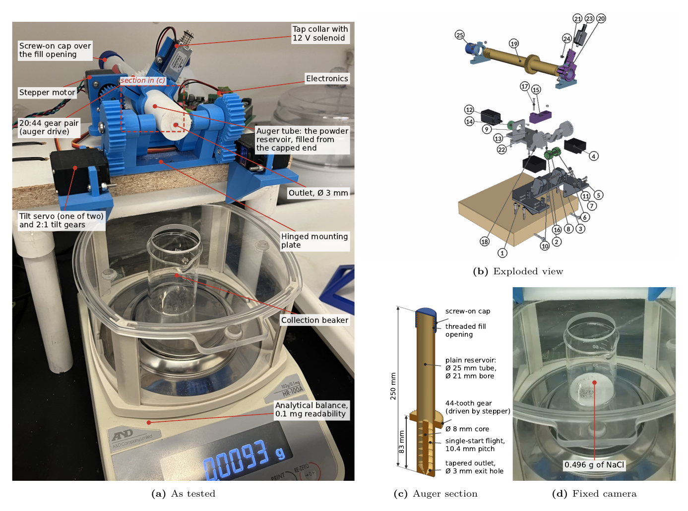
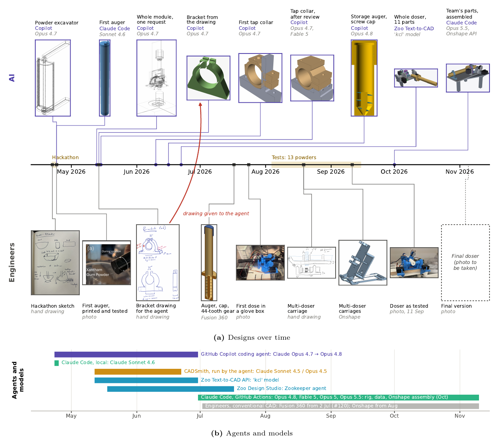
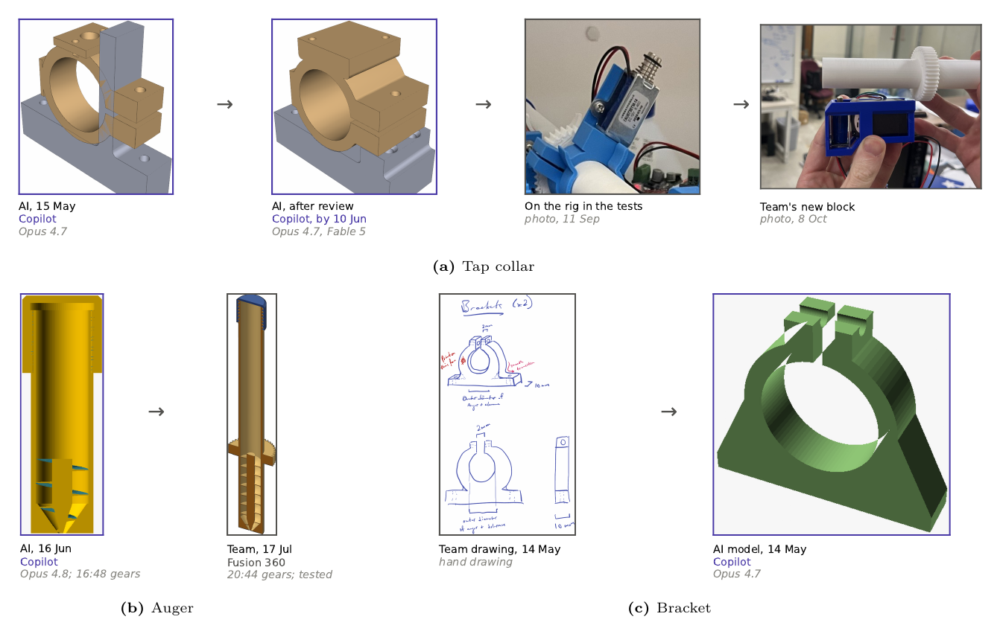
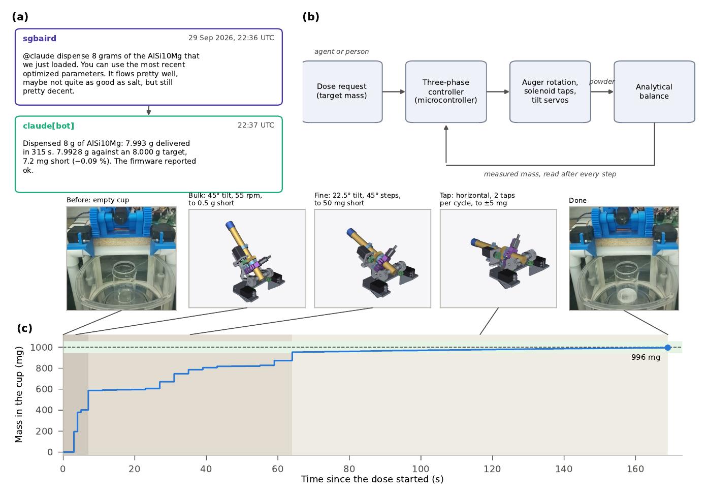
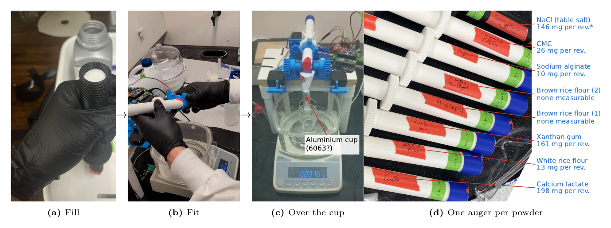
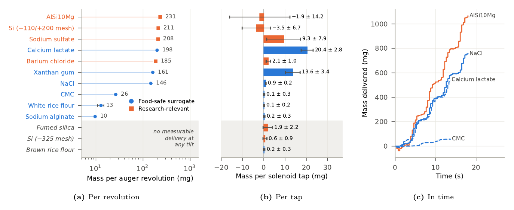
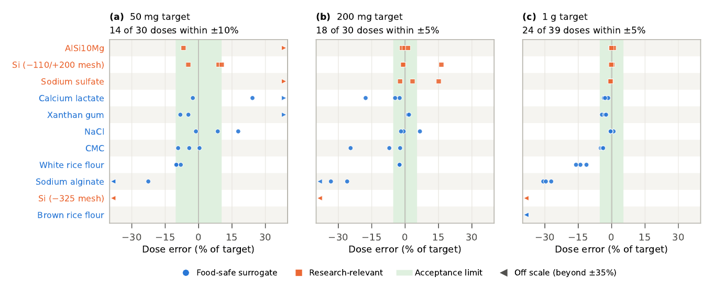
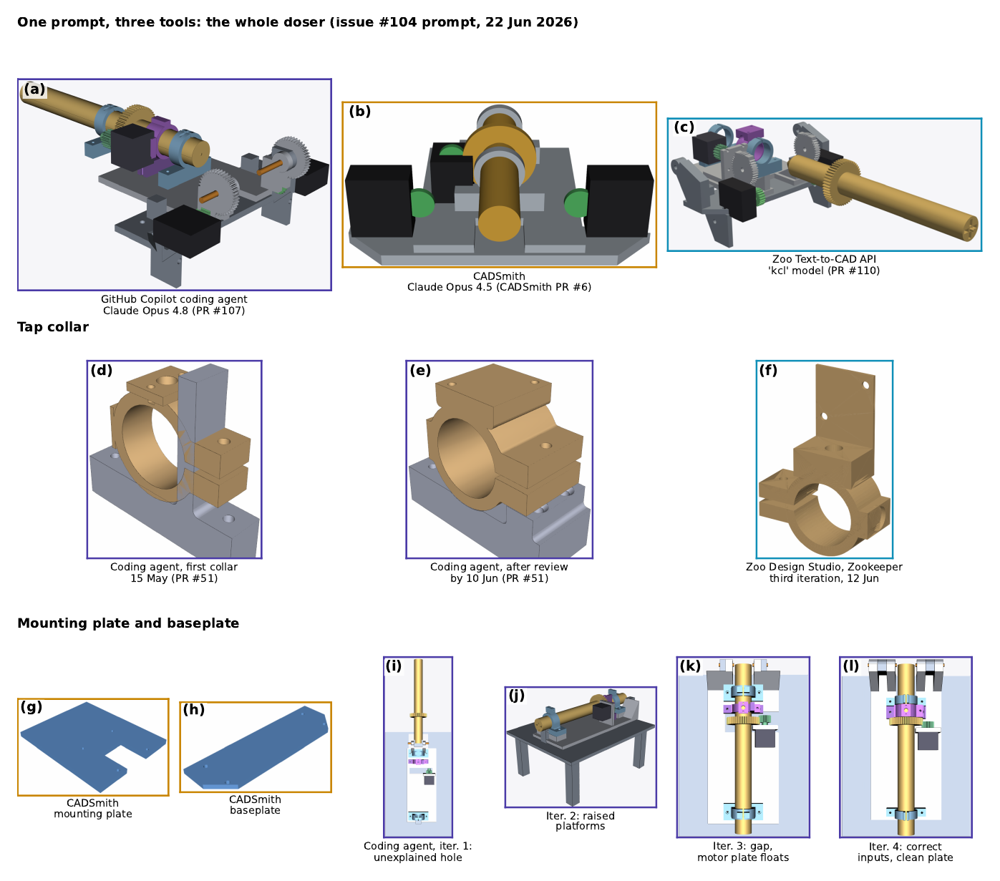
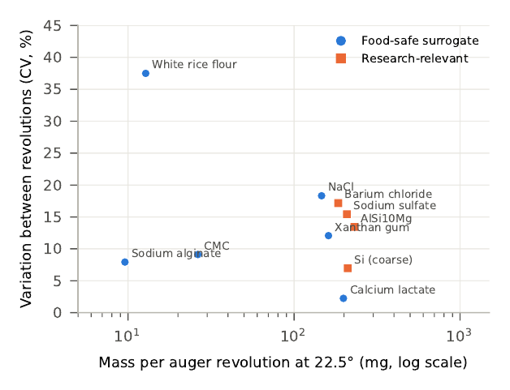
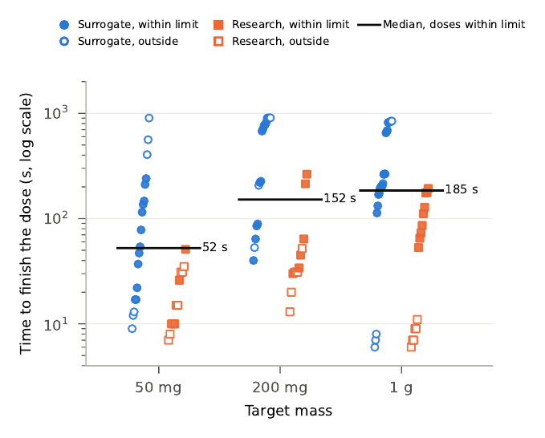

# Figures and tables for review (v2)

Every figure is shown with its full draft caption as text underneath (review of 11 Nov, [`../review_2026-11-11/NOTES.md`](../review_2026-11-11/NOTES.md)). The images are rendered from [`figures.tex`](figures.tex), which assembles the panels as LaTeX subfigures; [`figures.pdf`](figures.pdf) is the compiled version with captions and tables. Title and abstract: [`TITLE-ABSTRACT.md`](TITLE-ABSTRACT.md). How each item maps to the whiteboard and the meetings: [`README.md`](README.md).

## Main text

### Fig. 1 The doser

**Fig. 1 The doser.** One printed auger tube is both the powder reservoir and the dosing screw; the doser turns, tilts and taps it over a cup on an analytical balance. (a) The doser as tested in the second round (photographed 11 Sep 2026), with its parts labelled; the dashed box marks the part drawn in section in (c). (b) Exploded view of the current design, assembled in CAD from the team's parts ([#170](https://github.com/vertical-cloud-lab/powder-doser/issues/170)); the numbers refer to the bill of materials in the SI. (c) Section through the tested auger and its screw-on cap, the team's Fusion 360 part: the flight fills only the outlet end, and the 44-tooth gear is on the outside of the tube. (d) The fixed livestream camera's view of the cup after a 0.5 g NaCl dose (15 Sep 2026; 0.496 g delivered; [#116](https://github.com/vertical-cloud-lab/powder-doser/issues/116)).

### Fig. 2 AI agents and engineers, April to November 2026

**Fig. 2 AI agents and engineers, April to November 2026.** AI agents modelled the first parts from text and drawings; from July the engineers redrew in conventional CAD the parts that were built and tested, and the agents moved on to running the tests and assembling the CAD. (a) Key designs on one date axis, each joined to its date. Above the axis are the designs modelled by AI agents, with the agent (purple) and model (grey) under each: the powder excavator ([#2](https://github.com/vertical-cloud-lab/powder-doser/issues/2)) and the first auger ([#16](https://github.com/vertical-cloud-lab/powder-doser/issues/16)), from the hackathon; the whole module from a single request ([#35](https://github.com/vertical-cloud-lab/powder-doser/issues/35)); the bracket the agent modelled from the team's dimensioned drawing ([#46](https://github.com/vertical-cloud-lab/powder-doser/issues/46), [#47](https://github.com/vertical-cloud-lab/powder-doser/issues/47); red arrow); the first tap collar and the collar after review ([#51](https://github.com/vertical-cloud-lab/powder-doser/issues/51)); the storage auger with its screw cap ([#49](https://github.com/vertical-cloud-lab/powder-doser/issues/49)); all 11 parts from one prompt through the Zoo Text-to-CAD API ([#104](https://github.com/vertical-cloud-lab/powder-doser/issues/104), [#110](https://github.com/vertical-cloud-lab/powder-doser/issues/110)); and the team's parts assembled through the Onshape API ([#170](https://github.com/vertical-cloud-lab/powder-doser/issues/170)). Below the axis is the engineers' work: the hackathon sketch ([#2](https://github.com/vertical-cloud-lab/powder-doser/issues/2)), the first printed auger, the bracket drawing ([#46](https://github.com/vertical-cloud-lab/powder-doser/issues/46)), the Fusion 360 auger, cap and 44-tooth gear that turned in every test ([#120](https://github.com/vertical-cloud-lab/powder-doser/issues/120)), the first dose in a glove box ([#117](https://github.com/vertical-cloud-lab/powder-doser/issues/117)), the multi-doser carriage sketch and Onshape model ([#128](https://github.com/vertical-cloud-lab/powder-doser/issues/128)), and the doser as tested ([#156](https://github.com/vertical-cloud-lab/powder-doser/issues/156)). The hackathon (22–24 Apr) and the 13-powder test campaign (4 Aug–15 Sep) are shaded on the axis. (b) When each agent and model was in use, on the same date axis.

### Fig. 3 The original AI parts and what replaced them

**Fig. 3 The original AI parts and what replaced them.** Every AI-modelled part was reviewed, printed and tested, but the tested doser ran on later versions: the agent revised the tap collar and the team then rebuilt it, and the team redrew the agent's auger in Fusion 360. AI parts have purple frames, the team's grey. (a) Tap collar: the first AI collar (15 May) and the collar after review ([#51](https://github.com/vertical-cloud-lab/powder-doser/issues/51), by 10 Jun), the collar on the rig during the tests (11 Sep, [#156](https://github.com/vertical-cloud-lab/powder-doser/issues/156)), and the team's new block (8 Oct, [#128](https://github.com/vertical-cloud-lab/powder-doser/issues/128)). (b) Auger: the AI storage auger with 16:48 gears (16 Jun, [#49](https://github.com/vertical-cloud-lab/powder-doser/issues/49)) and the team's Fusion 360 recreation with 20:44 gears (17 Jul, [#120](https://github.com/vertical-cloud-lab/powder-doser/issues/120)), which turned in every test. (c) Bracket, the other direction: the team's dimensioned drawing ([#46](https://github.com/vertical-cloud-lab/powder-doser/issues/46)) and the agent's model of it ([#47](https://github.com/vertical-cloud-lab/powder-doser/issues/47)), both 14 May.

### Fig. 4 How a dose runs

**Fig. 4 How a dose runs.** A person asks the AI agent for a dose in a GitHub comment; a three-phase controller on the doser's microcontroller then turns, tilts and taps the auger until the balance reads the target. (a) A request and the agent's reply (8 g of AlSi10Mg for an atomizer charge, [#166](https://github.com/vertical-cloud-lab/powder-doser/issues/166), 29 Sep 2026). (b) The control loop: the balance is read after every step, and the controller acts on the mass still to go. (c) One 1 g NaCl dose from the test campaign (12 Aug 2026), with its three phases shaded: bulk, fine and tap. Above the trace are the tube positions in each phase (CAD renders of the current design at 45°, 22.5° and 0°) and the fixed camera's stills before and after a 0.5 g salt dose (15 Sep 2026). The green band is the ±5% acceptance limit. One image rather than subfigures: the lines join the stills to the trace.

### Fig. 5 Using the doser

**Fig. 5 Using the doser.** Each powder has its own auger, filled once and stored loaded, so changing powder means swapping a tube. (a) Filling an auger with salt through its open end, then capping it (29 Jul 2026). (b) Fitting a filled auger to the doser, and (c) the doser ready over the cup, frames from the 30 Sep 2026 dose video: the powder falls through a paper funnel into an aluminium cup that stands in the glass beaker. (d) Eight of the labelled augers, with each label and the mass one auger revolution delivered (\*at 22.5° tilt; Fig. 6a).

### Fig. 6 Open-loop delivery of 13 powders under one fixed set of settings

**Fig. 6 Open-loop delivery of 13 powders under one fixed set of settings.** Ten powders moved, from 10 to 231 mg per auger revolution, and three delivered nothing measurable; one solenoid tap released up to 20 mg, but for the fastest powders a single tap was unpredictable. (a) Mass per auger revolution at 22.5° (protocol C; mean ± standard error of six revolutions; log axis). (b) Mass released by one solenoid tap at 22.5° (protocol E): mean ± standard deviation of eight taps, the spread to expect from a single tap. Table S1 gives the standard errors. (c) Mass against time while the auger turned continuously at 15 rpm (protocol D).

### Fig. 7 Closed-loop doses

**Fig. 7 Closed-loop doses.** Doses of 1 g landed within ±5% for every powder that delivered at least 26 mg per revolution; smaller doses missed more often, fast powders tending to overshoot and slow ones to fall short. Error of every valid closed-loop dose from both test rounds, one row per powder, ordered by mass per revolution (fastest at the top). The green band is the acceptance limit: ±10% below 100 mg, ±5% at and above. Times per dose are in Table 3 and SI Fig. S3. One image rather than subfigures: the three panels share the powder axis.

## Tables

### Table 1 The 13 powders

Mass per auger revolution: protocol C mean at 22.5° (Fig. 6a). Closed-loop columns: valid doses within the acceptance limit (±10% at 50 mg, ±5% at 200 mg and 1 g) out of the number run (Fig. 7); a dash means not run. Silicon grades by sieve size: −325 mesh passes a 44 µm sieve; −110/+200 mesh lies between about 75 and 150 µm.

| Powder | Group | mg per rev. (22.5°) | 50 mg | 200 mg | 1 g | Observed behaviour |
|---|---|---:|:---:|:---:|:---:|---|
| AlSi10Mg (gas-atomized) | Research | 231 | 1/3 | 3/3 | 3/3 | Fastest powder; fluid-like; overshoots small targets |
| Silicon, −110/+200 mesh | Research | 211 | 2/3 | 2/3 | 3/3 | Free-flowing |
| Sodium sulfate | Research | 208 | 0/3 | 2/3 | 3/3 | Free-flowing; overshoots small targets |
| Calcium lactate | Surrogate | 198 | 1/3 | 2/3 | 3/3 | Free-flowing; largest tap increment |
| Barium chloride | Research | 185 | -- | -- | -- | Absorbed moisture and caked in the tube in round 2 |
| Xanthan gum | Surrogate | 161 | 2/3 | 3/3 | 3/3 | Flows under rotation; can clog after bursts |
| Sodium chloride (NaCl) | Surrogate | 146 | 2/3 | 2/3 | 6/6 | Free-flowing baseline (control) |
| Carboxymethyl cellulose (CMC) | Surrogate | 26 | 3/3 | 1/3 | 3/3 | Slow; charges electrostatically |
| White rice flour | Surrogate | 13 | 3/3 | 3/3 | 0/3 | Slow and pulsing; most variable between revolutions |
| Sodium alginate | Surrogate | 10 | 0/3 | 0/3 | 0/3 | Slowest powder that moved |
| Brown rice flour | Surrogate | none | -- | -- | 0/3 | No delivery at any tilt |
| Silicon, −325 mesh | Research | none | 0/3 | 0/3 | 0/6 | No delivery at 0 or 22.5°; one pulse at 45° |
| Fumed silica | Research | none | -- | -- | -- | No delivery; very light and fluffy |

### Table 2 Test protocols

Carried from the draft (`main.tex`).

| Protocol | Varied | Fixed settings | What it measures | Trials |
|---|---|---|---|---|
| A  Balance baseline | Nothing | Tilt 22.5°; eight readings, no actuation | Noise floor of the run, against which every other protocol is read | 8 |
| B  Static hold | Tilt (0, 22.5, 45°) | 15 s hold at each tilt, no actuation | Whether any powder flows on its own (clean shut-off) | 3 |
| C  Rotation | Tilt (0, 22.5, 45°) | Six single revolutions per tilt at 30 rpm, with a settled reading after each | Mass per revolution and its revolution-to-revolution variation | 18 |
| D  Speed sweep | Speed (15, 45, 90 rpm) | Tilt 22.5°; three revolutions commanded per speed; balance streamed every 0.25 s | Delivery rate against speed; mass-against-time traces | 3 |
| E  Tap | Tilt (0, 22.5°) | Eight trials of a one-revolution re-feed followed by one 60 ms solenoid tap | Mass released by a single tap, with the re-feed logged separately | 32 |
| F  Vibration | Tilt (0, 22.5°) | As E, with three vibration bursts in place of the tap | Mass released by vibration (no data: driver fault) | 0 |
| G  Closed-loop, 1 g | Nothing | Three doses of 1.000 g; three-phase controller | Dose error, time, and effort per phase | 3 doses |
| H  Closed-loop, small | Target (50, 200 mg) | Three doses at each target; same controller | Dose error and time at small targets | 6 doses |

### Table 3 Closed-loop doses by target

Protocols G and H, both rounds. Times are given here rather than as a figure panel; SI Fig. S3 shows every dose.

| Target | Limit | Valid doses | Within limit | Powders | Median time, doses within limit (s) | Overshoots among misses |
|---|---|---:|---:|---:|---:|---:|
| 50 mg | ±10% | 30 | 14 | 10 | 52 | 10 of 16 |
| 200 mg | ±5% | 30 | 18 | 10 | 152 | 3 of 12 |
| 1 g | ±5% | 39 | 24 | 11 | 185 | 0 of 15 |

### Table 4 AI tools, dates and models

Condensed from `paper/figures/data/ai_tools_timeline.csv`.

| Tool | What it did here | When | Models |
|---|---|---|---|
| GitHub Copilot coding agent | Modelled the AI-made parts as CadQuery or OpenSCAD code, one pull request per part; rendered views and ran solid and interference checks | 23 Apr – 30 Jun 2026 (CAD) | Claude Opus 4.7, then Opus 4.8 |
| Claude Code, run locally | First Archimedes auger (OpenSCAD) at the hackathon | 23–24 Apr 2026 | Claude Sonnet 4.6 |
| CADSmith (multi-agent text-to-CadQuery), run by the coding agent | Mounting plate and baseplate; whole doser from the issue #104 prompt | May – Jun 2026 | Claude Sonnet 4.5; Opus 4.5 |
| Zoo Text-to-CAD API | KCL parts from text; whole doser (11 parts) from the issue #104 prompt | May – Jun 2026 | Zoo 'kcl' model |
| Zoo Design Studio, Zookeeper agent | Conversational modelling in a live CAD view: the tap collar (three iterations), a servo pinion, multi-doser parts | May – Jul 2026 | Zookeeper (model not recorded) |
| Claude Code, GitHub Actions | Ran the test campaign on the rig, firmware, data analysis, figures; assembled the team's parts through the Onshape API (Oct) | 30 Jun – Nov 2026 | Claude Opus 4.8, Fable 5, Opus 5, Opus 5.5 |
| Edison Scientific | Literature searches and analysis-mode reviews (including mock peer review) | Apr – Oct 2026 | job types only (PaperQA3) |
| Engineers, conventional CAD (not AI) | Recreated the parts that were tested (Fusion 360, #120); multi-doser (Onshape) | From 2 Jul 2026 | -- |

### Table S1 Open-loop delivery per powder

Protocols C and E, round 1, one run per powder. Mass per auger revolution (mean ± standard error of six revolutions) at 0°, 22.5° and 45°; the revolution-to-revolution coefficient of variation (CV) at 22.5°; mass released by one solenoid tap at 22.5° (mean ± standard error of eight taps). Replaces the tilt panel of the earlier draft (old Fig. 4a).

| Powder | Group | 0° | 22.5° | 45° | CV at 22.5° (%) | Per tap at 22.5° (mg) |
|---|---|---:|---:|---:|---:|---:|
| AlSi10Mg (gas-atomized) | Research | 49 ± 7 | 231 ± 13 | 339 ± 6 | 13 | *-1.9 ± 5.0* |
| Silicon, −110/+200 mesh | Research | 57 ± 7 | 211 ± 6 | 302 ± 5 | 7 | *-3.5 ± 2.4* |
| Sodium sulfate | Research | 51 ± 8 | 208 ± 13 | 244 ± 12 | 15 | 9.3 ± 2.8 |
| Calcium lactate | Surrogate | 47 ± 5 | 198 ± 2 | 232 ± 3 | 2 | 20.4 ± 1.0 |
| Barium chloride | Research | 23 ± 4 | 185 ± 13 | 200 ± 31 | 17 | 2.1 ± 0.4 |
| Xanthan gum | Surrogate | 24 ± 2 | 161 ± 8 | 187 ± 3 | 12 | 13.6 ± 1.2 |
| Sodium chloride (NaCl) | Surrogate | 38 ± 4 | 146 ± 11 | 265 ± 13 | 18 | 0.9 ± 0.1 |
| Carboxymethyl cellulose (CMC) | Surrogate | 2.6 ± 0.5 | 26 ± 1 | n.r. | 9 | *0.1 ± 0.1* |
| White rice flour | Surrogate | 3.8 ± 0.3 | 13 ± 2 | 37 ± 7 | 37 | *0.1 ± 0.1* |
| Sodium alginate | Surrogate | 0.8 ± 0.2 | 9.6 ± 0.3 | 11 ± 1 | 8 | 0.2 ± 0.1 |
| Brown rice flour | Surrogate | n.r. | n.r. | n.r. | -- | *0.2 ± 0.1* |
| Silicon, −325 mesh | Research | n.r. | n.r. | n.r. | -- | *0.6 ± 0.3* |
| Fumed silica | Research | n.r. | n.r. | n.r. | -- | *1.9 ± 0.8* † |

n.r.: not resolved (mean not more than twice its standard error). Italic: tap increment within the balance noise of its run. †: fumed silica's only run failed screening.

### Candidate table for the lessons-learned discussion

Carried from the draft's failure-modes table.

| Failure | Example | Caught or prevented by |
|---|---|---|
| Parts that do not fit together | Whole-module prompts; first tap collar; bracket with unconnected plates  | Asking for one part at a time, with interfaces listed |
| Unrequested changes | Fixing one defect altered an unrelated feature | Full re-inspection of rendered views at every iteration |
| Mislabelled variants | Two of four test nozzles swapped relative to their documentation | Human cross-check before printing |
| Sub-millimetre errors | Height mismatch of one print layer | Only the failed print |
| Designing around bad inputs | Out-of-date neighbouring parts led to a hole, platforms, then a gap  | Supplying the correct upstream files |
| No sense of "finished" | Late iterations disturbed features that were already right | The team freezing the geometry |
| Wrong orientation | Solenoid mis-oriented on the tap collar over several coding-agent iterations | Switching the part to Zoo Design Studio |

## Supporting information

### Fig. S1 Generative-CAD comparison

**Fig. S1 Generative-CAD comparison.** Asked for the whole doser at once, every tool returned parts that did not make a working assembly; one part at a time, with review, worked better. (a–c) The same prompt ([#104](https://github.com/vertical-cloud-lab/powder-doser/issues/104), 22 Jun 2026) given to the GitHub Copilot coding agent, CADSmith and the Zoo Text-to-CAD API, each rendered from the same viewpoint. (d–f) The tap collar from the coding agent (first version and after review) and from Zoo Design Studio (third Zookeeper iteration). (g, h) CADSmith's mounting plate and baseplate. (i–l) The coding agent's four mounting-plate iterations: out-of-date input files led to a hole, then platforms, then a gap, until the correct files were supplied. Not yet reviewed; still one image.

### Fig. S2 Variation between revolutions

**Fig. S2 Variation between revolutions.** Most powders varied by 2–18% from one revolution to the next; white rice flour, at 37%, varied most. Revolution-to-revolution coefficient of variation against mass per revolution at 22.5° (old Fig. 3c, without the slow/fast shading). The same numbers are in Table S1, so this figure can also be dropped.

### Fig. S3 Time per dose

**Fig. S3 Time per dose.** Larger doses took longer: for doses within the limit, the median was 52 s at 50 mg, 152 s at 200 mg and 185 s at 1 g. Time to finish each dose, by target mass; lines are the medians of the doses that finished within the acceptance limit (old Fig. 5d).

### SI Fig. S4 Assembly steps and adjusting the stand

Not remade. The exploded view and the 19 build steps from PR #170 already exist (`paper/figures/figS_assembly_exploded.pdf`, `paper/figures/figS_assembly_steps.pdf`). Nothing shows the new stand (fitted 2 Oct) being assembled or its height being adjusted.
