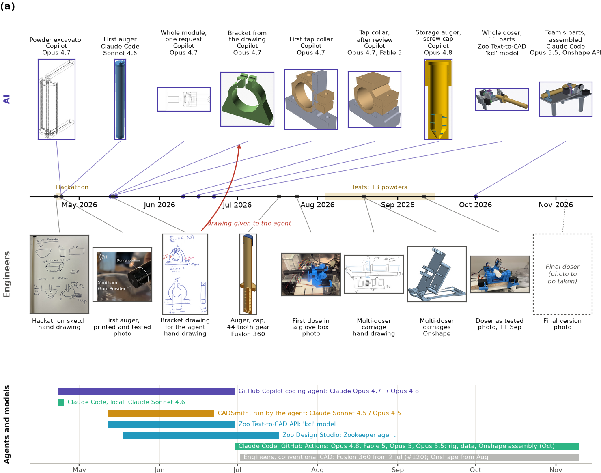
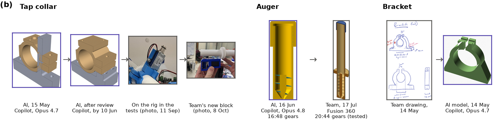
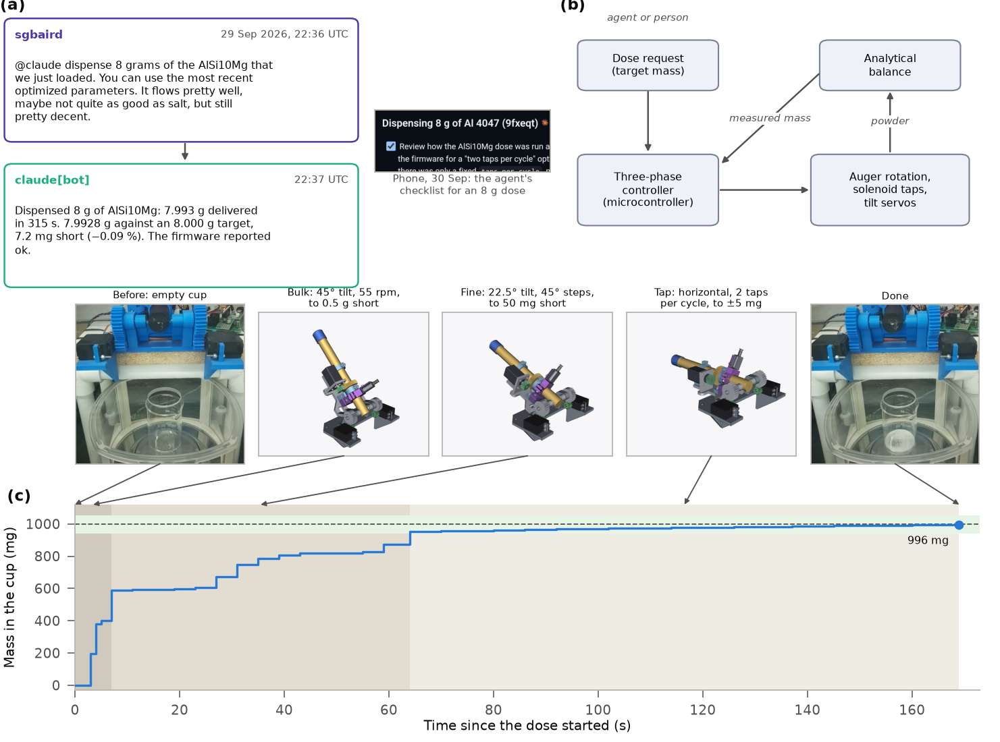
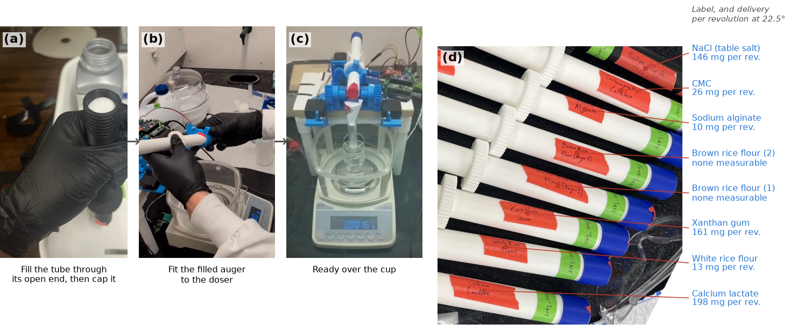
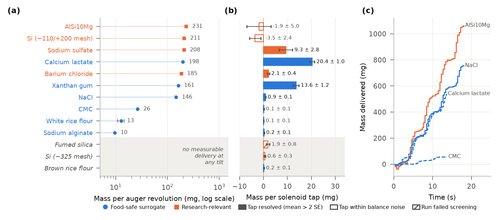
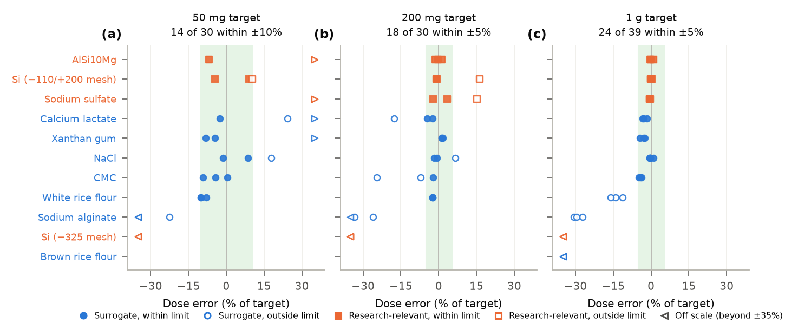
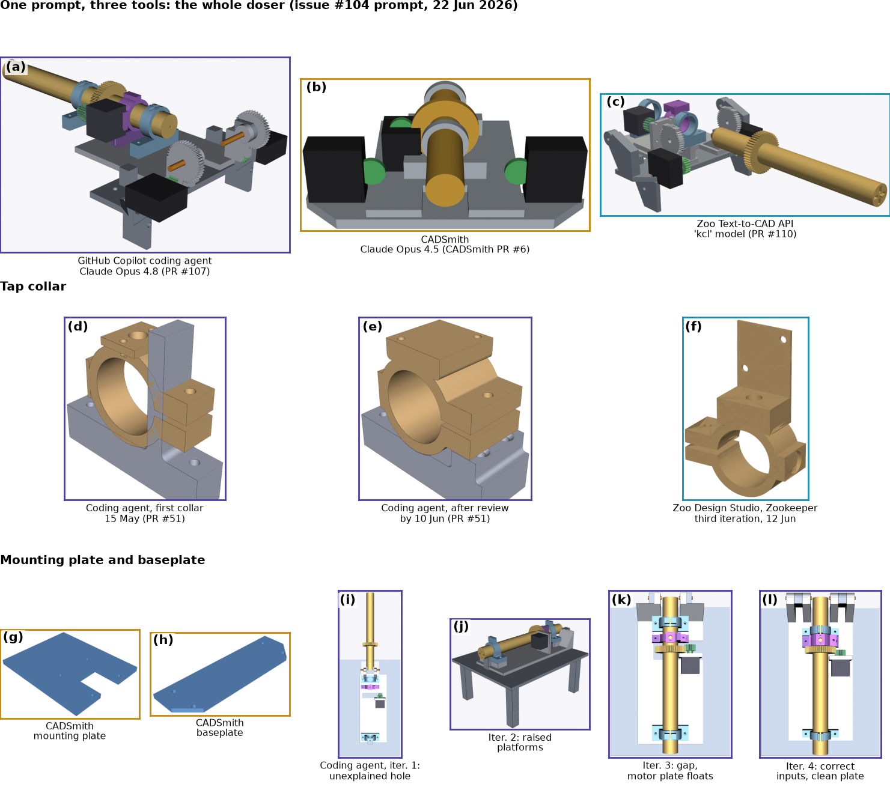
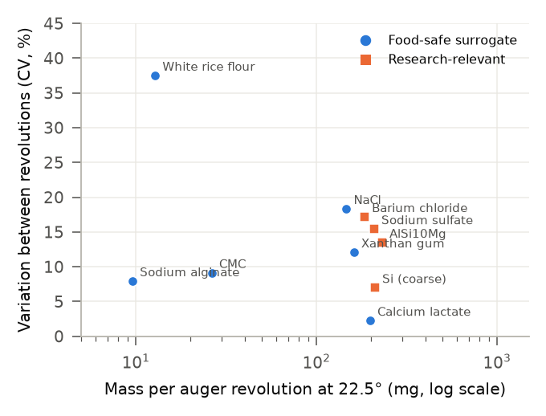
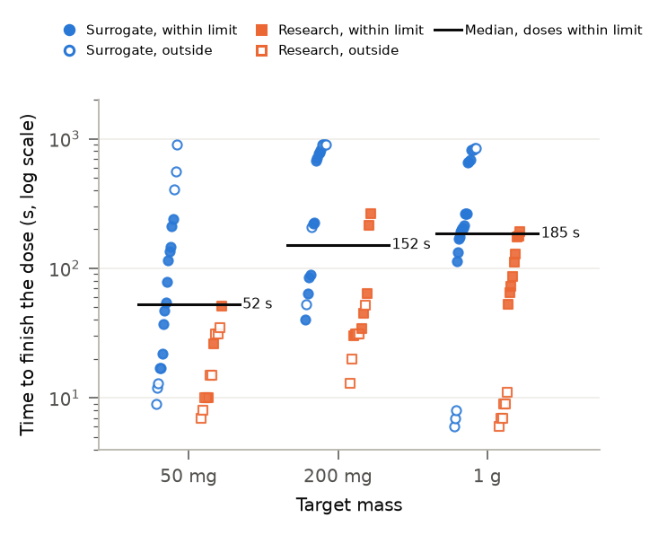

# Figures and tables for review (v2)

Title and abstract: [`TITLE-ABSTRACT.md`](TITLE-ABSTRACT.md). How each item maps to the
whiteboard and the 27 Oct meeting: [`README.md`](README.md). Captions are drafts.

## Main text

### Fig. 1 The doser

**Fig. 1** The single-channel powder doser. (a) The doser as tested in the second round
(photographed 11 Sep 2026), over the collection beaker on the analytical balance, with its
parts labelled. The dashed box marks the auger tube shown in (c). (b) Exploded view of the
current design, assembled in CAD from the team's parts (PR #170); the numbers refer to the
bill of materials in the SI. (c) Section through the tested auger and its screw-on cap, the
team's Fusion 360 part. (d) Calcium lactate in the beaker after a dose (10 Sep 2026).

### Fig. 2 AI agents and engineers, April to November 2026

**Fig. 2** How the design moved between AI agents and engineers. (a) Key designs on one time
axis. Above the axis are designs modelled by AI agents, with the tool and model under each.
Below it are the engineers' drawings, conventional-CAD parts and photographs. The red arrow
links a drawing the team gave the agent to the part the agent modelled from it. The bars along
the bottom show when each agent and model was in use. The hackathon (22–24 Apr) and the test
campaign (4 Aug–15 Sep) are shaded on the axis. (b) Original AI parts beside what replaced
them. Tap collar: the first AI collar, the AI collar after review, the collar on the rig during
the tests, and the team's new block. Auger: the AI storage auger (16:48 gears) and the team's
Fusion 360 recreation (20:44 gears), which turned in every test. Bracket: the team's drawing
and the AI's model of it.

### Fig. 3 How a dose runs

**Fig. 3** How a dose runs. (a) A person asks the AI agent for a dose in a GitHub comment, and
the agent replies with the result (8 g of AlSi10Mg for an atomizer charge, 29 Sep 2026).
Right: the agent's checklist on a phone during a later 8 g dose (30 Sep). (b) The feedback
loop. (c) One 1 g NaCl dose from the test campaign (12 Aug 2026), with its three phases shaded:
bulk, fine and tap. Above the trace are the tube positions in each phase (CAD renders of the
current design at 45°, 22.5° and 0°) and livestream stills before and after a 0.5 g salt dose
(15 Sep 2026). The green band is the ±5% acceptance limit.

### Fig. 4 Using the doser

**Fig. 4** Using the doser. (a) Filling an auger with salt through its open end (29 Jul 2026).
(b) Fitting a filled auger to the doser, and (c) the doser ready over the cup (frames from the
30 Sep 2026 dose video). (d) Eight of the labelled augers: each powder had its own auger, filled
once and stored loaded. Callouts give each label and the mass one revolution delivered at 22.5°
(Fig. 5a).

### Fig. 5 Open-loop delivery

**Fig. 5** How much powder the auger delivers, for 13 powders under one fixed set of settings.
(a) Mass per auger revolution at 22.5° (protocol C, mean ± standard error of six revolutions).
The three powders at the bottom delivered nothing measurable at any tilt. (b) Mass released by
one solenoid tap at 22.5° (protocol E, mean ± standard error of eight taps), for every powder.
Filled bars cleared twice their standard error; hollow bars lie within the balance noise of
their run (every research-relevant powder was tested in the noisier period); the hatched bar is
fumed silica, whose only run failed screening. (c) Mass against time while the auger turned
continuously at 15 rpm (protocol D).

### Fig. 6 Closed-loop doses

**Fig. 6** Error of every valid closed-loop dose at 50 mg, 200 mg and 1 g, from both test
rounds. Filled markers finished within the acceptance limit (green band: ±10% below 100 mg,
±5% at and above). Times per dose are in Table 3 and SI Fig. S3.

### Table 1 The 13 powders

| Powder | Group | mg per rev. (22.5°) | 50 mg | 200 mg | 1 g | Observed behaviour |
|---|---|---:|:---:|:---:|:---:|---|
| AlSi10Mg (gas-atomized) | Research | 231 | 1/3 | 3/3 | 3/3 | Fastest powder; fluid-like; overshoots small targets |
| Silicon, −110/+200 mesh | Research | 211 | 2/3 | 2/3 | 3/3 | Free-flowing |
| Sodium sulfate | Research | 208 | 0/3 | 2/3 | 3/3 | Free-flowing; overshoots small targets |
| Calcium lactate | Surrogate | 198 | 1/3 | 2/3 | 3/3 | Free-flowing; largest tap increment |
| Barium chloride | Research | 185 | -- | -- | -- | Absorbed moisture and caked in the tube in round 2 |
| Xanthan gum | Surrogate | 161 | 2/3 | 3/3 | 3/3 | Flows under rotation; can clog after bursts |
| Sodium chloride (NaCl) | Surrogate | 146 | 2/3 | 2/3 | 6/6 | Free-flowing baseline (control) |
| Carboxymethyl cellulose (CMC) | Surrogate | 26 | 3/3 | 1/3 | 3/3 | Slow; charges electrostatically |
| White rice flour | Surrogate | 13 | 3/3 | 3/3 | 0/3 | Slow and pulsing; most variable between revolutions |
| Sodium alginate | Surrogate | 10 | 0/3 | 0/3 | 0/3 | Slowest powder that moved |
| Brown rice flour | Surrogate | none | -- | -- | 0/3 | No delivery at any tilt |
| Silicon, −325 mesh | Research | none | 0/3 | 0/3 | 0/6 | No delivery at 0 or 22.5°; one pulse at 45° |
| Fumed silica | Research | none | -- | -- | -- | No delivery; very light and fluffy |

### Table 2 Test protocols (carried from the draft)

| Protocol | Varied | Fixed settings | What it measures | Trials |
|---|---|---|---|---|
| A  Balance baseline | Nothing | Tilt 22.5°; eight readings, no actuation | Noise floor of the run, against which every other protocol is read | 8 |
| B  Static hold | Tilt (0, 22.5, 45°) | 15 s hold at each tilt, no actuation | Whether any powder flows on its own (clean shut-off) | 3 |
| C  Rotation | Tilt (0, 22.5, 45°) | Six single revolutions per tilt at 30 rpm, with a settled reading after each | Mass per revolution and its revolution-to-revolution variation | 18 |
| D  Speed sweep | Speed (15, 45, 90 rpm) | Tilt 22.5°; three revolutions commanded per speed; balance streamed every 0.25 s | Delivery rate against speed; mass-against-time traces | 3 |
| E  Tap | Tilt (0, 22.5°) | Eight trials of a one-revolution re-feed followed by one 60 ms solenoid tap | Mass released by a single tap, with the re-feed logged separately | 32 |
| F  Vibration | Tilt (0, 22.5°) | As E, with three vibration bursts in place of the tap | Mass released by vibration (no data: driver fault) | 0 |
| G  Closed-loop, 1 g | Nothing | Three doses of 1.000 g; three-phase controller | Dose error, time, and effort per phase | 3 doses |
| H  Closed-loop, small | Target (50, 200 mg) | Three doses at each target; same controller | Dose error and time at small targets | 6 doses |

### Table 3 Closed-loop doses by target

| Target | Limit | Valid doses | Within limit | Powders | Median time, doses within limit (s) | Overshoots among misses |
|---|---|---:|---:|---:|---:|---:|
| 50 mg | ±10% | 30 | 14 | 10 | 52 | 10 of 16 |
| 200 mg | ±5% | 30 | 18 | 10 | 152 | 3 of 12 |
| 1 g | ±5% | 39 | 24 | 11 | 185 | 0 of 15 |

### Table 4 AI tools, dates and models

| Tool | What it did here | When | Models |
|---|---|---|---|
| GitHub Copilot coding agent | Modelled the AI-made parts as CadQuery or OpenSCAD code, one pull request per part; rendered views and ran solid and interference checks | 23 Apr – 30 Jun 2026 (CAD) | Claude Opus 4.7, then Opus 4.8 |
| Claude Code, run locally | First Archimedes auger (OpenSCAD) at the hackathon | 23–24 Apr 2026 | Claude Sonnet 4.6 |
| CADSmith (multi-agent text-to-CadQuery), run by the coding agent | Mounting plate and baseplate; whole doser from the issue #104 prompt | May – Jun 2026 | Claude Sonnet 4.5; Opus 4.5 |
| Zoo Text-to-CAD API | KCL parts from text; whole doser (11 parts) from the issue #104 prompt | May – Jun 2026 | Zoo 'kcl' model |
| Zoo Design Studio, Zookeeper agent | Conversational modelling in a live CAD view: the tap collar (three iterations), a servo pinion, multi-doser parts | May – Jul 2026 | Zookeeper (model not recorded) |
| Claude Code, GitHub Actions | Ran the test campaign on the rig, firmware, data analysis, figures; assembled the team's parts through the Onshape API (Oct) | 30 Jun – Nov 2026 | Claude Opus 4.8, Fable 5, Opus 5, Opus 5.5 |
| Edison Scientific | Literature searches and analysis-mode reviews (including mock peer review) | Apr – Oct 2026 | job types only (PaperQA3) |
| Engineers, conventional CAD (not AI) | Recreated the parts that were tested (Fusion 360, #120); multi-doser (Onshape) | From 2 Jul 2026 | -- |

### Candidate table for the lessons-learned discussion (carried from the draft)

| Failure | Example | Caught or prevented by |
|---|---|---|
| Parts that do not fit together | Whole-module prompts; first tap collar; bracket with unconnected plates  | Asking for one part at a time, with interfaces listed |
| Unrequested changes | Fixing one defect altered an unrelated feature | Full re-inspection of rendered views at every iteration |
| Mislabelled variants | Two of four test nozzles swapped relative to their documentation | Human cross-check before printing |
| Sub-millimetre errors | Height mismatch of one print layer | Only the failed print |
| Designing around bad inputs | Out-of-date neighbouring parts led to a hole, platforms, then a gap  | Supplying the correct upstream files |
| No sense of "finished" | Late iterations disturbed features that were already right | The team freezing the geometry |
| Wrong orientation | Solenoid mis-oriented on the tap collar over several coding-agent iterations | Switching the part to Zoo Design Studio |

## Supporting information

### SI Fig. S1 Generative-CAD comparison

**SI Fig. S1** Images for the main-text tool comparison. (a–c) The same prompt (issue #104,
22 Jun 2026) given to the GitHub Copilot coding agent, CADSmith and the Zoo Text-to-CAD API,
each rendered from the same viewpoint. (d–f) The tap collar from the coding agent (first
version and after review) and from Zoo Design Studio (third Zookeeper iteration). (g, h)
CADSmith's mounting plate and baseplate. (i–l) The coding agent's four mounting-plate
iterations: out-of-date input files led to a hole, then platforms, then a gap, until the
correct files were supplied.

### SI Fig. S2 Variation between revolutions (old Fig. 3c)

**SI Fig. S2** Revolution-to-revolution coefficient of variation against mass per revolution
at 22.5°, without the slow/fast shading. The same numbers are in Table S1, so this figure can
also be dropped.

### SI Fig. S3 Time per dose (old Fig. 5d)

**SI Fig. S3** Time to finish each dose, by target mass. Lines: medians of the doses that
finished within the acceptance limit.

### SI Fig. S4 Assembly steps and adjusting the stand

Not remade. The exploded view and the 19 build steps from PR #170 already exist
(`paper/figures/figS_assembly_exploded.pdf`, `paper/figures/figS_assembly_steps.pdf`). Nothing
shows the new stand (fitted 2 Oct) being assembled or its height being adjusted: there are no
photos or videos of it, and its only design file is a lab Onshape document.

### Table S1 Open-loop delivery per powder (old Fig. 4a)

| Powder | Group | 0° | 22.5° | 45° | CV at 22.5° (%) | Per tap at 22.5° (mg) |
|---|---|---:|---:|---:|---:|---:|
| AlSi10Mg (gas-atomized) | Research | 49 ± 7 | 231 ± 13 | 339 ± 6 | 13 | *-1.9 ± 5.0* |
| Silicon, −110/+200 mesh | Research | 57 ± 7 | 211 ± 6 | 302 ± 5 | 7 | *-3.5 ± 2.4* |
| Sodium sulfate | Research | 51 ± 8 | 208 ± 13 | 244 ± 12 | 15 | 9.3 ± 2.8 |
| Calcium lactate | Surrogate | 47 ± 5 | 198 ± 2 | 232 ± 3 | 2 | 20.4 ± 1.0 |
| Barium chloride | Research | 23 ± 4 | 185 ± 13 | 200 ± 31 | 17 | 2.1 ± 0.4 |
| Xanthan gum | Surrogate | 24 ± 2 | 161 ± 8 | 187 ± 3 | 12 | 13.6 ± 1.2 |
| Sodium chloride (NaCl) | Surrogate | 38 ± 4 | 146 ± 11 | 265 ± 13 | 18 | 0.9 ± 0.1 |
| Carboxymethyl cellulose (CMC) | Surrogate | 2.6 ± 0.5 | 26 ± 1 | n.r. | 9 | *0.1 ± 0.1* |
| White rice flour | Surrogate | 3.8 ± 0.3 | 13 ± 2 | 37 ± 7 | 37 | *0.1 ± 0.1* |
| Sodium alginate | Surrogate | 0.8 ± 0.2 | 9.6 ± 0.3 | 11 ± 1 | 8 | 0.2 ± 0.1 |
| Brown rice flour | Surrogate | n.r. | n.r. | n.r. | -- | *0.2 ± 0.1* |
| Silicon, −325 mesh | Research | n.r. | n.r. | n.r. | -- | *0.6 ± 0.3* |
| Fumed silica | Research | n.r. | n.r. | n.r. | -- | *1.9 ± 0.8* † |

n.r.: not resolved (mean not more than twice its standard error). Italic: tap increment within the balance noise of its run. †: fumed silica's only run failed screening.
