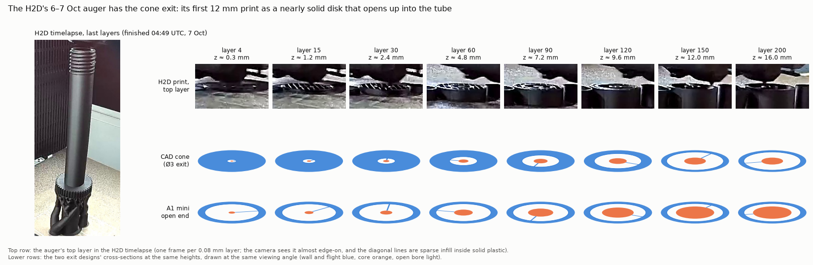

# What the H2D printed: its timelapses and camera clips

The H2D was read on 2026-10-11 with the updated `H2D_ACCESS_CODE`. Access was read-only
implicit FTPS through the doser Pi ([`../printer_ftps/`](../printer_ftps/)). Unlike the
A1 mini, the H2D keeps **no job files for its cloud prints**:

* There is no `/cache` folder.
* The SD card root holds only five LAN-sent jobs from 12–21 Aug: `H2Dtest1`, `photoa4stand_neg` and three
  `t3-prism-bo` truss plates ([`storage_listing.txt`](storage_listing.txt)).

So there is no G-code to rebuild its augers from. The printer's camera record does survive:

* 36 timelapses from 15 Jul to 9 Oct, one frame per layer, with a thumbnail of the finished plate
  ([`timelapse_thumbnails.jpg`](timelapse_thumbnails.jpg)).
* 500 camera clips of about 10 min each, recorded while printing, from 26 Sep to 9 Oct. Each has a thumbnail;
  every fifth one is in [`camera_clips_every5th.jpg`](camera_clips_every5th.jpg).

## One auger print: 6–7 Oct

Of the 36 timelapses and 500 clips, exactly one shows an auger ([`h2d_prints.json`](h2d_prints.json)).
It is a full-length black threaded auger, printed 17:11 UTC 6 Oct to 04:49 UTC 7 Oct alongside a short
cap-like cylinder. The other prints are truss/prism plates from another project, a fixture plate, a
perforated rack, and small parts from July.

That auger is the **cone-exit CAD design** (`threaded-auger-final`), not the open end:

| | H2D print, 6–7 Oct (from the timelapse) | CAD `threaded-auger-final` | A1 mini `auger_open_end` |
|---|---|---|---|
| length | about 253 mm (3164 layers at 0.08 mm) | 250 mm | 110 mm |
| gear | about 78–89 mm up (layers about 980–1110) | 78.6–88.6 mm | 79–88 mm |
| first 3 mm above the exit | nearly solid: sparse infill across the whole section | solid apart from a Ø3–6 mm hole | thin wall ring around an open bore |
| 5–10 mm | an opening that widens upward | the cone, bore Ø10–18 mm | open bore, growing core |
| from about 12 mm | the plain tube | the plain tube (Ø20.9 bore) | the plain tube |



The camera sees the top layer almost edge-on, so the Ø3 mm hole and the core tip in it are too
small to resolve. What the frames do settle is the cone: the exit end is solid for the first
millimetres and opens to the full bore over about 12 mm. [`oct7_first_260_layers.mp4`](oct7_first_260_layers.mp4)
is the first 21 mm of the print, cropped around the auger.

```bash
python h2d_exit_evidence.py /path/to/video_2026-10-07_01-11-34.mp4   # or no argument: uses frames/
```

The 58 MB timelapse is not committed. It is still on the printer at
`/timelapse/video_2026-10-07_01-11-34.mp4`.
